<div align="center">


<br />

**Ứng dụng web quản lý và thống kê huấn luyện cho một Lữ đoàn: nhân sự theo cây đơn vị, nội dung kiểm tra, chấm điểm một lần, xếp loại tự động, thống kê và in báo cáo.**

<br />


<br />

[📖 Giới thiệu](#-giới-thiệu) •
[✨ Chức năng](#-chức-năng) •
[🖼️ Giao diện](#giao-dien) •
[🧰 Công nghệ](#-công-nghệ) •
[🚀 Chạy dự án](#-cách-chạy-dự-án) •
[🧪 Kiểm thử](#-kiểm-thử) •
[📚 Tài liệu](#-tài-liệu) •
[🤝 Đóng góp](#-đóng-góp)

</div>

<br />

---

## 📖 Giới thiệu

**Training Statistics** số hóa việc quản lý huấn luyện của một Lữ đoàn: ai được kiểm tra nội dung gì, ai chấm, kết quả thế nào, đơn vị nào đạt tỷ lệ bao nhiêu.
Thay cho các bảng tính rời rạc, mọi dữ liệu nằm trong một hệ thống có **phân quyền chặt theo cây đơn vị**: mỗi Admin chỉ thấy và quản lý đúng nhánh của mình,
giám khảo chỉ chấm nội dung được giao, người học chỉ xem điểm của chính mình.

Hệ thống được thiết kế để **triển khai dễ trên một máy chủ Windows trong mạng LAN**: một bộ cài kèm sẵn Java, chạy như Windows Service, toàn bộ dữ liệu trong
**một file SQLite** và tự sao lưu hằng ngày. Điện thoại, máy tính bảng, laptop đều dùng được qua trình duyệt, không cần Internet.

> 💡 Hướng dẫn thao tác theo vai trò ở [docs/USER-GUIDE.md](docs/USER-GUIDE.md); cài đặt, build, sao lưu, lỗi thường gặp ở
> [docs/OPERATIONS-GUIDE.md](docs/OPERATIONS-GUIDE.md); thiết kế ở [docs/ARCHITECTURE.md](docs/ARCHITECTURE.md).

## ✨ Chức năng

|     | Chức năng                       | Mô tả                                                                                                                                                                                                                              |
| :-: | ------------------------------- | ---------------------------------------------------------------------------------------------------------------------------------------------------------------------------------------------------------------------------------- |
| 🌳  | **Cây đơn vị và phân quyền**    | Đơn vị hai cấp; Super Admin, Admin (theo nhánh), giám khảo (theo từng nội dung), người dùng. Phạm vi được kiểm tra ngay trong truy vấn SQL, ngoài phạm vi trả `404`. · [phân quyền](docs/ARCHITECTURE.md#5-ma-trận-phân-quyền)     |
| 👥  | **Quản lý nhân sự**             | Hồ sơ, cấp bậc, chức vụ, chuyên ngành, đối tượng (SQ, QNCN, HSQ-CS); tìm không dấu, lọc nhiều giá trị; chuyển đơn vị (tự hạ quyền khi ra ngoài nhánh), khóa, xóa mềm, cấp tài khoản. · [hướng dẫn](docs/USER-GUIDE.md#5-admin)     |
| 📅  | **Đợt và nội dung kiểm tra**    | Đợt gồm nhiều nội dung, mỗi nội dung có giám khảo, người học (cá nhân hoặc cả đơn vị), lý do vắng. Khóa đợt thì mọi nội dung của đợt đóng theo. · [hướng dẫn](docs/USER-GUIDE.md#6-super-admin)                                    |
| 🧮  | **Bảng phân công**              | Ma trận người × nội dung của một đợt, bấm ô để thêm hoặc gỡ; Admin gửi đề nghị, giám khảo duyệt hàng loạt. Có thể phân công bằng Excel. · [hướng dẫn](docs/USER-GUIDE.md#49-phân-công-thêm-nhiều-người-cùng-lúc)                   |
| 📨  | **Đề nghị và thông báo**        | Admin đề nghị thêm, gỡ người học; giám khảo hoặc Super Admin duyệt hoặc từ chối kèm lý do; chuông thông báo cập nhật tự động.                                                                                                      |
| ✍️  | **Chấm điểm**                   | Mỗi người **một điểm** (ràng buộc ở CSDL), xếp loại xem trước khi gõ, bước xác nhận trước khi lưu, tối ưu cho điện thoại. Chỉ Super Admin sửa điểm, bắt buộc có lý do, có lịch sử. · [hướng dẫn](docs/USER-GUIDE.md#46-chấm-điểm)  |
| 📊  | **Thống kê và dashboard**       | Xếp loại theo đơn vị (đơn vị tại thời điểm tham gia, không đổi khi người chuyển), điểm trung bình, danh sách chưa kiểm tra; điểm cá nhân và tập thể đơn vị tách riêng. Biểu đồ SVG tự vẽ.                                          |
| 📥  | **Nhập, xuất Excel**            | Nhập người dùng, nội dung, điểm, phân công; chấm **cả đợt** trong một file. Có bước kiểm tra, báo lỗi từng dòng, ghi tất cả hoặc không ghi gì. Xuất điểm một nội dung. · [hướng dẫn](docs/USER-GUIDE.md#7-nhập-dữ-liệu-bằng-excel) |
| 🖨️  | **In báo cáo**                  | Kết quả một nội dung và thông tin cá nhân, đúng bộ lọc đang chọn, khổ A4 đen trắng, cùng bố cục với file Excel; lưu PDF từ trình duyệt.                                                                                            |
| 🧾  | **Nhật ký thao tác**            | Mọi hành động quan trọng (đăng nhập, đổi quyền, chuyển đơn vị, nhập và sửa điểm...) ghi cùng giao dịch với thao tác; chỉ thêm, không sửa, không xóa.                                                                               |
| 💾  | **Sao lưu và nâng cấp an toàn** | Sao lưu tự động hằng ngày, tạo và tải thủ công, tự sao lưu trước mỗi lần nâng cấp dữ liệu. Trang Hệ thống cảnh báo khi quá hạn hoặc cùng ổ đĩa. · [sao lưu](docs/OPERATIONS-GUIDE.md#8-sao-lưu)                                    |
| 📱  | **Responsive**                  | Thanh bên trên máy tính, thanh tab dưới đáy trên điện thoại; vùng chạm tối thiểu 44 px, không cuộn ngang ở mọi độ rộng từ 360 px.                                                                                                  |

<a id="giao-dien"></a>

## 🖼️ Giao diện

> Ảnh dưới đây chụp từ bản chạy thật với **dữ liệu mẫu giả** (tên người hư cấu, tên đơn vị chung).

<div align="center">

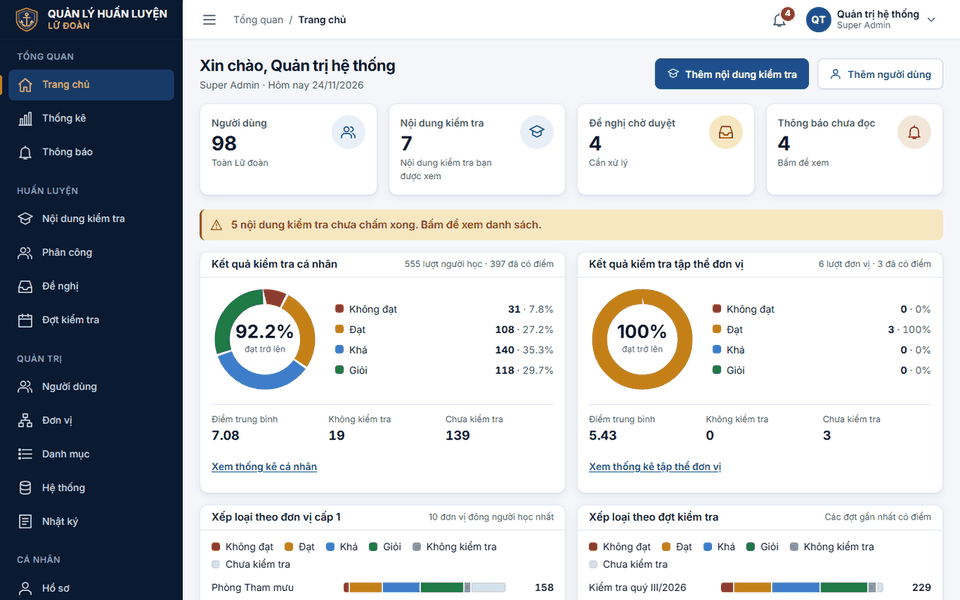

<sub>🎞️ <b>Một vòng qua các màn hình chính</b> — tổng quan, người dùng, nội dung kiểm tra, chấm điểm, phân công, thống kê</sub>

<br /><br />

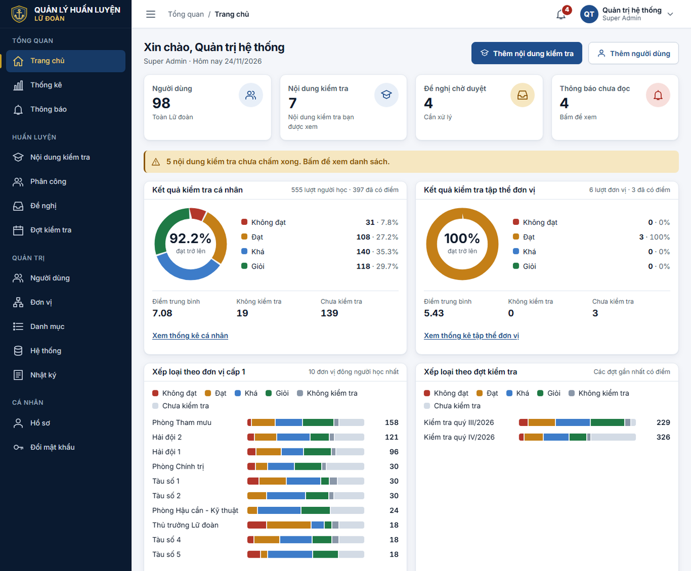

<sub>📊 <b>Tổng quan</b> — thẻ số liệu, hai vòng xếp loại riêng cho điểm cá nhân và tập thể đơn vị, xếp loại theo đơn vị và theo đợt</sub>

</div>

<br />

<table>
  <tr>
    <td width="50%" align="center">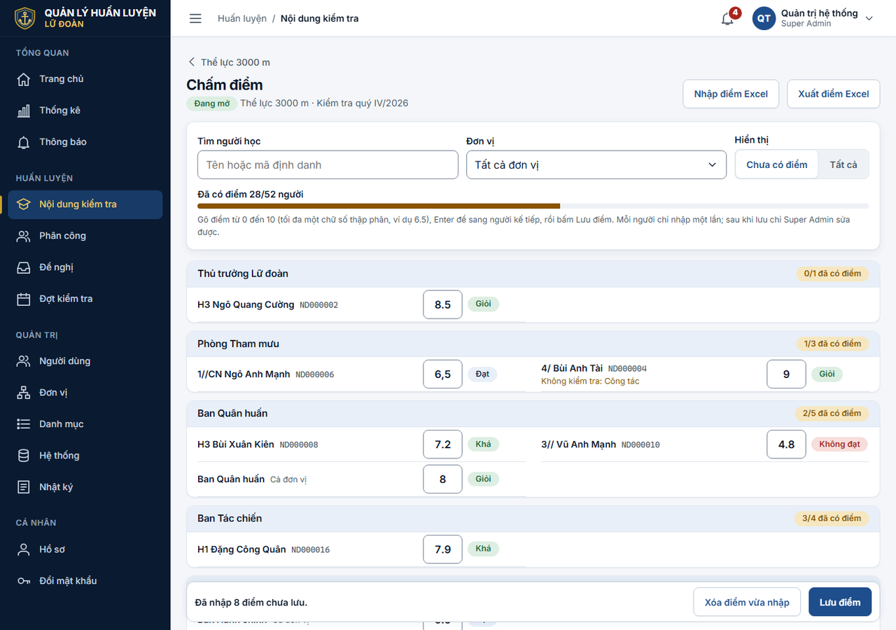<br /><sub>✍️ Chấm điểm: xếp loại hiện ngay, xác nhận trước khi lưu</sub></td>
    <td width="50%" align="center">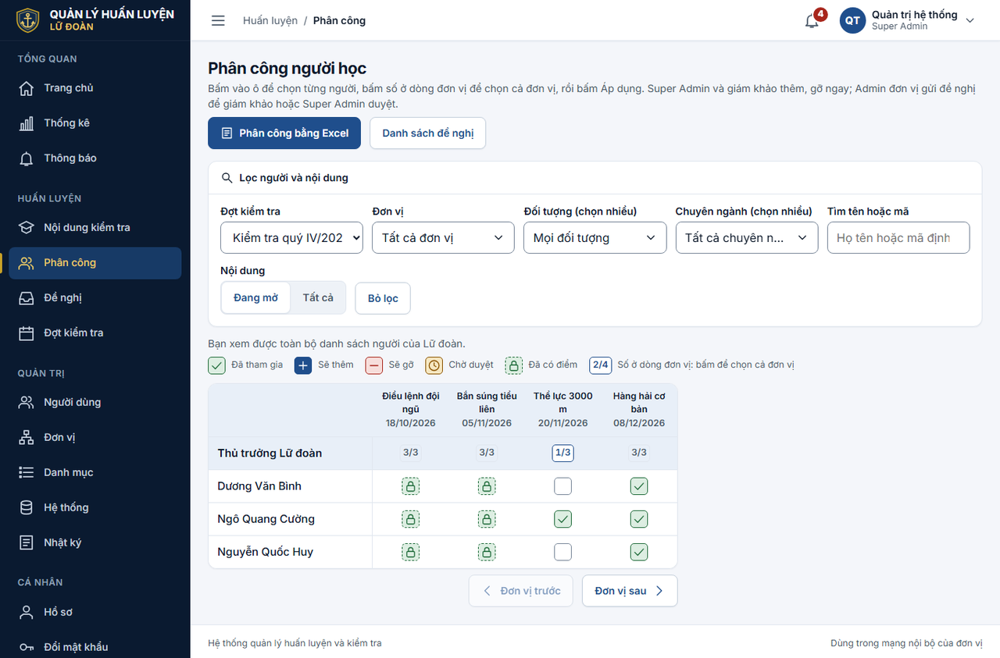<br /><sub>🧮 Bảng phân công người × nội dung</sub></td>
  </tr>
  <tr>
    <td width="50%" align="center">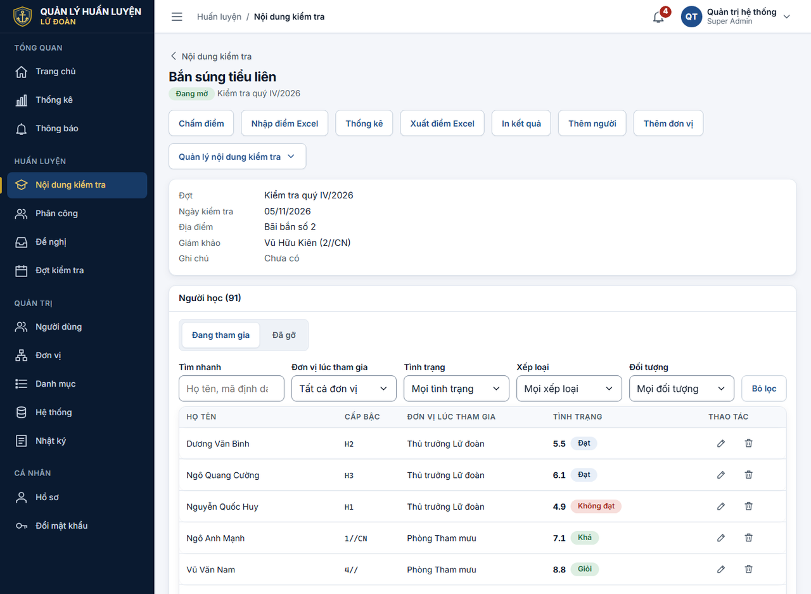<br /><sub>📅 Nội dung kiểm tra: người học, lọc, in, xuất Excel</sub></td>
    <td width="50%" align="center">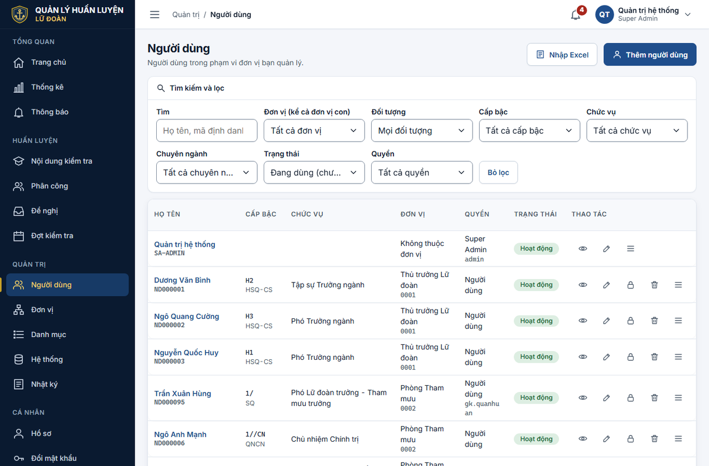<br /><sub>👥 Quản lý người dùng, lọc nhiều tiêu chí</sub></td>
  </tr>
  <tr>
    <td width="50%" align="center">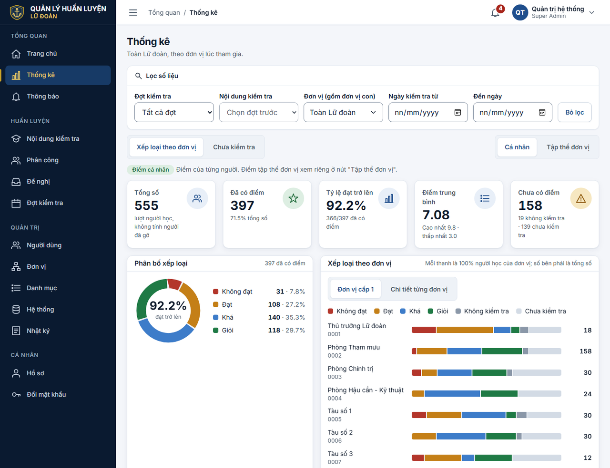<br /><sub>📈 Thống kê theo đơn vị, đợt, nội dung</sub></td>
    <td width="50%" align="center">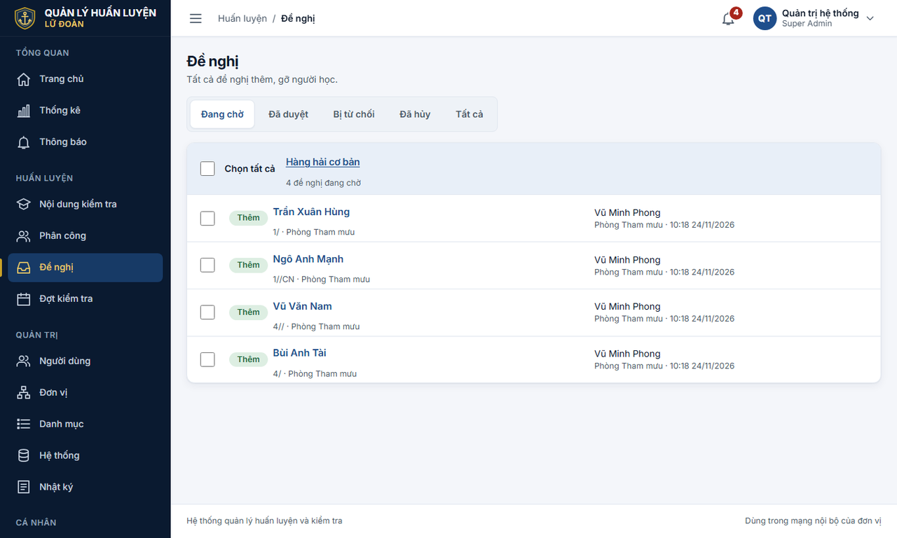<br /><sub>📨 Đề nghị chờ duyệt, gom theo nội dung</sub></td>
  </tr>
  <tr>
    <td width="50%" align="center">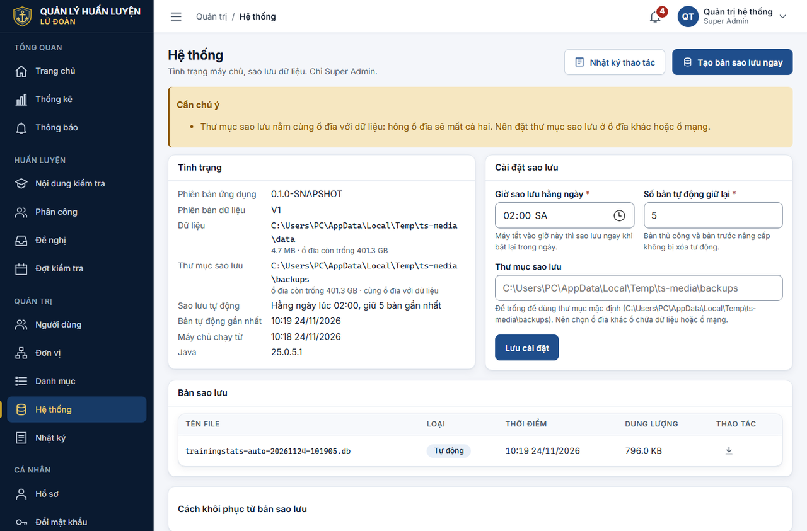<br /><sub>💾 Hệ thống: tình trạng, sao lưu, cảnh báo</sub></td>
    <td width="50%" align="center">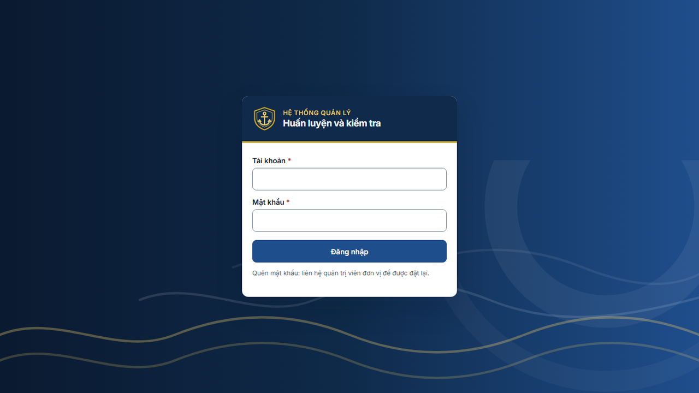<br /><sub>🔐 Đăng nhập</sub></td>
  </tr>
</table>

<div align="center">

<br />

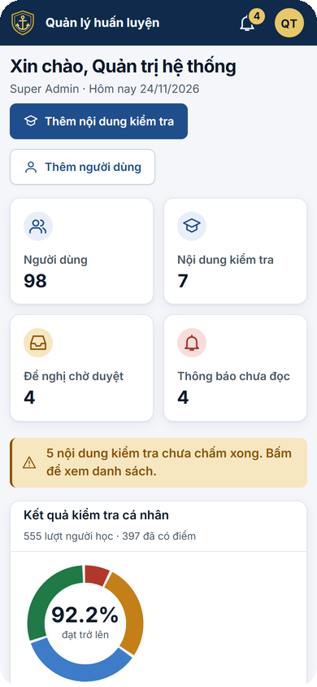
&nbsp;
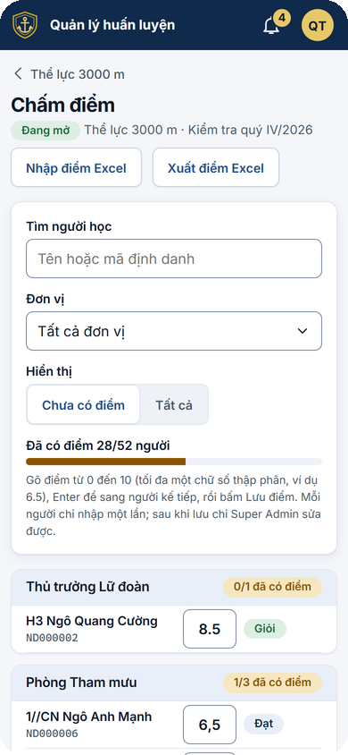
&nbsp;
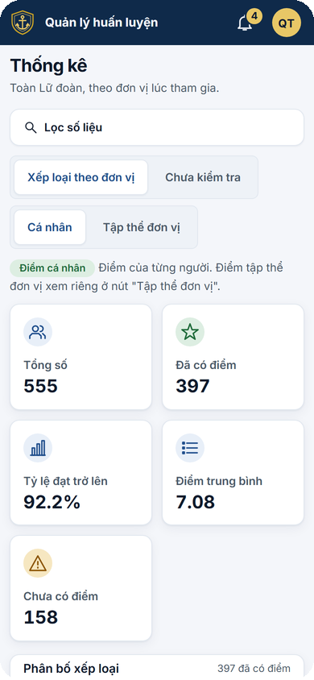
&nbsp;
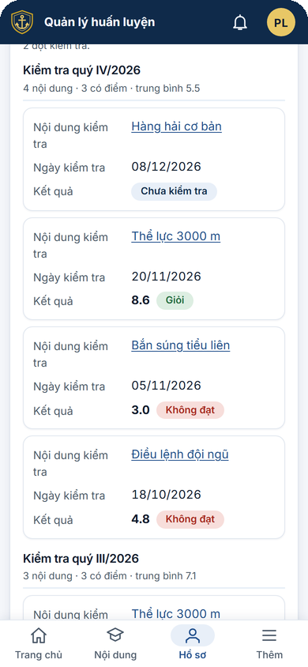

<sub>📱 <b>Trên điện thoại</b> — thanh tab đáy, bảng thành danh sách thẻ; chấm điểm, xem điểm, duyệt đề nghị đều làm được bằng cảm ứng</sub>

</div>

## 💻 Yêu cầu hệ thống

**Máy chủ chạy ứng dụng (bộ cài Windows):**

| Thành phần   | Yêu cầu                                                                  |
| ------------ | ------------------------------------------------------------------------ |
| Hệ điều hành | Windows 10, 11 hoặc Windows Server, quyền Administrator khi cài          |
| Java         | **Không cần cài**: bộ cài kèm JRE gọn                                    |
| Mạng         | LAN nội bộ; không cần Internet khi chạy                                  |
| Trình duyệt  | Edge, Chrome, Firefox bản gần đây; Chrome Android; Safari iOS 15 trở lên |

**Máy phát triển:**

| Thành phần     | Yêu cầu                                            |
| -------------- | -------------------------------------------------- |
| **JDK**        | **25** (Temurin hoặc tương đương), đặt `JAVA_HOME` |
| **Maven**      | Không cần cài, dùng `backend/mvnw`                 |
| **PowerShell** | 5.1 trở lên (build bộ cài, kiểm tra giao diện)     |
| **Internet**   | Lần build đầu để tải thư viện Maven và WinSW       |

## 🧰 Công nghệ

<table>
  <tr>
    <th align="left" width="130">Tầng</th>
    <th align="left">Công nghệ</th>
    <th align="left">Dùng để</th>
  </tr>
  <tr>
    <td><b>⚙️ Backend</b></td>
    <td>
      
      
      
      
    </td>
    <td>API REST dưới <code>/api/v1</code>; <code>JdbcTemplate</code> với SQL viết tay (không JPA); session phía server, BCrypt, CSRF; nhập, xuất <code>.xlsx</code> bằng POI.</td>
  </tr>
  <tr>
    <td><b>🗄️ Dữ liệu</b></td>
    <td>
      
      
    </td>
    <td>Một file DB, chế độ WAL, pool ghi 1 kết nối và pool đọc riêng; migration bằng Flyway; điểm lưu số nguyên, xếp loại là cột tính ở DB; trigger chặn xóa cứng.</td>
  </tr>
  <tr>
    <td><b>🎨 Frontend</b></td>
    <td>
      
      
      
      
    </td>
    <td>ES modules thuần, <b>không framework, không npm, không CDN</b>; router theo hash; biểu đồ SVG tự vẽ; font Inter lưu sẵn; design tokens trong một file CSS.</td>
  </tr>
  <tr>
    <td><b>📦 Triển khai</b></td>
    <td>
      
      
      
    </td>
    <td>Bộ cài đóng gói JAR + JRE; chạy như dịch vụ Windows bằng tài khoản ít quyền, tự khởi động lại khi sập; script cài, nâng cấp, gỡ, kiểm tra.</td>
  </tr>
  <tr>
    <td><b>🧪 Kiểm thử</b></td>
    <td>
      
      
    </td>
    <td>187 test backend (gồm kiểm tra tải 2.000 người, 50 truy cập đồng thời); kịch bản <code>ui-check</code> điều khiển trình duyệt thật ở 6 độ rộng.</td>
  </tr>
</table>

### 🏗️ Kiến trúc

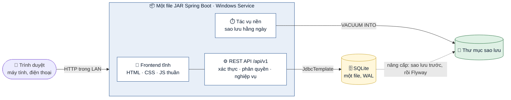

- **Phân quyền ở backend, trong truy vấn SQL** (`ScopeService`). Ẩn nút trên giao diện chỉ để thuận tiện, không phải bảo vệ.
- **Không bao giờ xóa cứng**: xóa mềm ở tầng mã, trigger chặn `DELETE` ở tầng DB; nhật ký chỉ thêm.
- **Một điểm duy nhất cho mỗi người học**: ràng buộc `UNIQUE`, hai giám khảo lưu cùng lúc thì chỉ một bên thành công.
- **Thống kê theo đơn vị lúc tham gia** (`unit_id_snapshot`): chuyển đơn vị không làm đổi số liệu cũ.

### 🗄️ Cơ sở dữ liệu

17 bảng SQLite. Sơ đồ rút gọn (đầy đủ cột, ràng buộc, chỉ mục, trigger: [docs/ERD.md](docs/ERD.md)):

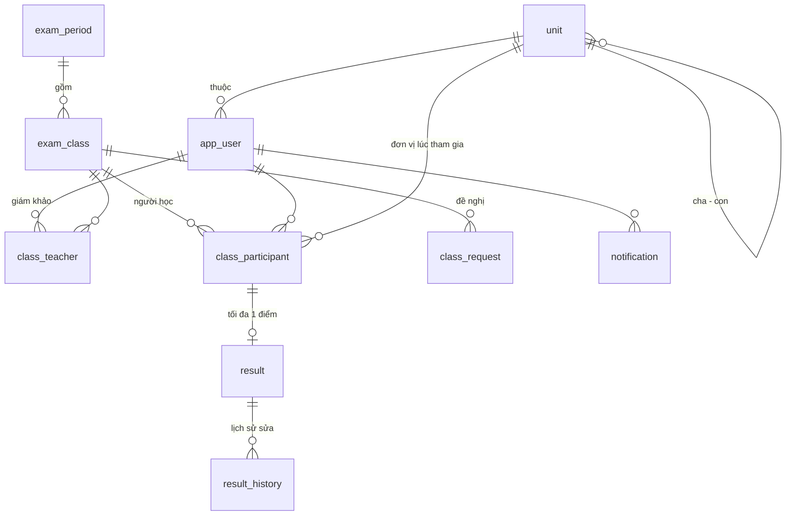

`audit_log` (nhật ký, chỉ thêm), `app_setting` (cấu hình) và các danh mục (`rank`, `position`, `specialty`, `absence_reason`) đứng riêng, không vẽ ở đây.

### 📁 Cấu trúc thư mục

```text
Training-Statistics/
├── ⚙️ backend/      Spring Boot: controller, service, repository theo từng tính năng; migration Flyway; test
├── 🎨 frontend/     HTML, CSS, JS thuần (Maven chép vào JAR khi build)
├── 📦 installer/    Bộ cài Windows: build.ps1, install, uninstall, check, reset Super Admin, cấu hình WinSW
├── 🛠️ tools/        ui-check.ps1: kiểm tra giao diện tự động bằng trình duyệt thật
├── 📚 docs/         PRD, kiến trúc, API, ERD, use case, kế hoạch, hướng dẫn; ảnh minh họa ở docs/images
└── 📄 CLAUDE.md     Quy tắc cho agent làm việc trong repo
```

## 🔌 API

REST dưới `/api/v1`, JSON, lỗi thống nhất `{code, message, fieldErrors[]}`, bản ghi ngoài phạm vi trả `404`. Đầy đủ route, tham số, mã lỗi: **[docs/API.md](docs/API.md)**.

| Nhóm                | Route chính                                                                       |
| ------------------- | --------------------------------------------------------------------------------- |
| 🔐 Phiên            | `/auth/csrf`, `/auth/login`, `/auth/logout`, `/me`, `/me/password`                |
| 🌳 Đơn vị, danh mục | `/units/tree`, `/units`, `/catalogs`                                              |
| 👥 Người dùng       | `/users`, `/users/{id}`, `account`, `role`, `move`, `reset-password`, `import`    |
| 📅 Đợt, nội dung    | `/periods`, `/classes`, `/classes/{id}/teachers`                                  |
| 🧑‍🎓 Người học        | `/classes/{id}/participants`, `candidates`, `/classes/{id}/requests`, `/requests` |
| ✍️ Điểm             | `.../participants/{pid}/result`, `/results/{id}`, `/me/classes`                   |
| 🧮 Phân công        | `/assignments/matrix`, `apply`, `template`, `import`                              |
| 📊 Thống kê         | `/stats/overview`, `grade-by-unit`, `not-tested`, `class/{id}`                    |
| 📥 Excel            | `*/import-template`, `*/import?dryRun=`, `/classes/{id}/results/export`           |
| 🛡️ Quản trị         | `/audit-logs`, `/admin/health`, `/admin/backups`, `/admin/backup-settings`        |

## 🚀 Cách chạy dự án

### 1️⃣ Chạy ở máy phát triển

```powershell
$env:JAVA_HOME = 'C:\Program Files\Eclipse Adoptium\jdk-25...'     # đổi theo máy
cd backend

# Tạo Super Admin "admin" (một lần, khi DB còn trống)
$env:TS_RESET_PASSWORD = 'MatKhau@123'
.\mvnw.cmd -q spring-boot:run "-Dspring-boot.run.arguments=--reset-superadmin"
Remove-Item Env:TS_RESET_PASSWORD

# Chạy máy chủ (cổng 8080, dữ liệu ở backend\data\)
.\mvnw.cmd spring-boot:run
```

Mở **http://localhost:8080/**, đăng nhập `admin`. Cách khác để tạo Super Admin, chạy cổng và thư mục dữ liệu riêng: [docs/OPERATIONS-GUIDE.md](docs/OPERATIONS-GUIDE.md#3-chạy-chương-trình-từ-mã-nguồn).

| Biến môi trường  | Mặc định           | Ý nghĩa                                   |
| ---------------- | ------------------ | ----------------------------------------- |
| `APP_PORT`       | `8080`             | Cổng lắng nghe                            |
| `APP_DATA_DIR`   | `./data`           | Thư mục chứa file SQLite                  |
| `APP_CONFIG_DIR` | `<data>/../config` | Thư mục cấu hình (`first-run.properties`) |

### 2️⃣ Đóng gói bộ cài Windows

```powershell
installer\windows\build.ps1               # build, chạy test, tạo JRE gọn, đóng gói
installer\windows\build.ps1 -SkipTests    # chỉ đóng gói
```

Kết quả: `dist\TrainingStats\` và `dist\TrainingStats-<phiên bản>.zip` (khoảng 105 MB, kèm JRE). Chỉ cần JAR: `cd backend; .\mvnw.cmd clean package -DskipTests` (luôn có `clean`).

### 3️⃣ Cài đặt trên máy chủ

Giải nén gói, mở PowerShell **bằng quyền Administrator**:

```powershell
.\install.ps1                                  # hỏi cổng và mật khẩu Super Admin; nâng cấp tại chỗ nếu đã cài
& 'C:\Program Files\TrainingStats\check.ps1'   # kiểm tra dịch vụ, cổng, tường lửa, truy cập LAN
```

Dữ liệu, cấu hình, log và sao lưu nằm ở `C:\ProgramData\TrainingStats\` và **không bị xóa** khi nâng cấp hay gỡ cài đặt. Quên mật khẩu Super Admin: `reset-superadmin.ps1`. Hướng dẫn đầy đủ (nâng cấp, sao lưu, khôi phục, lỗi thường gặp): [docs/OPERATIONS-GUIDE.md](docs/OPERATIONS-GUIDE.md).

### 🧭 Lệnh thường dùng

| Việc                     | Lệnh (trong `backend/`, PowerShell)                                                            |
| ------------------------ | ---------------------------------------------------------------------------------------------- |
| Chạy toàn bộ test        | `.\mvnw.cmd test`                                                                              |
| Chạy một lớp test        | `.\mvnw.cmd test -Dtest=SqliteSpikeTest`                                                       |
| Kiểm thử tải (tùy chọn)  | `.\mvnw.cmd test -Dtest=LoadTest -Dload=true`                                                  |
| Tạo file JAR             | `.\mvnw.cmd clean package -DskipTests`                                                         |
| Kiểm tra giao diện       | `tools\ui-check.ps1 -BaseUrl http://localhost:18095 -Password '...'` (chỉ vào máy chủ **thử**) |
| Kiểm tra nâng cấp bộ cài | `installer\windows\test-upgrade.ps1`                                                           |

## 🧪 Kiểm thử

| Bộ kiểm thử                   | Quy mô                                 | Kiểm                                                                                                                                                                              |
| ----------------------------- | -------------------------------------- | --------------------------------------------------------------------------------------------------------------------------------------------------------------------------------- |
| 🧱 **Backend (JUnit)**        | 187 test đạt                           | Schema và ràng buộc, phân quyền theo nhánh (kể cả quét mọi endpoint), xếp loại ở điểm biên (4.9, 5.0, 6.5, 6.6, 7.9, 8.0), điểm một lần, nhập Excel 1.000 dòng, sao lưu, nâng cấp |
| ⚡ **Tải**                    | 2.000 người, 50 truy cập đồng thời     | Trang chủ dưới 2 giây (p95 khoảng 0,9 giây); 6 giám khảo chấm đồng thời, mỗi người đúng một điểm                                                                                  |
| 🖥️ **Giao diện (`ui-check`)** | 382 phép kiểm, 6 độ rộng 360 → 1920 px | Không cuộn ngang, vùng chạm 44 px, không lỗi JS hay CSP, không tài nguyên ngoài, số trên giao diện khớp API, bản in đen trắng                                                     |
| 📦 **Nâng cấp bộ cài**        | `test-upgrade.ps1`                     | Dữ liệu và cấu hình giữ nguyên từng byte khi cài bản mới                                                                                                                          |

Hướng dẫn chạy, đọc kết quả và các lỗi thường gặp: [docs/OPERATIONS-GUIDE.md](docs/OPERATIONS-GUIDE.md#11-kiểm-thử).

## 🔐 Bảo mật

- 🔑 Mật khẩu chỉ lưu **BCrypt**; session phía server, cookie `HttpOnly`, **CSRF** cho mọi request ghi; header bảo mật (CSP `default-src 'self'`).
- 🧱 **Phân quyền trong truy vấn SQL**; bản ghi ngoài phạm vi trả `404`; không tự khóa, xóa, hạ quyền chính mình; luôn còn ít nhất một Super Admin.
- 🧾 **Nhật ký chỉ thêm**: đăng nhập thành công và thất bại kèm IP, đổi quyền, sửa điểm; trigger chặn sửa, xóa.
- 🕵️ Giám khảo tìm ứng viên toàn Lữ đoàn chỉ nhận tên, cấp bậc, đơn vị, mã định danh; không lộ ngày sinh, điện thoại, tài khoản.
- 🧼 Frontend **không dùng `innerHTML`** với dữ liệu người dùng; dữ liệu đưa vào DOM qua `textContent`.
- ⚠️ Hệ thống chạy **HTTP** trong LAN, không khóa tài khoản khi nhập sai (quyết định của chủ dự án): nên đặt ở mạng nội bộ riêng và chọn mật khẩu Super Admin mạnh. Rủi ro và biện pháp: [ARCHITECTURE.md R4](docs/ARCHITECTURE.md#7-rủi-ro-và-cách-giảm-thiểu).

## 📚 Tài liệu

Toàn bộ nằm trong thư mục [docs/](docs/).

| Bạn cần                                  | Đọc                                                                                                                                             |
| ---------------------------------------- | ----------------------------------------------------------------------------------------------------------------------------------------------- |
| **Dùng hệ thống**                        | [Hướng dẫn sử dụng](docs/USER-GUIDE.md): Người dùng, Giám khảo, Admin, Super Admin, nhập Excel, in báo cáo, quy trình mẫu                       |
| **Cài đặt, vận hành**                    | [Hướng dẫn cài đặt và vận hành](docs/OPERATIONS-GUIDE.md): cài đặt, nâng cấp, sao lưu, khôi phục, đặt lại mật khẩu, build, test, lỗi thường gặp |
| **Hiểu yêu cầu và thiết kế**             | [PRD](docs/PRD.md) (yêu cầu, 42 quyết định đã chốt) · [ARCHITECTURE](docs/ARCHITECTURE.md) (kiến trúc, schema, phân quyền, giao diện, rủi ro)   |
| **Tra cứu kỹ thuật**                     | [API](docs/API.md) · [ERD và từ điển dữ liệu](docs/ERD.md) · [Use case](docs/USE-CASE.md)                                                       |
| **Kế hoạch và tình trạng**               | [PLAN](docs/PLAN.md): các mốc M0 đến M7 và nghiệm thu theo PRD                                                                                  |
| **Làm việc trong repo (người và agent)** | [CLAUDE.md](CLAUDE.md): quy tắc bất biến, lệnh build và test, quy ước mã                                                                        |

## 🗺️ Tình trạng và hướng phát triển

Đã hoàn thành các mốc M0 đến M7 (xem [PLAN](docs/PLAN.md)):

- [x] Nền tảng: schema, đăng nhập, phân quyền theo nhánh, nhật ký, giao diện Hải quân responsive
- [x] Nhân sự, đơn vị, danh mục; đợt và nội dung kiểm tra; đề nghị, thông báo, bảng phân công
- [x] Chấm điểm, sửa điểm kèm lịch sử, hồ sơ cá nhân
- [x] Nhập, xuất Excel; chấm cả đợt bằng một file
- [x] Thống kê, dashboard, in báo cáo theo bộ lọc
- [x] Sao lưu tự động, nâng cấp an toàn, quản trị hệ thống, bộ cài Windows
- [x] Tài liệu: hướng dẫn sử dụng, vận hành, API, ERD, use case

Ngoài phạm vi hiện tại (có thể làm sau):

- [ ] Xuất Excel và PDF báo cáo thống kê từ máy chủ
- [ ] Nhiều giám khảo chấm riêng rồi tính trung bình
- [ ] Thống kê theo cấp bậc, chức vụ, chuyên ngành và so sánh giữa các kỳ
- [ ] Khôi phục bản sao lưu bằng giao diện (hiện khôi phục thủ công, xem hướng dẫn)
- [ ] Bộ cài Linux hoặc Docker

## 🤝 Đóng góp

1. Đọc [CLAUDE.md](CLAUDE.md) (quy tắc bất biến) và mở `docs/PLAN.md` để biết việc thuộc mốc nào.
2. Viết mã, **viết test cùng lúc** (đặc biệt phân quyền, xếp loại, điểm một lần, nhập Excel), chạy `.\mvnw.cmd test` trong `backend/`.
3. Trang mới phải qua `tools/ui-check.ps1` (chạy vào **máy chủ thử**, không vào dịch vụ đang dùng) và được xem ảnh ở 360 px và 1366 px.
4. Thay đổi yêu cầu, thiết kế, API, giao diện thì **cập nhật tài liệu cùng lúc**: PRD, ARCHITECTURE, API, ERD, hướng dẫn.
5. Commit message tiếng Việt, ngắn, mỗi commit một việc.

Quy ước chính: phân quyền trong truy vấn SQL, không xóa cứng, không `innerHTML`, màu và cỡ chữ chỉ ở `css/tokens.css`, vùng chạm tối thiểu 44 px.

## 👤 Tác giả

<div align="center">

<table>
  <tr>
    <td align="center" width="220">
      <a href="https://github.com/copirlo20">
        
      </a>
      <br />
      <sub>Backend Developer</sub>
      <br />
      <b>Nguyễn Trọng Đạt</b>
    </td>
    <td align="left">
      <p>👋 Xin chào! Mình là người xây dựng <b>Training Statistics</b>. Nếu thấy hay, hãy tặng dự án ⭐</p>
      <p>
        🐙 GitHub: <a href="https://github.com/copirlo20">Nguyễn Trọng Đạt</a><br />
        📧 Email: <a href="mailto:copirlo20@gmail.com">copirlo20@gmail.com</a><br />
        💜 Donate (TPBank): <code>050296 99999</code> · NGUYEN TRONG DAT<br />
      </p>
    </td>
  </tr>
</table>
</div>
