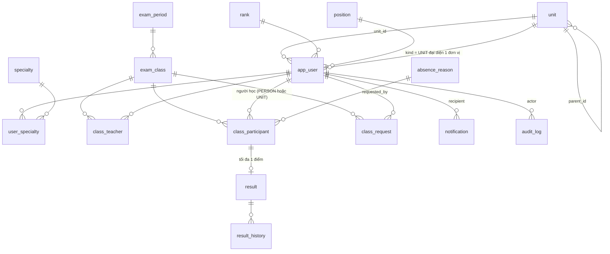

# Kiến trúc: Ứng dụng quản lý và thống kê huấn luyện

Tài liệu thiết kế kỹ thuật, dựa trên [PRD.md](PRD.md). Mô tả hệ thống đúng như đã xây dựng: schema, API, cấu trúc mã, phân quyền, giao diện, đóng gói, rủi ro. Kế hoạch và tình trạng thực hiện ở [PLAN.md](PLAN.md).

> **Thuật ngữ.** Trên giao diện và trong thông báo, "lớp" gọi là **nội dung kiểm tra** và "giáo viên" gọi là **giám khảo**. Trong mã, API, bảng và các mục kỹ thuật dưới đây vẫn dùng `class`/`exam_class`/`classes` và `teacher`/`class_teacher`, nên "lớp" và "giáo viên" ở đây chính là hai khái niệm này. Hệ thống không có trường "Môn kiểm tra".

## Mục lục

1. [Tóm tắt các quyết định kiến trúc](#1-tóm-tắt-các-quyết-định-kiến-trúc)
2. [Schema database](#2-schema-database)
3. [Danh sách API](#3-danh-sách-api)
4. [Cấu trúc thư mục, giao diện và quy ước mã](#4-cấu-trúc-thư-mục)
5. [Ma trận phân quyền](#5-ma-trận-phân-quyền)
6. [Đóng gói và triển khai](#6-đóng-gói-và-triển-khai)
7. [Rủi ro và cách giảm thiểu](#7-rủi-ro-và-cách-giảm-thiểu)
8. [Quyết định đã chốt khi làm rõ yêu cầu](#8-quyết-định-đã-chốt-khi-làm-rõ-yêu-cầu)
9. [Thứ tự triển khai](#9-thứ-tự-triển-khai)

---

## 1. Tóm tắt các quyết định kiến trúc

| Chủ đề | Quyết định | Lý do |
|---|---|---|
| Kiểu ứng dụng | Một file JAR Spring Boot, vừa phục vụ API vừa phục vụ frontend tĩnh | Chỉ một tiến trình, một cổng, một bộ cài. Không cần web server riêng |
| Ngôn ngữ, runtime | Java 25 (LTS), Spring Boot 3.5, JRE đóng kèm bộ cài | Người cài không phải cài Java |
| Truy cập dữ liệu | `JdbcTemplate`/`NamedParameterJdbcTemplate`, SQL viết tay. Không dùng JPA/Hibernate | Dialect SQLite của Hibernate là bản cộng đồng, hay lỗi. Phân quyền theo nhánh cần chèn điều kiện SQL ở mọi truy vấn, viết tay rõ ràng hơn |
| Migration | Flyway. Một file nền `V1__init.sql` (schema và dữ liệu ban đầu); thay đổi schema về sau thêm `V2__*.sql`... (S13) | Nâng cấp bộ cài tự cập nhật schema. Đã kiểm chứng Flyway với SQLite (R17) |
| Xác thực | Session phía server (cookie HttpOnly), BCrypt, CSRF token | Đơn giản, thu hồi session dễ, phù hợp một máy chủ. JWT không đem lại lợi ích gì ở đây |
| Phiên đăng nhập | Mỗi request nạp lại người dùng từ DB | Khóa tài khoản, đổi quyền, chuyển đơn vị có hiệu lực ngay ở request kế tiếp, kể cả với phiên đang mở |
| Phân quyền | Một `ScopeService` trung tâm. Mọi truy vấn dữ liệu nhận tham số phạm vi (scope) | Tránh việc từng API tự kiểm tra rồi quên. Xem mục 5.1 |
| Cây đơn vị | Mã đơn vị chứa luôn đường dẫn (`0002.0001`). Kiểm tra "cùng nhánh" bằng tiền tố mã | Không cần truy vấn đệ quy. Cây chỉ có 2 cấp nên đơn giản |
| Điểm | Lưu dạng số nguyên "điểm × 10" (0–100) | Tránh sai số số thực, xếp loại biên chính xác (6.5 và 6.6, 7.9 và 8.0) |
| Xếp loại | Cột tính tự động (generated column) từ điểm | DB bảo đảm xếp loại không bao giờ lệch điểm |
| Điểm "một lần duy nhất" | Ràng buộc UNIQUE ở DB, không chỉ kiểm tra trong code | Hai giám khảo bấm lưu cùng lúc thì chỉ một bên thành công |
| Xóa mềm | Cột `status`/`deleted_at` cộng trigger chặn `DELETE` cứng trên bảng nghiệp vụ | Bảo vệ lớp thứ hai nếu lập trình viên lỡ viết `DELETE` |
| Pool kết nối | Hai pool: ghi 1 kết nối, đọc 4 kết nối chỉ đọc. Giao dịch ghi đi pool ghi, còn lại đi pool đọc | Ghi lỡ nằm ngoài giao dịch thì lỗi ngay thay vì lặng lẽ chạy. Người ghi xếp hàng trong pool thay vì tranh khóa SQLite. Xem 4.2 |
| Frontend | HTML/CSS/JS thuần, ES modules, router theo hash (`#/users`), không bước build | Đúng ràng buộc "không npm". Chạy được khi mất Internet |
| Biểu đồ | Tự vẽ bằng SVG | Không có thư viện biểu đồ |
| In ấn | CSS `@media print` trên các trang báo cáo | PRD mục 12 |
| Thông báo | Frontend gọi `unread-count` định kỳ (khoảng 30 giây) | Dưới 50 người dùng cùng lúc nên polling đủ rẻ. SSE/WebSocket để sau |
| Thời gian | Lưu `TEXT` ISO-8601 theo UTC, ngày kiểm tra lưu `YYYY-MM-DD`. Hiển thị theo múi giờ `Asia/Ho_Chi_Minh` | Tránh lệch ngày khi máy chủ đổi múi giờ |
| Đối tượng kiểm tra | Đơn vị cũng là một dòng trong `app_user` với `kind = UNIT`, liên kết tới đơn vị có sẵn và do hệ thống tự tạo | Giữ trường "Loại" ở bảng user như PRD. Bảng người học trong lớp chỉ cần một khóa `user_id` cho cả hai loại |
| Sao lưu | Tự động hằng ngày, giữ 5 bản gần nhất (đổi được), thêm sao lưu trước mỗi lần nâng cấp và nút tải thủ công | Toàn bộ dữ liệu nằm trong một file, mất file là mất hết |
| Bảo mật mạng | HTTP, không HTTPS, không trì hoãn khi nhập sai mật khẩu (đã chấp nhận rủi ro) | Quyết định của chủ dự án, xem R4 |
| Responsive | CSS thuần, thiết kế ưu tiên điện thoại (mobile-first), ba điểm ngắt, bảng tự chuyển thành thẻ trên màn hình nhỏ | Giáo viên có thể chấm điểm ngay tại bãi kiểm tra bằng điện thoại. Không cần framework. Xem mục 4.1 |
| Phong cách giao diện | Bộ biến CSS (design tokens) phong cách Hải quân, font Inter lưu sẵn trong dự án, biểu tượng SVG tự vẽ, không ảnh hay font từ bên ngoài | Đổi giao diện chỉ cần sửa một file (`tokens.css`). Chạy được khi không có Internet. Xem mục 4.1 |

---

## 2. Schema database

### 2.1 Sơ đồ quan hệ



### 2.2 Quy ước chung

- Khóa chính `id INTEGER PRIMARY KEY` (tự tăng).
- Mọi bảng nghiệp vụ có `created_at`, `created_by`, `updated_at`, `updated_by`. Bảng có xóa mềm có thêm `deleted_at`, `deleted_by`.
- Khóa ngoại luôn `ON DELETE RESTRICT`. Bật `PRAGMA foreign_keys=ON` cho **mọi kết nối** (SQLite mặc định tắt).
- Cột `version INTEGER` ở `app_user`, `exam_period`, `exam_class`, `result` để khóa lạc quan. Hai người sửa cùng bản ghi thì người lưu sau nhận lỗi 409.
- Danh mục (cấp bậc, chức vụ, chuyên ngành, lý do vắng) có `active` thay vì xóa, để dữ liệu cũ vẫn hiển thị đúng.

### 2.3 Nhóm đơn vị và người dùng

**`unit`** (đơn vị)

| Cột | Kiểu | Ghi chú |
|---|---|---|
| `code` | TEXT, UNIQUE, NOT NULL | Cấp 1: `0002`. Cấp 2: `0002.0001`. **Không đổi sau khi tạo** |
| `name` | TEXT, NOT NULL | Tên có thể trùng (ví dụ "Hải đội bộ" nằm dưới Hải đội 412 và Hải đội 414), chỉ `code` là duy nhất. Hai đơn vị Cấp 1 tên "Tàu 412", "Tàu 414" trong danh sách đơn vị ban đầu được seed với tên "Hải đội 412", "Hải đội 414" theo yêu cầu của chủ dự án |
| `parent_id` | INTEGER, NULL | NULL với Cấp 1. Cấp 0 không có bản ghi `unit` |
| `level` | INTEGER, CHECK IN (1,2) | Cấp admin được suy ra từ đây |
| `sort_order`, `active` | | |

Ràng buộc: `code` Cấp 2 phải bắt đầu bằng `code` của cha cộng dấu chấm (kiểm tra ở service, bằng trigger và bằng test).

**`app_user`** (người dùng. Dùng tên này vì `user` là từ khóa SQL)

| Cột | Kiểu | Ghi chú |
|---|---|---|
| `kind` | TEXT, NOT NULL, CHECK IN (`PERSON`,`UNIT`), mặc định `PERSON` | Trường "Loại" của PRD. `UNIT` là bản ghi đại diện cho **một đơn vị** để đưa vào lớp, xem 2.7 |
| `last_name` | TEXT, NULL | Họ đệm. Bắt buộc khi `PERSON`, NULL khi `UNIT` |
| `first_name` | TEXT, NULL | Tên. Bắt buộc khi `PERSON`, NULL khi `UNIT` |
| `search_text` | TEXT, NOT NULL | Họ tên (hoặc tên đơn vị với `UNIT`) đã bỏ dấu, chữ thường, để tìm kiếm (xem R6) |
| `rank_id`, `position_id` | FK, NULL | Không bắt buộc. Luôn NULL khi `UNIT` |
| `unit_id` | FK, NULL | `PERSON`: đơn vị người đó thuộc, NULL **chỉ** khi `role = SUPER_ADMIN`. `UNIT`: chính đơn vị được đại diện |
| `username` | TEXT, UNIQUE, NULL | Nhiều dòng NULL vẫn hợp lệ (người không có tài khoản). Không phân biệt hoa thường (S6) |
| `password_hash` | TEXT, NULL | BCrypt |
| `role` | TEXT, CHECK IN (`USER`,`ADMIN`,`SUPER_ADMIN`) | |
| `status` | TEXT, CHECK IN (`ACTIVE`,`INACTIVE`,`DELETED`) | `DELETED` là xóa mềm |
| `personal_code` | TEXT, UNIQUE | **Bắt buộc với `PERSON`**: số hiệu/mã định danh duy nhất, là khóa khớp khi nhập Excel. Để trống khi tạo thì hệ thống tự cấp `ND` + số thứ tự (A12). NULL với `UNIT` |
| `category` | TEXT | **Đối tượng**: `SQ` sĩ quan, `QNCN` quân nhân chuyên nghiệp, `HSQ-CS` hạ sĩ quan - chiến sĩ. DB cho NULL (tài khoản Super Admin tạo lúc cài không thuộc đơn vị); máy chủ bắt buộc với mọi người có đơn vị khi tạo, sửa, nhập Excel (người đã có đối tượng mà ô Excel trống thì giữ nguyên). `UNIT` luôn NULL |
| `birth_date`, `phone`, `note` | | Thông tin hồ sơ cá nhân. Không dùng để khớp khi nhập Excel vì đã có `personal_code` |
| `last_login_at`, `version` | | |

Ràng buộc CHECK ở DB:
- `kind = 'PERSON'` ⇒ `last_name`, `first_name`, `personal_code` NOT NULL.
- `kind = 'UNIT'` ⇒ `unit_id` NOT NULL, `role = 'USER'`, và `last_name`, `first_name`, `personal_code`, `rank_id`, `position_id`, `category`, `username`, `password_hash` đều NULL. Chỉ mục duy nhất trên `unit_id` khi `kind = 'UNIT'` (mỗi đơn vị đúng một bản ghi đại diện).
- `kind = 'PERSON'` và `role = 'SUPER_ADMIN'` ⇔ `unit_id IS NULL`.
- `role IN ('ADMIN','SUPER_ADMIN')` ⇒ `username` và `password_hash` NOT NULL.
- `password_hash` NOT NULL ⇒ `username` NOT NULL.

**`user_specialty`** (nhiều-nhiều): `user_id`, `specialty_id`, khóa chính ghép.

**Danh mục** (đều có `id`, `name`, `sort_order`, `active`):

| Bảng | Cột riêng | Dữ liệu seed |
|---|---|---|
| `rank` | `symbol` (UNIQUE), `name` | 20 cấp bậc theo yêu cầu ban đầu |
| `position` | | 26 chức vụ theo yêu cầu ban đầu |
| `specialty` | | 24 chuyên ngành theo yêu cầu ban đầu |
| `absence_reason` | | Ốm, Công tác, Nghỉ phép, Khác (S10) |

### 2.4 Nhóm kiểm tra và điểm

**`exam_period`** (đợt kiểm tra): `name`, `start_date`, `end_date`, `status` (`OPEN`/`CLOSED`), `note`, xóa mềm.

**`exam_class`** (lớp, gọi là nội dung kiểm tra trên giao diện): `period_id`, `name`, `exam_date`, `location`, `status` (`OPEN`/`CLOSED`), `note`, `version`, xóa mềm. Lớp `CLOSED` không nhận thêm người học và không nhận đề nghị mới. Lớp thuộc đợt `CLOSED` cũng coi là `CLOSED` (trạng thái hiệu lực, C1).

**`class_teacher`**: `class_id`, `user_id`, khóa chính ghép. Giáo viên phải là user **có tài khoản** và `ACTIVE`. Mặc định Super Admin (không cần dòng riêng, Super Admin luôn có quyền).

**`class_participant`** (người học trong lớp)

| Cột | Ghi chú |
|---|---|
| `class_id` | FK |
| `user_id` | NOT NULL. Có thể là user `PERSON` hoặc user `UNIT`, nên không cần cột phân loại riêng ở bảng này |
| `unit_id_snapshot` | **Đơn vị của người đó tại thời điểm vào lớp**. Dùng cho thống kê theo đơn vị (Q4, xem R2). Với user `UNIT` thì là chính đơn vị đó |
| `absence_reason_id`, `absence_note` | "Lý do không kiểm tra". Lưu ở đây, không lưu ở `result` |
| `removed_at`, `removed_by`, `removed_reason` | Xóa mềm khỏi lớp. `removed_reason` bắt buộc khi gỡ người đã có điểm |
| `added_via` | `DIRECT` hoặc `REQUEST` (kèm `request_id`) |

Chỉ mục duy nhất (partial index): `(class_id, user_id)` khi `removed_at` NULL. Nhờ vậy một người không thể vào cùng lớp hai lần, nhưng vẫn thêm lại được sau khi bị gỡ (khi đó là một dòng người học mới, có thể có điểm mới).

**`result`** (điểm)

| Cột | Ghi chú |
|---|---|
| `participant_id` | **UNIQUE**, bảo đảm mỗi người học chỉ có một điểm |
| `score_x10` | INTEGER, CHECK 0–100. Ví dụ 6.5 lưu là 65 |
| `grade` | Cột tính tự động: <50 `FAIL`, 50–65 `PASS`, 66–79 `GOOD`, ≥80 `EXCELLENT` |
| `graded_by`, `graded_at` | Người nhập lần đầu |
| `version` | |

Một người học hoặc có điểm (có dòng `result`), hoặc có lý do vắng, hoặc chưa có gì (**chưa kiểm tra**). Không được vừa có điểm vừa có lý do vắng: kiểm tra ở service, và khi nhập điểm thì xóa lý do vắng trong cùng giao dịch.

**Người học đã có điểm bị gỡ khỏi lớp (chỉ Super Admin, kèm lý do):** dòng `class_participant` được đánh dấu `removed_at`, dòng `result` **vẫn giữ nguyên trong DB**. Thống kê và lịch sử cá nhân chỉ tính các dòng chưa bị gỡ, nên điểm bị loại khỏi số liệu nhưng không mất. Super Admin xem lại được qua bộ lọc "đã gỡ" ở chi tiết lớp.

**`result_history`**: mỗi lần Super Admin sửa điểm ghi một dòng: `result_id`, `old_score_x10`, `new_score_x10`, `reason` (**bắt buộc**), `changed_by`, `changed_at`.

**`class_request`** (đề nghị thêm/xóa người học)

| Cột | Ghi chú |
|---|---|
| `class_id`, `type` (`ADD`/`REMOVE`) | |
| `user_id` | Đối tượng được đề nghị (user `PERSON` hoặc `UNIT`) |
| `requested_by`, `requested_unit_id` | Đơn vị của admin tại lúc đề nghị |
| `status` | `PENDING`, `APPROVED`, `REJECTED`, `CANCELLED` |
| `decided_by`, `decided_at`, `decision_note` | |

Duyệt `ADD` thì tạo `class_participant`. Duyệt `REMOVE` thì gỡ mềm. Chỉ mục duy nhất ngăn hai đề nghị `PENDING` giống hệt nhau.

### 2.5 Nhóm hệ thống

- **`notification`**: `recipient_id`, `type`, `title`, `body`, `ref_type`, `ref_id`, `created_at`, `read_at`. Chỉ mục `(recipient_id, read_at)`.
- **`audit_log`**: `at`, `actor_id` (**không có khóa ngoại**, xem S1), `actor_username` (bản sao, phòng khi user bị xóa mềm), `action`, `entity_type`, `entity_id`, `unit_code`, `before_json`, `after_json`, `ip`. **Chỉ thêm, không sửa, không xóa** (trigger chặn `UPDATE` và `DELETE`).
- **`app_setting`**: `key`, `value`. Ví dụ độ dài mật khẩu tối thiểu, thời gian hết phiên, giờ sao lưu hằng ngày, số bản sao lưu giữ lại (5), thư mục sao lưu (S12).

Các hành động ghi audit log: đăng nhập thành công và **thất bại** (không có trì hoãn hay khóa, nên log là cách duy nhất để phát hiện dò mật khẩu), đổi mật khẩu, reset mật khẩu, đổi quyền, đổi đơn vị, đổi trạng thái/xóa mềm, **thêm người học trực tiếp**, gỡ người học, nhập điểm, sửa điểm, duyệt/hủy đề nghị, nhập Excel, sao lưu.

### 2.6 Chỉ mục chính

| Bảng | Chỉ mục | Phục vụ |
|---|---|---|
| `unit` | `code` (UNIQUE), `parent_id` | Kiểm tra nhánh, dựng cây |
| `app_user` | `(unit_id, status)`, `search_text`, `username`, `personal_code` | Danh sách theo đơn vị, tìm kiếm, đăng nhập |
| `class_participant` | `(class_id)`, `(user_id)`, `(unit_id_snapshot)` | Danh sách lớp, lịch sử cá nhân, thống kê đơn vị |
| `exam_class` | `(period_id)`, `(exam_date)` | Lọc thống kê |
| `class_request` | `(status, class_id)` | Danh sách chờ duyệt |

### 2.7 Giải thích các quyết định schema

- **Trường "Loại" nằm ở `app_user.kind`** (Q6, đúng câu chữ PRD). User `UNIT` không phải một con người: không có họ tên, cấp bậc, chức vụ, mã định danh, tài khoản. Nó chỉ trỏ tới một đơn vị có sẵn và lấy tên từ đơn vị đó. Hệ thống **tự tạo** bản ghi này khi lần đầu đưa một đơn vị vào lớp, không có màn hình tạo tay. Hệ quả: bảng người học và bảng đề nghị chỉ cần `user_id`, quyền xem theo nhánh dùng chung điều kiện `unit_id` cho cả hai loại. Cái giá phải trả là bảng `app_user` có nhiều ràng buộc theo `kind` (xem R19).
- **Lý do vắng nằm ở `class_participant`**, không ở `result`. Nhờ đó `result` chỉ chứa điểm thật, thống kê điểm không phải lọc bỏ dòng vắng.
- **Thống kê theo đơn vị dùng `unit_id_snapshot`**, còn quyền xem chi tiết cá nhân dùng đơn vị hiện tại. Xem R2.
- **Không lưu cấp admin riêng.** Cấp admin lấy từ `unit.level` của đơn vị người đó, đúng quyết định số 4 trong PRD. Hệ quả: đổi đơn vị là đổi cấp admin, xem R1.

### 2.8 Ghi chú về schema V1

Schema nằm ở `backend/src/main/resources/db/migration/V1__init.sql`.

| # | Nội dung |
|---|---|
| S1 | **`audit_log.actor_id` không có khóa ngoại tới `app_user`.** Đăng nhập thất bại với tài khoản không tồn tại vẫn phải ghi được, và một khóa ngoại làm việc ghi nhật ký có thể bị chặn. `actor_username` lưu bản sao tên |
| S2 | **Danh mục (`rank`, `position`, `specialty`, `absence_reason`) chỉ có `created_at`, `updated_at`**, không có `created_by`, `updated_by`, vì chỉ Super Admin sửa và đã có audit log |
| S3 | **Trigger `BEFORE INSERT` chạy trước khi SQLite kiểm tra CHECK.** Với dữ liệu vi phạm cả hai (ví dụ đơn vị cấp 2 không có cha), mã lỗi trả về là `SQLITE_CONSTRAINT_TRIGGER` chứ không phải `_CHECK`. Code xử lý lỗi không được dựa vào việc phân biệt hai loại này |
| S4 | **Bảng cho phép xóa dòng:** chỉ `class_teacher` và `user_specialty`, vì gán lại giáo viên hoặc chuyên ngành là thay tập hợp dòng. Mọi bảng nghiệp vụ khác bị trigger chặn `DELETE`. `result_history` và `audit_log` còn bị chặn cả `UPDATE` |
| S5 | **Đơn vị: mã, cấp, đơn vị cha không đổi được** (trigger `trg_unit_immutable`), tên và `active` đổi được. Thêm đơn vị cấp 2 phải có cha là cấp 1 và mã bắt đầu bằng `[mã cha].` (trigger `trg_unit_parent_check`) |
| S6 | **`username` không phân biệt hoa thường** (`COLLATE NOCASE`), nên `QuanTri` và `quantri` là trùng |
| S7 | **Cấp bậc có 20 mục** theo yêu cầu ban đầu |
| S8 | **Mã đơn vị trong phần seed là mã tạm.** Yêu cầu ban đầu chỉ nói định dạng `[xxxx]`, không cho mã thật. Seed đánh số 0001 đến 0011 cho 11 đơn vị Cấp 1 theo thứ tự trong danh sách ban đầu, Cấp 2 là `[mã cha].0001...`. **Vì mã không đổi được, nếu đơn vị có hệ mã chính thức thì phải sửa phần seed đơn vị trong `V1__init.sql` TRƯỚC khi triển khai thật.** Sau khi đã triển khai, đổi mã cần một thao tác di chuyển riêng (R14) |
| S9 | **Không seed người dùng nào.** Super Admin được tạo ở lần chạy đầu từ mật khẩu bộ cài truyền vào, vì mật khẩu không được nằm trong file SQL |
| S10 | **Lý do không kiểm tra (seed)** là bốn giá trị đề xuất (Ốm, Công tác, Nghỉ phép, Khác), yêu cầu ban đầu không liệt kê |
| S11 | **Super Admin tạo tự động** có tên tài khoản mặc định `admin` (đổi được bằng `app.first-run.admin-username` trong `first-run.properties`), họ tên "Quản trị hệ thống", và mã định danh `SA-<TÊN TÀI KHOẢN>` vì cột mã định danh bắt buộc với người dùng cá nhân |
| S12 | **Cấu hình mặc định (`app_setting`)**: `password.min-length=8`, `session.timeout-minutes=30`, `backup.time=02:00`, `backup.keep=5`, `backup.dir` rỗng (dùng thư mục mặc định) |
| S13 | **Quy tắc migration.** `V1__init.sql` là schema nền (17 bảng, 22 chỉ mục, 18 trigger, khóa ngoại, dữ liệu seed). Bản cài nào đã chạy `V1__init.sql` thì mọi thay đổi schema đi qua `V2__*.sql` trở đi, không sửa file đã có. **Không sửa nội dung `V1__init.sql`, kể cả chú thích:** Flyway tính checksum cả chú thích, nên sửa file sẽ làm mọi bản cài đã chạy `V1` báo "checksum mismatch" và không khởi động. Ngoại lệ duy nhất đã làm, theo yêu cầu của chủ dự án: bỏ phần chú thích nhắc tới các file Excel yêu cầu ban đầu (không đổi dữ liệu hay cấu trúc); checksum của `V1` đổi từ `-669641724` sang `2136348535`. Ứng dụng tự xử lý bản cài cũ: khi khởi động, `UpgradeBackup` đổi checksum đã lưu của `V1` từ đúng giá trị cũ sang giá trị mới (chỉ khi file `V1` đi kèm đúng là bản đã sửa), nên không cần thao tác tay; mọi chênh lệch checksum khác vẫn bị Flyway chặn. Test `UpgradeBackupTest` kiểm cả việc này lẫn việc `V1` không bị sửa thêm. Đóng gói luôn chạy `clean` (`installer/windows/build.ps1`): file migration đã xóa mà còn trong `target/classes` sẽ vào JAR và Flyway báo "Found more than one migration with version 1" |

---

## 3. Danh sách API

Tất cả route nằm dưới `/api/v1`, dữ liệu JSON, mã hóa UTF-8. Mọi route trừ `login` đều yêu cầu đã đăng nhập. Cột "Ai" là quyền tối thiểu, chi tiết nằm ở [mục 5](#5-ma-trận-phân-quyền).

**Quy ước**
- Phân trang: `?page=0&size=20&sort=...`. Trả `{items, page, size, total}`.
- Lỗi theo dạng thống nhất: `{code, message, fieldErrors[]}`. Mã trạng thái: 400 (dữ liệu sai), 401 (chưa đăng nhập), 403 (đủ đăng nhập nhưng sai vai trò), **404 khi bản ghi nằm ngoài phạm vi** (không tiết lộ là có tồn tại), 409 (trùng, đã chấm điểm rồi, hoặc sai `version`).
- Không có `DELETE` cứng. Xóa mềm dùng `POST .../delete` hoặc `PATCH .../status`.

### 3.1 Xác thực và tài khoản của mình

| Method | Route | Ai | Mô tả |
|---|---|---|---|
| GET | `/auth/csrf` | Công khai | Trả token CSRF và đặt cookie `XSRF-TOKEN`. Mọi request ghi gửi lại token trong header `X-XSRF-TOKEN` |
| POST | `/auth/login` | Công khai | Đăng nhập, tạo session, trả cùng dữ liệu như `GET /me`. Lỗi: 401 `INVALID_CREDENTIALS` (sai tài khoản hoặc mật khẩu, cùng một câu), 401 `ACCOUNT_LOCKED` (chỉ báo khi mật khẩu đúng) |
| POST | `/auth/logout` | Đã đăng nhập | |
| GET | `/me` | Đã đăng nhập | Thông tin của mình, vai trò, đơn vị, danh sách lớp mình làm giáo viên, `sessionTimeoutMinutes` (C13) |
| PUT | `/me/password` | Đã đăng nhập | Đổi mật khẩu (nhập mật khẩu cũ) |
| GET | `/me/classes` | Đã đăng nhập | Các lớp mình tham gia và điểm của mình |

### 3.2 Đơn vị và danh mục

| Method | Route | Ai | Mô tả |
|---|---|---|---|
| GET | `/units/tree` | Admin trở lên | **Toàn bộ** cây đơn vị (chỉ mã và tên), dùng cho ô chọn đơn vị và để chuyển đơn vị cho user |
| POST / PUT | `/units`, `/units/{id}` | Super Admin | Thêm, sửa đơn vị (không đổi `code`, `parent_id`) |
| PATCH | `/units/{id}/status` | Super Admin | Khóa hoặc mở đơn vị |
| GET | `/catalogs` | Đã đăng nhập | Trả một lần toàn bộ danh mục (cấp bậc, chức vụ, chuyên ngành, lý do vắng) |
| POST / PUT / PATCH | `/catalogs/{type}`, `/catalogs/{type}/{id}`, `.../status` | Super Admin | `type` ∈ `ranks`, `positions`, `specialties`, `absence-reasons` |

### 3.3 Người dùng

| Method | Route | Ai | Mô tả |
|---|---|---|---|
| GET | `/users` | Admin trở lên | Tìm kiếm, lọc (đơn vị, đối tượng, cấp bậc, chức vụ, chuyên ngành, trạng thái, quyền, `kind`). Mỗi tiêu chí `unitId`, `rankId`, `positionId`, `specialtyId`, `category`, `status`, `role` nhận nhiều giá trị (cách nhau bằng dấu phẩy hoặc lặp tham số): "hoặc" trong một tiêu chí, "và" giữa các tiêu chí; đơn vị gồm đơn vị con, một đơn vị ngoài phạm vi là 404. Mặc định chỉ trả `PERSON`. **Chỉ trong phạm vi** |
| GET | `/users/{id}` | Trong phạm vi, hoặc chính mình | Chi tiết |
| POST | `/users` | Admin trong phạm vi | Tạo user `PERSON`. `personal_code` để trống thì tự cấp (A12). `unit_id` phải thuộc phạm vi của người tạo. User `UNIT` không tạo qua route này |
| PUT | `/users/{id}` | Admin trong phạm vi | Sửa hồ sơ (kèm `version`), không gồm tài khoản (A5) |
| PUT | `/users/{id}/account` | Admin trong phạm vi | Cấp, đổi tên hoặc thu hồi tài khoản đăng nhập. Tài khoản mới nhận mật khẩu mặc định (A13) |
| PATCH | `/users/{id}/status` | Admin trong phạm vi | `ACTIVE`, `INACTIVE`, `DELETED`. Không tự đổi của mình |
| PUT | `/users/{id}/role` | Admin trong phạm vi | Đổi quyền `USER`/`ADMIN`. Chỉ Super Admin được tạo `SUPER_ADMIN` |
| POST | `/users/{id}/reset-password` | Admin trong phạm vi | Đặt mật khẩu mới |
| POST | `/users/{id}/move` | Admin trong phạm vi | Chuyển sang **bất kỳ** đơn vị. Quy tắc hạ quyền ở R1 |
| GET | `/users/{id}/history` | Trong phạm vi, hoặc chính mình | Lịch sử điểm qua các đợt |
| GET | `/users/{id}/print` | Trong phạm vi, hoặc chính mình | Dữ liệu trang in thông tin cá nhân (dùng tên cấp bậc đầy đủ) |
| POST | `/users/import?dryRun=true\|false` | Admin trong phạm vi | Nhập Excel. Mặc định `dryRun` để xem lỗi theo dòng trước, rồi gọi lại với `false` để ghi |
| GET | `/users/import-template` | Admin trở lên | Tải file Excel mẫu |

### 3.4 Đợt kiểm tra và lớp

| Method | Route | Ai | Mô tả |
|---|---|---|---|
| GET | `/periods`, `/periods/{id}` | Đã đăng nhập | Danh sách đợt (để lọc) |
| POST / PUT / PATCH | `/periods`, `/periods/{id}`, `.../status` | Super Admin | Đóng (khóa), mở đợt (C1) |
| POST | `/periods/{id}/delete` | Super Admin | Xóa mềm đợt, chỉ khi đợt không còn lớp |
| GET | `/classes` | Đã đăng nhập | Kết quả tự lọc theo vai trò: Super Admin và Admin thấy tất cả (Admin: số người học chỉ đếm người trong nhánh, C4). Giáo viên thấy lớp mình dạy. User thấy lớp mình tham gia. Mỗi dòng có `participantCount`, `gradedCount` (đã có điểm), `pendingCount` (còn phải chấm: chưa có điểm, chưa ghi lý do vắng), cùng phạm vi đếm. `ungraded=true`: chỉ lớp có `pendingCount > 0` |
| GET | `/classes/open` | Admin trở lên | Danh sách lớp đang `OPEN` (chỉ tên, đợt, ngày), để chọn lớp khi tạo đề nghị |
| GET | `/classes/{id}` | Có liên quan đến lớp | Chi tiết lớp |
| POST / PUT | `/classes`, `/classes/{id}` | Super Admin | Tạo, sửa lớp (kèm `teacherIds`, C15) |
| PATCH | `/classes/{id}/status` | Super Admin | Đóng, mở lớp |
| POST | `/classes/{id}/delete` | Super Admin | Xóa mềm lớp |
| PUT | `/classes/{id}/teachers` | Super Admin | Gán danh sách giáo viên |
| GET | `/classes/import-template` | Super Admin | File mẫu nhập lớp (sheet `NoiDung`, `NguoiHoc`) |
| POST | `/classes/import?dryRun=` | Super Admin | Nhập nhiều lớp kèm người học; đợt kiểm tra chọn trong file theo từng lớp (E5). `periodId` chỉ là đợt mặc định cho file không có cột đợt |

### 3.5 Người học, đề nghị và điểm

| Method | Route | Ai | Mô tả |
|---|---|---|---|
| GET | `/classes/{id}/participants` | Có liên quan đến lớp | Admin chỉ thấy người học trong nhánh mình. Giáo viên và Super Admin thấy cả lớp |
| GET | `/classes/{id}/candidates?q=&kind=` | Super Admin, giáo viên lớp đó | Tìm ứng viên để thêm vào lớp **trong toàn Lữ đoàn**. Chỉ trả tên, cấp bậc, đơn vị, mã định danh. Có giới hạn số kết quả và không trả ngày sinh, số điện thoại, tài khoản. `kind=UNIT` tìm đơn vị (giáo viên có thể là user thường, không gọi được `/units/tree`) |
| POST | `/classes/{id}/participants` | Super Admin, giáo viên lớp đó | Thêm trực tiếp. Body gồm `userId` (người) hoặc `unitId` (đơn vị, hệ thống tự tạo user `UNIT` nếu chưa có). Ghi audit log |
| POST | `/classes/{id}/participants/{pid}/remove` | Super Admin, giáo viên lớp đó | Gỡ mềm. Người **chưa có điểm**: cả giáo viên lẫn Super Admin. Người **đã có điểm**: chỉ Super Admin, bắt buộc có lý do, điểm giữ lại nhưng bị loại khỏi thống kê |
| PUT | `/classes/{id}/participants/{pid}/absence` | Super Admin, giáo viên lớp đó | Ghi hoặc xóa lý do không kiểm tra |
| POST | `/classes/{id}/requests` | Admin | Đề nghị thêm/xóa. Đối tượng phải thuộc phạm vi của admin |
| GET | `/requests` | Admin, giáo viên, Super Admin | Admin xem đề nghị của mình. Giáo viên xem đề nghị của lớp mình. Super Admin xem tất cả. Lọc theo `status` |
| GET | `/requests/{id}` | Như trên | Một đề nghị (đích của thông báo). Không thấy thì 404 |
| POST | `/requests/{id}/approve` | Super Admin, giáo viên lớp đó | |
| POST | `/requests/{id}/reject` | Super Admin, giáo viên lớp đó | Kèm lý do |
| POST | `/requests/{id}/cancel` | Chính người đề nghị | Khi còn `PENDING` |
| POST | `/classes/{id}/participants/{pid}/result` | Super Admin, giáo viên lớp đó | **Nhập điểm lần đầu.** 409 nếu đã có điểm. Giáo viên không chấm cho chính mình |
| PUT | `/results/{rid}` | Super Admin | Sửa điểm, bắt buộc có `reason` và `version` |
| GET | `/results/{rid}/history` | Super Admin | Lịch sử sửa điểm (D3) |
| GET | `/classes/{id}/results/import-template` | Super Admin, giáo viên lớp đó | File mẫu điền sẵn người học chưa có điểm |
| POST | `/classes/{id}/results/import?dryRun=...` | Super Admin, giáo viên lớp đó | Nhập điểm hàng loạt. Dòng nào người đó đã có điểm thì báo lỗi, không ghi đè |
| GET | `/classes/{id}/results/export` | Người xem được lớp (như `GET /participants`) | File Excel điểm của nội dung (E11). Dữ liệu như danh sách người học: Super Admin, giám khảo cả lớp; Admin người trong nhánh; người học dòng của mình; còn lại 404 |
| GET | `/periods/{id}/results/import-template` | Super Admin | File mẫu chấm điểm cả đợt (E12): mỗi đơn vị lúc tham gia một sheet, cột là mọi nội dung của đợt |
| POST | `/periods/{id}/results/import?dryRun=...` | Super Admin | Nhập điểm nhiều nội dung một lần (E12). Cùng quy tắc với nhập điểm một nội dung; `file` không bắt buộc ở tầng Spring để kiểm quyền trước |

### 3.6 Thống kê

Tất cả đều tự giới hạn theo phạm vi. Tham số lọc chung: `periodId`, `classId` (nội dung kiểm tra), `unitId` (nhiều giá trị), `from`, `to`, `kind` (`PERSON` mặc định hoặc `UNIT`, **không trộn hai loại**). Thống kê theo đơn vị dùng đơn vị tại thời điểm vào lớp (`unit_id_snapshot`), và bỏ qua người đã bị gỡ khỏi lớp.

| Method | Route | Ai | Mô tả |
|---|---|---|---|
| GET | `/stats/grade-by-unit` | Admin trở lên | Số lượng và tỷ lệ xếp loại theo đơn vị |
| GET | `/stats/class/{id}` | Admin trở lên, giáo viên lớp đó | Thống kê điểm của một lớp |
| GET | `/stats/unit-scores` | Admin trở lên | Điểm trung bình, cao nhất, thấp nhất theo đơn vị. Giao diện không dùng (bảng xếp loại theo đơn vị đã có điểm trung bình); giữ API cho báo cáo về sau |
| GET | `/stats/not-tested` | Admin trở lên | Danh sách chưa kiểm tra và không kiểm tra kèm lý do |
| GET | `/stats/overview` | Admin trở lên | Số liệu cho dashboard: tổng, theo đơn vị, theo đợt (6 đợt gần nhất), theo nội dung kiểm tra (`byContent`: 8 nội dung có ngày kiểm tra gần nhất) |

Ghi chú về thống kê (các mã S1–S6 dưới đây thuộc mục này, khác với S1–S13 của schema ở 2.8):

| # | Nội dung |
|---|---|
| S1 | **Phạm vi ghép trên đơn vị lúc vào lớp** (`su.code` của `unit_id_snapshot`) qua `Scope.unitFilter`: Admin thấy lượt học của người vào lớp khi còn ở nhánh mình, kể cả khi người đó đã chuyển đi (R2). Lọc `unitId` gồm đơn vị con, đơn vị ngoài phạm vi trả 404. Bỏ người đã gỡ (`removed_at`) và lớp đã xóa. `kind` chỉ nhận `PERSON` hoặc `UNIT`; mỗi lần gọi chỉ một loại (R9) |
| S2 | **Số liệu mỗi nhóm** (`Counts`): tổng lượt, đã có điểm, không kiểm tra (có lý do), chưa kiểm tra, số lượng từng xếp loại đếm theo cột `result.grade` của DB, điểm trung bình ×10 (làm tròn 1 chữ số, chỉ để xem), cao nhất, thấp nhất. Tỷ lệ phần trăm do giao diện tính từ số lượng |
| S3 | **Gộp đơn vị**: tham số `group=unit` (mặc định, theo đơn vị lúc vào lớp) hoặc `group=top` (gộp đơn vị cấp 2 về đơn vị cấp 1). `unit-scores` cùng số liệu với `grade-by-unit` nhưng xếp theo điểm trung bình giảm dần |
| S4 | **Thống kê một lớp**: Super Admin và giáo viên của lớp xem cả lớp; Admin xem được mọi lớp nhưng chỉ thấy người học thuộc nhánh mình (lớp không có ai trong nhánh thì số liệu rỗng); người khác 404. Trả thêm phân bố điểm 10 khoảng 1 điểm (khoảng cuối gồm điểm 10) |
| S5 | **Danh sách chưa kiểm tra** ngoài phạm vi theo đơn vị lúc vào lớp còn yêu cầu **đơn vị hiện tại** của người đó trong phạm vi người xem: Admin không thấy họ tên người đã chuyển khỏi nhánh (danh sách cá nhân là quyền xem chi tiết, C5). Vì vậy số người trong danh sách có thể nhỏ hơn số "chưa có điểm" trong thống kê tổng hợp của đơn vị cũ. Lọc `state` = `ALL`, `ABSENT`, `NOT_TESTED`, có phân trang và đếm theo lý do |
| S6 | **Hiệu năng**: test với 2.000 người, 40 lớp, 10.000 lượt học, 8.000 điểm; bốn truy vấn thống kê toàn Lữ đoàn chạy dưới 3 giây trên máy phát triển (thường dưới 1 giây). Dùng các chỉ mục sẵn có (`class_participant` theo lớp, người, đơn vị lúc vào lớp; `exam_class` theo đợt, ngày) |

### 3.7 Thông báo và quản trị hệ thống

| Method | Route | Ai | Mô tả |
|---|---|---|---|
| GET | `/notifications` | Đã đăng nhập | Của chính mình |
| GET | `/notifications/unread-count` | Đã đăng nhập | Frontend gọi định kỳ |
| POST | `/notifications/{id}/read`, `/notifications/read-all` | Đã đăng nhập | |
| GET | `/audit-logs` | Super Admin | Lọc theo người, hành động, thời gian |
| GET | `/admin/backups` | Super Admin | `{settings: {time, keep, dir, effectiveDir, defaultDir}, items: [{name, kind, createdAt, sizeBytes}]}`: mọi bản sao lưu (tự động, thủ công, trước nâng cấp), mới nhất trước |
| POST | `/admin/backup` | Super Admin | Tạo ngay một bản sao lưu thủ công (201, trả `{name, kind, createdAt, sizeBytes}`); lỗi thì 400 `BACKUP_FAILED`. Audit `BACKUP_CREATED` / `BACKUP_FAILED` |
| GET | `/admin/backups/{name}` | Super Admin | Tải file sao lưu (tên phải đúng mẫu `trainingstats-<loại>-yyyyMMdd-HHmmss…db`, không thì 404). Audit `BACKUP_DOWNLOADED` |
| PUT | `/admin/backup-settings` | Super Admin | `{time: "H:mm", keep: 1..30, dir}` (dir rỗng là mặc định; thư mục phải tạo và ghi được ngay, không thì 400 theo ô). Audit `SETTINGS_UPDATED` |
| GET | `/admin/health` | Super Admin | Phiên bản ứng dụng (build-info), phiên bản dữ liệu (Flyway), dung lượng DB và WAL, ổ đĩa còn trống, thư mục sao lưu, bản tự động gần nhất, cảnh báo (chưa có hoặc quá 2 ngày chưa sao lưu, sao lưu cùng ổ đĩa với dữ liệu, ổ sắp đầy) |

Sao lưu tự động hằng ngày **không phải API**. Đó là tác vụ định kỳ nội bộ của ứng dụng (xem mục 6).

### 3.8 Ghi chú về API người dùng

| # | Nội dung |
|---|---|
| A1 | `POST /units` nhận `{parentId, segment, name}`. `segment` là 4 ký tự chữ in hoặc số, bỏ trống thì tự đánh số kế tiếp trong cùng cấp. Đơn vị cha phải là cấp 1 (tối đa 2 cấp) |
| A2 | `GET /catalogs` trả `{ranks, positions, specialties, absenceReasons}`, kể cả mục đã khóa (có cờ `active`), để dữ liệu cũ vẫn hiển thị đúng. Mục đã khóa không gán được cho dữ liệu mới |
| A3 | `GET /users`: tham số `q` tìm trên `search_text` (họ tên, mã định danh, tài khoản, đã bỏ dấu). `unitId` lọc cả đơn vị con. `status` mặc định bỏ `DELETED`, nhận `ACTIVE`, `INACTIVE`, `DELETED`, `ALL`. `sort` nhận `name`, `code`, `unit`, `rank`, `status` |
| A4 | `POST /users` nhận `role` = `USER` hoặc `ADMIN` (Admin cấp trong nhánh, Q2), `SUPER_ADMIN` chỉ Super Admin tạo được và không có đơn vị. Có `username` mà không gửi `password` thì dùng mật khẩu mặc định (A13) |
| A5 | `PUT /users/{id}` chỉ sửa hồ sơ (kèm `version`). Tài khoản, đơn vị, quyền, trạng thái, mật khẩu đi qua các endpoint riêng; tài khoản cấp ở trang chi tiết, không ở form sửa |
| A6 | `PUT /users/{id}/role`: lên Super Admin thì bỏ đơn vị; hạ Super Admin xuống thì bắt buộc `unitId`. Lên `ADMIN` hoặc `SUPER_ADMIN` cần đã có tài khoản và mật khẩu |
| A7 | `POST /users/{id}/move` trả `{downgraded, stillInScope, user}`. `user` là null khi người chuyển không còn quyền xem. Không tự chuyển đơn vị của mình. Không chuyển Super Admin (không có đơn vị) |
| A8 | `POST /users/{id}/reset-password` không dùng cho chính mình (dùng `/me/password`). Admin không thấy tài khoản Super Admin nên nhận 404 |
| A9 | `PATCH /users/{id}/status` về `ACTIVE` dùng để mở khóa hoặc khôi phục người đã xóa mềm |
| A10 | User thường gọi được `GET /users/{id}`, `/print`, `/history` nhưng chỉ cho chính mình; người khác trả 404. `EndpointAccessScanTest` kiểm điều này |
| A11 | Bản ghi `kind = UNIT` (đại diện đơn vị) không sửa được qua các API này |
| A12 | **Mã định danh tự cấp.** `POST /users` để trống `personalCode` thì hệ thống cấp `ND` + số thứ tự ít nhất 6 chữ số: lấy số lớn nhất trong các mã dạng `ND<chữ số>` (kể cả mã người dùng tự gõ đúng dạng đó) cộng 1. Tính trong giao dịch ghi, SQLite chỉ có một người ghi nên không cấp trùng; chỉ mục UNIQUE là lớp chặn cuối. Vẫn nhập được số hiệu chính thức, trùng thì 409. `PUT /users/{id}` vẫn bắt buộc mã (đổi được, không xóa được). Người đã có mã (kể cả `SA-<tài khoản>` của Super Admin, S11) giữ nguyên |
| A13 | **Tài khoản và mật khẩu mặc định.** Mọi tài khoản mới cấp mà không nhập mật khẩu (form tạo, `PUT /users/{id}/account`, nhập Excel E4) có mật khẩu `123456789` (`UserService.DEFAULT_PASSWORD`, frontend `refdata.DEFAULT_PASSWORD`). Không qua `PasswordPolicy`, để tăng độ dài tối thiểu trong cài đặt không làm hỏng việc cấp tài khoản. Không ép đổi lần đầu (PRD #17). `PUT /users/{id}/account`: có `username` thì cấp hoặc đổi tên (đổi tên giữ mật khẩu đang có, chưa có mật khẩu thì nhận mặc định); để trống thì thu hồi và xóa mật khẩu, chỉ với Người dùng. Trùng tài khoản 409. Admin không thấy Super Admin nên nhận 404. Audit `USER_UPDATED` ghi tài khoản trước, sau và `account` = `CREATED`/`RENAMED`/`REMOVED`, không ghi mật khẩu |

### 3.9 Ghi chú về API đợt, lớp, người học, đề nghị, thông báo

| # | Nội dung |
|---|---|
| C1 | **Đợt đóng không nhận lớp mới** (tạo lớp hoặc chuyển lớp sang đợt đóng đều báo lỗi `periodId`). **Đóng (khóa) đợt thì mọi lớp của đợt coi như đã đóng:** trạng thái hiệu lực tính trong SQL (`ClassStatusSql.effective`), không ghi đè `exam_class.status`; không thêm người, không nhận đề nghị (409 `CLASS_CLOSED`), không mở lại riêng lớp (409 `PERIOD_CLOSED`), không có trong `/classes/open`, cột phân công chỉ xem. Chấm điểm vẫn làm được như với lớp đóng. Mở lại đợt thì mỗi lớp trở về trạng thái lưu của nó. Chỉ xóa mềm được đợt không còn lớp (409 `PERIOD_HAS_CLASSES`) |
| C2 | **Không xóa được lớp đã có điểm** (409 `CLASS_HAS_RESULTS`), dùng đóng lớp thay thế. Xóa lớp thì các đề nghị đang chờ của lớp chuyển sang `CANCELLED` với ghi chú "Lớp đã bị xóa." |
| C3 | Giáo viên phải là `PERSON` có tài khoản, có mật khẩu, `ACTIVE`; tối đa 20 người mỗi lớp. `PUT /classes/{id}/teachers` thay toàn bộ danh sách. Bỏ gán thì mất quyền ngay ở request kế tiếp |
| C4 | **Admin thấy mọi lớp:** `GET /classes` liệt kê mọi lớp chưa xóa, `GET /classes/{id}` trả thông tin chung (tên, đợt, ngày, địa điểm, giám khảo) kể cả lớp đóng. Mọi dữ liệu về người học vẫn lọc theo nhánh trong SQL: số người học, `GET /classes/{id}/participants`, `GET /stats/class/{id}`; lớp không có ai thuộc nhánh thì các phần này rỗng. Lớp đóng vẫn không nhận đề nghị (409 `CLASS_CLOSED`). User thường chỉ thấy lớp mình dạy hoặc tham gia, ngoài ra 404 |
| C5 | **Phạm vi người học tính theo đơn vị HIỆN TẠI của người đó** (xem chi tiết cá nhân), còn `unit_id_snapshot` chỉ dùng cho thống kê. Người chuyển ra khỏi nhánh thì Admin cũ không còn thấy trong danh sách lớp. Giáo viên và Super Admin thấy cả lớp. Người học thường chỉ thấy chính mình |
| C6 | `GET /classes` trả `participantCount` là số người học **mà người gọi được thấy** và `teaching` (mình có dạy lớp này không). `GET /classes/{id}` trả `access {manage, request, edit}` để giao diện ẩn hiện nút; quyền thật vẫn kiểm ở máy chủ |
| C7 | `GET /classes/{id}/participants?state=ACTIVE\|REMOVED\|ALL`, mặc định `ACTIVE`; `REMOVED`, `ALL` chỉ Super Admin (403 với người khác). Mỗi người học có `state`: `TESTED`, `ABSENT`, `NOT_TESTED`. Trả danh sách đầy đủ, không phân trang (một lớp vài trăm người) |
| C8 | Thêm trực tiếp: đúng một trong `userId` (người `ACTIVE`, có đơn vị, nên Super Admin không vào lớp được) hoặc `unitId` (đơn vị đang hoạt động, tự tạo bản ghi `UNIT` lần đầu, audit `UNIT_RECORD_CREATED`). Trùng người trong lớp trả 409 `ALREADY_IN_CLASS` |
| C9 | Gỡ người chưa có điểm: lý do không bắt buộc. Gỡ người đã có điểm: giáo viên nhận 403 `HAS_RESULT`, Super Admin phải có `reason`. Gỡ và ghi lý do vắng vẫn làm được khi lớp đã đóng; chỉ việc thêm người và tạo đề nghị bị chặn |
| C10 | **Chỉ Admin tạo đề nghị** (`@PreAuthorize ADMIN`). Super Admin và giáo viên thêm trực tiếp. Đối tượng ngoài nhánh của Admin trả 404. `ADD` cho người đã trong lớp, hoặc `REMOVE` cho người không trong lớp, trả 409 |
| C11 | Duyệt `ADD`: đơn vị lúc vào lớp lấy theo đơn vị **hiện tại** của đối tượng, không theo lúc đề nghị; lớp đóng thì 409 `CLASS_CLOSED`, giáo viên từ chối thay. Duyệt `REMOVE` người đã có điểm: chỉ Super Admin, ghi chú duyệt chính là lý do gỡ. Người đề nghị không phải giáo viên thì không tự duyệt được (403) |
| C12 | Thông báo: đề nghị mới gửi cho giáo viên của lớp và mọi Super Admin `ACTIVE` (trừ chính người đề nghị); duyệt, từ chối gửi cho người đề nghị. Thông báo ghi cùng giao dịch với thao tác. `ref_type = class_request`. Bấm thông báo đề nghị mới (`REQUEST_CREATED`) mở cả danh sách đang chờ `#/requests?focus={id}`, nhóm nội dung có đề nghị đó được viền đậm và cuộn tới, vì một thông báo gộp (P6) ứng với nhiều đề nghị; thông báo đã duyệt, bị từ chối mở `#/requests/{id}` |
| C13 | `GET /me` có thêm `sessionTimeoutMinutes`. Chuông thông báo chỉ hỏi `unread-count` khi tab đang hiển thị và người dùng có thao tác trong khoảng đó, để việc hỏi định kỳ không giữ phiên sống mãi (R26) |
| C14 | `GET /classes`, `/requests`, `/periods`, `/notifications` mở cho mọi người đã đăng nhập vì giáo viên có thể là user thường; kết quả tự lọc. Đã khai báo kèm lý do trong `USER_ALLOWED` của `EndpointAccessScanTest` |
| C15 | **`POST /classes`, `PUT /classes/{id}` nhận thêm `teacherIds`** (thêm và sửa nội dung bằng hộp thoại kèm gán giám khảo). `null` thì giữ nguyên danh sách giám khảo; có giá trị (kể cả rỗng) thì thay toàn bộ, cùng giao dịch với lưu nội dung: giám khảo không hợp lệ (không tài khoản, bị khóa, quá 20) trả 400 trường `teacherIds` và không lưu gì. Ghi `CLASS_TEACHERS_CHANGED` như `PUT /classes/{id}/teachers` (vẫn giữ endpoint này) |

### 3.10 Ghi chú về API điểm và hồ sơ

| # | Nội dung |
|---|---|
| D1 | `POST /classes/{id}/participants/{pid}/result` nhận `{score}` là số 0–10, tối đa một chữ số thập phân (`6.50` hợp lệ, `6.55` thì 400 ở trường `score`). Máy chủ đọc bằng `BigDecimal` để không mất chữ số, đổi sang `score_x10` (lớp `result/Scores`, dùng lại cho nhập Excel). Trả người học (cùng dạng `GET .../participants`) kèm điểm. Lỗi: người không quản lý lớp 404; tự chấm cho mình 403 `SELF_GRADING` (Super Admin chấm thay được); đã có điểm 409 `ALREADY_GRADED` (cả khi hai người lưu cùng lúc: DB chỉ có một kết nối ghi, người sau thấy điểm đã có, chỉ mục UNIQUE là lớp chặn cuối); người đã gỡ 409 `ALREADY_REMOVED` |
| D2 | **Lớp đã đóng vẫn nhập điểm được.** Đóng lớp chỉ chặn thêm người và đề nghị mới (C9), còn điểm thường được nhập sau buổi kiểm tra. Nhập điểm xóa lý do vắng trong cùng giao dịch; audit `RESULT_CREATED` ghi lại lý do đã xóa |
| D3 | `PUT /results/{rid}` nhận `{score, reason, version}`; điểm mới giống điểm cũ thì 400; người đã gỡ khỏi lớp thì 409. Ghi `result_history` và audit `RESULT_UPDATED` (điểm và xếp loại cũ, mới, lý do). `GET /results/{rid}/history` **chỉ Super Admin** (chỉ Super Admin cần xem khi sửa). Admin, giáo viên thấy điểm đã sửa qua cờ `edited` |
| D4 | Điểm trong danh sách người học có thêm `version` (để sửa), `gradedAt`, `gradedByName`, `edited` |
| D5 | `GET /me/classes` và `GET /users/{id}/history` trả cùng dạng `[{participantId, classInfo, state, absence, result}]`, lớp mới nhất trước, **bỏ dòng đã gỡ khỏi lớp và lớp đã xóa**. `/users/{id}/history`: chính mình, Admin trong nhánh (theo đơn vị hiện tại), Super Admin; làm giáo viên không cho quyền xem hồ sơ. Bản ghi `UNIT` chỉ Admin trong nhánh và Super Admin xem được: thành viên đơn vị gọi với id đó nhận 404 (Q5) |
| D6 | **Ngoại lệ duy nhất cho quy tắc "xếp loại chỉ tính ở DB":** màn hình chấm điểm hiện xếp loại XEM TRƯỚC khi lưu (`previewGrade` trong `core/refdata.js`, R22). Sau khi lưu, giao diện hiện xếp loại máy chủ trả về. Kịch bản `xep-loai-xem-truoc-khop-may-chu` của `tools/ui-check.ps1` chấm thật ở các điểm biên và so hai bên |

### 3.11 Nhập, xuất Excel

| # | Nội dung |
|---|---|
| E1 | **Dạng chung.** Gửi `multipart/form-data` trường `file`, tham số `dryRun` (mặc định `true`). Trả `ImportReport {dryRun, written, totalRows, errorCount, errors[{sheet, row, column, message}], rows[{sheet, row, action, label, detail}], counts}`, mã 200 kể cả khi có lỗi dữ liệu (`written = false`). File hỏng, sai định dạng, quá lớn, thiếu cột, quá 5.000 dòng thì 400 (`INVALID_FILE`, `FILE_TOO_LARGE`, `INVALID_TEMPLATE`, `TOO_MANY_ROWS`, `FILE_REQUIRED`). `row` là số dòng như Excel hiển thị (tiêu đề là dòng 1) |
| E2 | **Ghi tất cả hoặc không ghi gì.** Đọc file ngoài giao dịch (việc chậm). Khi ghi, kiểm lại toàn bộ trong giao dịch ghi rồi mới ghi, nên dữ liệu đổi giữa lúc kiểm và lúc ghi vẫn bị bắt. Mỗi lần nhập có một dòng audit tổng (`USERS_IMPORTED`, `CLASSES_IMPORTED`, `RESULTS_IMPORTED`, `ASSIGNMENTS_IMPORTED`, kèm tên file), cộng audit từng bản ghi như thao tác tay (`USER_CREATED`, `PARTICIPANT_ADDED`, `RESULT_CREATED`... có `source: IMPORT`) |
| E3 | **Cột tìm theo tên tiêu đề** (không phân biệt hoa thường, dấu, dấu `*`), nên đổi thứ tự cột hay thêm cột vẫn đọc được. Dòng tiêu đề cột là dòng đầu tiên trong 15 dòng đầu có đủ các cột bắt buộc (file mẫu có khối tiêu đề phía trên). Ô ngày nhận ô kiểu ngày của Excel, `dd/mm/yyyy` hoặc `yyyy-mm-dd`. Ô số giữ đúng chữ số người dùng thấy (không thành `9.12E8`). File mẫu: cột mã, điện thoại, ngày định dạng Text; cột danh mục có ô chọn trỏ tới sheet ẩn `DanhMuc` (cấp bậc theo tên, R7); sheet `HuongDan` giải thích từng cột |
| E4 | **Nhập người dùng.** Cột: Mã định danh, Họ đệm *, Tên *, Đơn vị * (mã, hoặc "mã - tên" như ô chọn), **Đối tượng *** (ô chọn SQ, QNCN, HSQ-CS; nhận cả tên đầy đủ; bắt buộc với người mới), Cấp bậc, Chức vụ, Chuyên ngành 1, 2, 3 (mỗi cột một ô chọn; Excel không chọn nhiều giá trị trong một ô; vẫn đọc cột "Chuyên ngành" kiểu cũ, cách nhau bởi `;`), Ngày sinh, Số điện thoại, Ghi chú, **Tài khoản**, **Quyền**. Đã chọn chuyên ngành thì thay toàn bộ chuyên ngành của người đó. Khớp theo mã: có thì cập nhật, không có thì tạo (để trống mã thì tự cấp, A12, tiếp nối cả các mã `ND...` gõ trong file). **Cập nhật: ô trống ở cột không bắt buộc giữ giá trị cũ**, Excel không xóa dữ liệu. Đơn vị khác hiện tại là chuyển đơn vị (đích vẫn trong phạm vi nên không hạ quyền). Quyền là ô chọn "Người dùng" hoặc "Admin"; để trống thì người mới là Người dùng, người đã có giữ quyền cũ. Tài khoản mới nhận mật khẩu mặc định (A13), băm BCrypt một lần ngoài giao dịch ghi. Người đã có tài khoản giữ nguyên tài khoản và mật khẩu, ghi tài khoản khác thì báo lỗi (đổi tên làm trên trang chi tiết). Báo lỗi ngay ở bước kiểm tra: Admin không có tài khoản, tài khoản sai dạng, trùng trong file (không phân biệt hoa thường) hoặc đã được người khác dùng, quyền Super Admin hay giá trị lạ, tự đổi quyền của mình. Đổi quyền ghi thêm `USER_ROLE_CHANGED`. Báo lỗi khác: người được khớp ngoài phạm vi (không lộ họ tên), đã xóa, là Super Admin, tự chuyển đơn vị của mình |
| E5 | **Nhập lớp** (Super Admin). Một file, sheet `NoiDung` (Tên nội dung *, Đợt kiểm tra *, Ngày kiểm tra, Địa điểm, Ghi chú) và `NguoiHoc` (Tên nội dung *, Mã định danh *). Đợt chọn trong file theo từng lớp (ô chọn "tên (từ ngày - đến ngày)" các đợt đang mở; gõ đúng tên cũng nhận nếu không trùng tên), phải đang mở. Ô người học có dạng "mã - họ tên (đơn vị)", khi đọc chỉ lấy phần mã. Tên lớp không trùng trong file. Người học phải `ACTIVE`, có đơn vị; đơn vị lúc vào lớp lấy theo đơn vị hiện tại. Giáo viên và người học là cả đơn vị thêm trên trang lớp |
| E6 | **Nhập điểm một nội dung.** File mẫu theo lớp là **danh sách đầy đủ của lớp** (người chưa gỡ): STT, Mã định danh (dòng cả đơn vị dùng mã đơn vị), Họ tên, Cấp bậc, Đơn vị, Tình trạng (chỉ để đối chiếu), Điểm. Người đã có điểm hiện sẵn điểm và khóa ô; dòng của chính người tải (giáo viên là người học) khóa ô điểm. Ô Điểm trống thì bỏ qua dòng (`SKIP`); điểm đã có giữ nguyên cũng bỏ qua. Lỗi: đổi điểm của người đã có điểm (không ghi đè), tự chấm cho mình, điểm sai (dùng chung `Scores`, nhận dấu phẩy), mã không thuộc lớp, trùng dòng. Lớp đã đóng vẫn nhập được (D2) |
| E7 | **Phân quyền.** Tham số `file` không bắt buộc ở tầng Spring để kiểm quyền chạy trước khi đọc file: người không có quyền luôn nhận 403 (người dùng, lớp) hoặc 404 (điểm, như các API lớp) dù gửi gì |
| E8 | **File lỗi** là CSV (UTF-8 có BOM để Excel mở đúng tiếng Việt) tạo ngay trong trình duyệt từ báo cáo, không cần thêm API |
| E9 | **File mẫu chặn nhập sai và trình bày như văn bản của đơn vị** (`common/excel/ExcelTemplate`). Mỗi cột có ràng buộc dữ liệu kiểu **Stop** (Excel từ chối giá trị sai). **Không bật hộp nhắc khi chọn ô** (hộp nhắc che ô bên cạnh khi nhập liên tục); hướng dẫn định dạng nằm ở sheet `HuongDan` và trong hộp báo lỗi. **Mọi cột có dữ liệu chọn sẵn trong DB đều là ô chọn lấy từ DB lúc tải mẫu:** đơn vị trong phạm vi, cấp bậc theo tên, chức vụ, chuyên ngành, đợt kiểm tra đang mở, người học (người dùng đang hoạt động); danh sách nằm ở sheet ẩn hẳn `DanhMuc`, cùng danh sách chỉ ghi một lần. Ngoài ra: ngày thật (ngày sinh không sau hôm nay), điểm 0–10 một chữ số thập phân, độ dài chữ, mã định danh và tên lớp không trùng trong file, sheet `NguoiHoc` chỉ chọn tên nội dung có ở sheet `NoiDung`. File mẫu điểm khóa sheet (không mật khẩu), chỉ mở ô Điểm của các dòng điền sẵn. Bố cục: khối tiêu đề xanh hải quân có vạch vàng kim, dòng thông tin (người tạo, phạm vi hoặc lớp, ngày tạo), tiêu đề cột bắt buộc màu đậm, bảng kẻ viền và sọc, bộ lọc, cố định dòng tiêu đề, in A4 ngang vừa khổ có số trang, sheet `HuongDan` dạng bảng (cột, bắt buộc, định dạng, ví dụ), **luôn là sheet đầu tiên và mở ra trước** ở mọi file mẫu; vì vậy khi file không có sheet đúng tên, máy chủ đọc sheet dữ liệu đang hiện đầu tiên, bỏ qua `HuongDan`. Máy chủ vẫn kiểm lại mọi giá trị: người dùng có thể dán dữ liệu, tắt bảo vệ, hoặc dùng phần mềm khác. POI ghi `usePrinterDefaults="false"` làm Excel bỏ qua khổ giấy và chiều giấy, nên phải bỏ thuộc tính này (đã kiểm bằng Excel 2016) |
| E10 | **Phân công bằng Excel** (`assignment/AssignmentExcelService`). Cùng quyền với bảng phân công. File mẫu theo một đợt: **mỗi đơn vị một sheet, đơn vị nhỏ nhất** (người thuộc đúng đơn vị đó; tên sheet là tên đơn vị, trùng tên thì thêm mã), chỉ đơn vị có người trong phạm vi người tải (Super Admin, giám khảo của đợt: toàn Lữ đoàn; Admin: nhánh mình). Cột khóa: STT, Mã định danh *, Họ tên, Cấp bậc, Đối tượng; mỗi nội dung đang mở người tải thao tác được một cột (Super Admin mọi nội dung, giám khảo nội dung mình, Admin mọi nội dung), tiêu đề "tên (dd/MM)", trùng thì thêm `#id`, ô chọn chỉ có `x`. Điền sẵn tình trạng hiện tại: `x` là đang tham gia; người đã có điểm (`x`) và ô đang chờ duyệt ("Chờ duyệt thêm/gỡ") bị khóa. Nhập: đọc mọi sheet đang hiện (trừ `HuongDan`), khớp người theo mã trong phạm vi (ngoài phạm vi báo lỗi, không lộ tên); so với hiện tại: `x` ở người chưa tham gia là thêm, ô trống ở người đang tham gia là gỡ, ô chờ duyệt bỏ qua, gỡ người đã có điểm và giá trị khác `x` là lỗi, mã trùng giữa các sheet là lỗi. Super Admin, giám khảo: `ADD`/`REMOVE` làm ngay; Admin: `REQUEST_ADD`/`REQUEST_REMOVE` (một thông báo gộp mỗi nội dung). Ghi trong một giao dịch, mỗi thay đổi đi qua service gốc (ParticipantService, RequestService, giao dịch lồng kiểu REQUIRED); thay đổi nào lỗi lúc ghi thì hủy toàn bộ. Audit tổng `ASSIGNMENTS_IMPORTED`. Vòng duyệt file theo đợt dùng chung với E12 qua `common/excel/ContentRows` |
| E11 | **Xuất điểm một nội dung kiểm tra** (`result/ResultExportService`). Cùng bố cục với file mẫu (`ExcelTemplate`: khối tiêu đề, dòng thông tin, bảng kẻ viền và sọc, bộ lọc, cố định tiêu đề, in A4 ngang), kiểu cột `VALUE`/`VALUE_SCORE`: không ràng buộc, không khóa, không tô xám; không có sheet hướng dẫn. Một sheet `KetQua`: STT, Mã định danh (dòng cả đơn vị dùng mã đơn vị), Họ tên, Cấp bậc ("Cả đơn vị"), Đối tượng, Đơn vị (lúc tham gia), Điểm (số, `0.0`), Xếp loại (chữ, lấy từ cột DB), Tình trạng, Ghi chú (lý do vắng, "điểm đã được sửa"), Người chấm, Thời gian chấm (giờ Việt Nam). Dòng thông tin: nội dung, đợt, ngày, địa điểm, giám khảo, sĩ số và số đã, không, chưa kiểm tra, **xếp loại cá nhân và xếp loại đơn vị tách riêng**, phạm vi, người và thời gian xuất. Chỉ người chưa gỡ. Nút "Xuất điểm Excel" ở trang chi tiết nội dung (cùng điều kiện nút Thống kê) và trang chấm điểm |
| E12 | **Chấm điểm cả đợt bằng Excel** (`result/PeriodResultImportService`, chỉ Super Admin, trang `#/periods/import-results?periodId=` mở từ dòng của đợt ở trang Đợt kiểm tra). Bố cục như file phân công (E10): mỗi **đơn vị lúc tham gia** một sheet (người có mặt ở nhiều nội dung với đơn vị khác nhau thì theo nội dung đầu tiên), dòng "Cả đơn vị" (điểm tập thể, mã đơn vị) đứng đầu sheet, rồi người học theo tên; cột STT, Mã định danh, Họ tên, Cấp bậc, Đối tượng và **mọi nội dung chưa xóa của đợt, kể cả nội dung đã đóng và đợt đã khóa** (vẫn chấm được như trên giao diện), tiêu đề cột tính cùng cách với file phân công. Ô là điểm (ràng buộc 0–10 một chữ số thập phân). **Ba loại ô tô khác hẳn nhau** (`ExcelTemplate.CellState`): ô được nhập **nền vàng nhạt**, mở; ô đã có điểm **nền xám, số in nghiêng**, khóa; ô của người không có trong nội dung **gạch chéo**, khóa. Dòng chú thích có ô mẫu tô đúng ba kiểu nằm ngay trên tiêu đề cột (trong vùng cố định khi cuộn). Sọc xen kẽ của bảng không phủ cột điểm ở mọi file mẫu, vì định dạng có điều kiện đè lên màu nền của ô. Nhập: giữ nguyên điểm đã có thì bỏ qua, đổi thì báo lỗi (không ghi đè); ô trống bỏ qua; ô của người không có trong nội dung là lỗi; nhập điểm thì xóa lý do vắng; không tự chấm. Ghi tất cả hoặc không, mỗi điểm qua `ResultService.insertResult` (audit `RESULT_CREATED` có `source: IMPORT`) cộng một dòng audit `RESULTS_IMPORTED` cho đợt (`exam_period`, kèm số điểm theo nội dung) |

### 3.12 Bảng phân công

Giao diện thêm người theo ma trận: **hàng là người** (nhóm theo đơn vị), **cột là các nội dung kiểm tra của một đợt**, ô được đánh dấu là người vào nội dung đó. Gói `assignment` (`AssignmentController`, `AssignmentService`, `AssignmentRepository`, `AssignmentExcelService`). Không thay đổi schema.

| Method | Route | Ai | Mô tả |
|---|---|---|---|
| GET | `/assignments/matrix?periodId=&unit=&unitId=&specialtyId=&category=&q=&includeClosed=&page=&size=` | Super Admin, giám khảo của ít nhất một nội dung trong đợt, Admin | Cột (nội dung kiểm tra kèm `mode`), hàng (người kèm ô `cells` và `category`), `viewer` (xem toàn bộ hay một nhánh), phân trang (mặc định 100, tối đa 200 người). `unit`: chỉ người thuộc đúng đơn vị đó, không gồm đơn vị con (giao diện xem từng đơn vị một); `category`: đối tượng, nhiều giá trị |
| GET | `/assignments/units?periodId=` | Như trên | Đơn vị trong phạm vi người gọi, kèm `people` (số người thuộc đúng đơn vị đó), cho ô chọn đơn vị (giám khảo là user thường không gọi được `/units/tree`) |
| POST | `/assignments/apply` | Như trên | Áp dụng tối đa 300 thay đổi `{classId, userId, action: ADD\|REMOVE}`, trả kết quả từng thay đổi |
| GET | `/assignments/template?periodId=` | Như trên | File mẫu phân công (E10) |
| POST | `/assignments/import?periodId=&dryRun=` | Như trên | Nhập file phân công (E10), `file` không bắt buộc ở tầng Spring để kiểm quyền trước khi đọc file |

| # | Quyết định |
|---|---|
| P1 | **Phạm vi danh sách người.** Super Admin và giám khảo của ít nhất một nội dung trong đợt thấy **toàn bộ** danh sách (người `PERSON`, `ACTIVE`, có đơn vị, không gồm Super Admin). Admin chỉ thấy người thuộc nhánh mình (`Scope.unitFilter`). Người dùng thường không phải giám khảo nhận 404 (như thể chức năng không có). Lọc theo đơn vị ngoài phạm vi: 404 |
| P2 | **Chỉ lộ các trường được phép:** họ tên, cấp bậc, mã định danh, đơn vị (và đơn vị cha), chuyên ngành. Không có ngày sinh, số điện thoại, tài khoản (test kiểm danh sách trường). Tìm kiếm theo `search_text` như `/classes/{id}/candidates` |
| P3 | **Cột và chế độ (`mode`).** Super Admin: mọi nội dung của đợt. Giám khảo: nội dung mình được gán. Admin: mọi nội dung đang mở. `DIRECT` (Super Admin, giám khảo của nội dung đó): thêm, gỡ có hiệu lực ngay. `REQUEST` (Admin): gửi đề nghị. `VIEW`: nội dung đã đóng, chỉ xem. Mặc định chỉ hiện nội dung đang mở; `includeClosed=true` thêm nội dung đã đóng (Admin chỉ thấy nội dung đã đóng nếu là giám khảo hoặc có người thuộc nhánh mình) |
| P4 | **Ô (`cells`):** `IN` đang tham gia, `IN_GRADED` đã có điểm (chỉ gỡ được ở trang nội dung kiểm tra kèm lý do), `PENDING_ADD`/`PENDING_REMOVE` có đề nghị chờ duyệt. Đề nghị chờ chỉ hiện cho Super Admin, người tạo đề nghị và giám khảo của nội dung |
| P5 | **`apply` đi qua đúng service của chức năng gốc** (`ParticipantService.add/remove`, `RequestService`), nên mọi kiểm tra và audit log giữ nguyên: thêm trùng 409, nội dung đã đóng, người ngoài nhánh của Admin 404, người đã có điểm không gỡ được bằng bảng. Mỗi thay đổi có giao dịch ghi riêng (không dùng một giao dịch chung, không `REQUIRES_NEW`): thay đổi lỗi được báo riêng, các thay đổi còn lại vẫn áp dụng |
| P6 | **Một thông báo gộp mỗi nội dung** khi Admin gửi nhiều đề nghị cùng lúc (`RequestService.createWithoutNotification` và `notifyBatchCreated`), thay vì mỗi đề nghị một thông báo. Từng đề nghị vẫn là một dòng ở trang Đề nghị để duyệt riêng |
| P7 | Các endpoint phân công không khóa theo vai trò vì giám khảo có thể là user thường: đã khai báo ở `USER_ALLOWED` của `EndpointAccessScanTest` kèm lý do, `AssignmentApiTest` kiểm quyền |
| P8 | **Lọc nhiều lựa chọn:** `unitId` và `specialtyId` nhận nhiều giá trị (`unitId=1,2` hoặc lặp tham số), gom trong record `MatrixQuery`. Nhiều đơn vị là hợp các nhánh (gồm đơn vị con); nhiều chuyên ngành là người có ít nhất một chuyên ngành trong danh sách. Một đơn vị ngoài phạm vi trong danh sách: 404 |

---

## 4. Cấu trúc thư mục

Tổ chức **theo tính năng**, không theo tầng. Mỗi tính năng ở backend gồm controller, service, repository, DTO.

```
Training-Statistics/
├── docs/
│   ├── PRD.md                           # yêu cầu sản phẩm
│   ├── ARCHITECTURE.md                  # tài liệu này
│   ├── PLAN.md                          # kế hoạch theo mốc, tình trạng, nghiệm thu
│   ├── USE-CASE.md                      # tác nhân, use case, sơ đồ tuần tự
│   ├── API.md                           # tài liệu REST API
│   ├── ERD.md                           # sơ đồ quan hệ thực thể, từ điển dữ liệu
│   ├── USER-GUIDE.md                    # hướng dẫn sử dụng theo vai trò
│   └── OPERATIONS-GUIDE.md              # cài đặt, build, chạy, test, sao lưu, khôi phục, lỗi thường gặp
├── backend/
│   ├── pom.xml
│   └── src/
│       ├── main/
│       │   ├── java/vn/trainingstats/
│       │   │   ├── TrainingStatsApplication.java
│       │   │   ├── config/              # cấu hình SQLite (pragma, pool), session, CSRF, header bảo mật
│       │   │   ├── security/            # đăng nhập, ScopeService, Scope, UserGuards, UserPrincipal
│       │   │   ├── auth/                # đăng nhập, đổi mật khẩu
│       │   │   ├── common/              # lỗi thống nhất, phân trang, thời gian, SqlCondition, excel/ (ExcelBook, ExcelTemplate, ImportReport, ContentRows...)
│       │   │   ├── audit/               # ghi audit log, API xem log
│       │   │   ├── unit/                # cây đơn vị
│       │   │   ├── catalog/             # cấp bậc, chức vụ, chuyên ngành, lý do vắng
│       │   │   ├── user/                # CRUD, chuyển đơn vị, reset mật khẩu, nhập Excel
│       │   │   ├── exam/                # đợt kiểm tra, lớp, giáo viên của lớp, nhập lớp
│       │   │   ├── participant/         # người học trong lớp, lý do vắng
│       │   │   ├── request/             # đề nghị thêm/xóa người học
│       │   │   ├── assignment/          # bảng phân công, phân công bằng Excel
│       │   │   ├── result/              # nhập, sửa điểm, lịch sử, nhập Excel, xuất Excel, chấm cả đợt
│       │   │   ├── stats/               # truy vấn thống kê
│       │   │   ├── notification/
│       │   │   └── admin/               # sao lưu (BackupService, UpgradeBackup), health, lệnh reset Super Admin
│       │   └── resources/
│       │       ├── application.yml
│       │       ├── db/migration/        # V1__init.sql: schema và dữ liệu ban đầu (danh mục, đơn vị, cấu hình)
│       │       └── static/              # frontend được copy vào đây khi build (không sửa tay)
│       └── test/
│           └── java/vn/trainingstats/   # test phân quyền, xếp loại biên, điểm một lần, nhập Excel, sao lưu, tải
├── frontend/
│   ├── index.html                       # khung trang, nạp js/app.js dạng module
│   ├── login.html
│   ├── assets/                          # logo, biểu tượng SVG, họa tiết, fonts/ (Inter, giấy phép OFL)
│   ├── css/
│   │   ├── tokens.css                   # biến màu, cỡ chữ, khoảng cách, bo góc, điểm ngắt (theme Hải quân)
│   │   ├── base.css                     # reset, kiểu chữ, lưới, tiện ích
│   │   ├── layout.css                   # khung trang, thanh bên, thanh điều hướng dưới, điểm ngắt responsive
│   │   ├── components.css               # bảng, form, nút, hộp thoại, thanh thông báo
│   │   └── print.css                    # @media print cho báo cáo
│   └── js/
│       ├── app.js                       # khởi động, router
│       ├── core/                        # api.js (fetch + CSRF + xử lý lỗi), router.js, auth.js, store.js, format.js (giờ VN), refdata.js (danh mục, đơn vị, nhãn trạng thái, điểm)
│       ├── ui/                          # thành phần dùng chung, xem 4.3 (escape, table, form, modal, page-head, filter-field, dl, charts, importer, print-sheet...)
│       └── pages/
│           ├── home.js, notifications.js
│           ├── users/                   # danh sách, chi tiết, form, nhập Excel, bản in, lịch sử điểm
│           ├── classes/                 # nội dung kiểm tra, người học, chấm điểm, nhập điểm, bản in
│           ├── periods/                 # đợt kiểm tra, chấm điểm cả đợt bằng Excel
│           ├── assign/                  # bảng phân công, phân công bằng Excel
│           ├── requests/                # đề nghị
│           ├── stats/                   # thống kê chung, thống kê một nội dung
│           ├── me/                      # hồ sơ, đổi mật khẩu
│           └── admin/                   # đơn vị, danh mục, nhật ký thao tác, hệ thống (sao lưu)
├── tools/
│   └── ui-check.ps1                     # kiểm tra giao diện tự động bằng Edge headless (OPERATIONS-GUIDE.md mục 11)
├── installer/
│   └── windows/
│       ├── build.ps1                    # build JAR, jlink tạo JRE gọn, đóng gói
│       ├── service/                     # cấu hình chạy như Windows Service
│       ├── setup/                       # script tạo file cài đặt (hỏi cổng, mật khẩu Super Admin), check.ps1
│       ├── test-upgrade.ps1             # kiểm tra nâng cấp giữ nguyên dữ liệu
└── README.md
```

**Quy ước cần giữ**
- Mỗi trang frontend là một ES module xuất hàm `render(container, params)`. Không có biến toàn cục.
- Mọi truy vấn trong `user/`, `participant/`, `result/`, `stats/` **bắt buộc** nhận một `Scope`. Có test kiểm tra không có truy vấn nào bỏ qua `Scope`.
- Dữ liệu từ server đưa vào DOM luôn đi qua `ui/escape.js` hoặc `textContent`, không dùng `innerHTML` với dữ liệu người dùng.
- Dữ liệu nằm **ngoài** thư mục cài đặt (xem mục 6).

### 4.1 Giao diện: responsive và phong cách Hải quân

**Nguyên tắc.** CSS thuần, thiết kế **ưu tiên điện thoại** (viết kiểu cho màn hình nhỏ trước, rồi mở rộng bằng `min-width`). Mọi màu, cỡ chữ, khoảng cách, bo góc nằm trong biến CSS ở `css/tokens.css`. Không đặt giá trị cứng trong file khác, nên đổi phong cách chỉ sửa một nơi.

**Điểm ngắt và bố cục**

| Độ rộng | Thiết bị điển hình | Bố cục |
|---|---|---|
| Dưới 600 px (mặc định) | Điện thoại | Một cột. Thanh tab cố định ở đáy với 4–5 mục chính, mục còn lại nằm trong menu "Thêm". Bảng chuyển thành danh sách thẻ. Hộp thoại mở toàn màn hình |
| Từ 600 px | Máy tính bảng đứng | Form hai cột. Bảng giữ lại các cột ưu tiên, cột phụ ẩn đi và xem trong chi tiết. Menu thu gọn thành thanh biểu tượng (88 px) |
| Từ 1024 px | Máy tính bảng ngang, laptop | Thanh bên trái cố định (248 px). Bảng đầy đủ cột. Hộp thoại dạng cửa sổ giữa màn hình |
| Từ 1440 px | Màn hình lớn | Giữ nguyên bố cục 1024 px, giới hạn bề rộng vùng nội dung (khoảng 1600 px) để dòng chữ và bảng không bị kéo giãn quá mức |

**Quy tắc bắt buộc**
- Thẻ `<meta name="viewport" content="width=device-width, initial-scale=1">` ở mọi trang. Không khóa việc phóng to của người dùng.
- Không có thanh cuộn ngang ở cấp trang. Bảng rộng được bọc trong vùng cuộn riêng nếu bắt buộc phải giữ dạng bảng.
- Vùng chạm tối thiểu 44×44 px. Cỡ chữ ô nhập tối thiểu 16 px (nhỏ hơn thì Safari trên iOS tự phóng to khi chạm vào ô nhập).
- Không có chức năng nào chỉ dùng được khi di chuột (hover). Mọi chú thích phải truy cập được bằng chạm.
- Dùng `rem`, `clamp()`, Flexbox, Grid. Hình dạng co giãn theo vùng chứa chứ không đặt chiều rộng cố định theo pixel.
- Biểu đồ co giãn theo khung (SVG `viewBox`, cột vẽ lại theo bề rộng). Nhãn dài được rút gọn trên màn hình nhỏ. Biểu đồ luôn có bảng số liệu hoặc chú giải có số đi kèm.
- Ô nhập có `inputmode` và `type` phù hợp (`decimal` cho điểm, `date` cho ngày) để bàn phím điện thoại hiện đúng loại.
- Khi bàn phím ảo mở, ô đang nhập phải cuộn vào vùng nhìn thấy.
- Tôn trọng `prefers-reduced-motion`. Hiệu ứng chuyển động ở mức tối thiểu.

**Ưu tiên theo thiết bị.** Mọi chức năng dùng được trên điện thoại, nhưng chỉ các việc sau được thiết kế riêng cho điện thoại: đăng nhập, xem hồ sơ và điểm của mình, thông báo, xem lớp, chấm điểm, duyệt đề nghị. Nhập Excel, thống kê chi tiết và quản lý user hàng loạt vẫn hiển thị đúng nhưng tối ưu cho máy tính bảng và máy tính.

**Chấm điểm trên điện thoại.** Danh sách người học dạng hàng gọn, mỗi người có tên, cấp bậc và một ô nhập điểm dùng bàn phím số. Vì điểm chỉ được nhập một lần và chỉ Super Admin sửa được (xem R22), nút "Lưu điểm" chung phải mở một bước xác nhận hiển thị tên người học, điểm và xếp loại sẽ ghi.

**Màu Hải quân Việt Nam, kiểu dashboard hiện đại**

| Yếu tố | Định hướng |
|---|---|
| Bảng màu (đã đo tương phản, xem OPERATIONS-GUIDE.md phụ lục B) | Xanh hải quân sẫm `#0A1A30` cho thanh bên, `#0F2A4A` cho thanh trên trên điện thoại; từ 600 px thanh trên màu trắng. Xanh hải quân `#1F4E8C` cho nút chính và liên kết, xanh nhạt `#E8EFF8` cho nền mục đang chọn, nhãn và nút phụ khi rê chuột. Nền trang `#F4F6FA`, nền thẻ và bảng trắng. Chữ `#0E1A2B`, chữ phụ `#4A5868`. Vàng kim `#C9A227` cho vạch nhấn trên nền tối (mục đang chọn ở thanh bên, dải dưới đầu trang đăng nhập; 5.99:1 trên `#0F2A4A`), vàng sáng `#E8C766` cho chữ nhấn trên nền tối (8.82:1). Số thông báo trên thanh trên màu trắng dùng nền đỏ `#A8261C`, không dùng vàng. **Không dùng vàng kim trên nền sáng** (2.42:1); viền focus trên nền sáng là `#8A6A10` (5.06:1). Đỏ `#A8261C` cho lỗi và "Không đạt", xanh lá `#1F6B3A` cho thành công và "Giỏi" |
| Hình khối | Kiểu dashboard quản trị mật độ cao (mẫu AdminKit, Hope UI, Admindek). Thẻ, bảng, hộp thoại bo góc 12 px, nút và ô nhập bo 8 px, nhãn trạng thái dạng viên thuốc, viền mảnh màu nhạt, đổ bóng nhẹ (biến `--shadow*`). Tiêu đề thẻ là phần đầu thẻ có đường kẻ dưới. Bộ lọc dạng tab là "segmented control" |
| Khung trang | **Thanh bên** xanh sẫm chạy suốt chiều cao: logo, menu chia nhóm có tiêu đề (Tổng quan, Huấn luyện, Quản trị, Cá nhân), mục đang chọn nền sáng hơn, chữ và vạch vàng kim; chỉ mục khớp dài nhất được đánh dấu (ở `#/me/password` là "Đổi mật khẩu", không đánh dấu cả "Hồ sơ"). Từ 1024 px nút ☰ thu gọn về dạng biểu tượng (nhớ trong trình duyệt). **Thanh trên** trắng: đường dẫn "nhóm / trang", chuông mở khung xem nhanh 5 thông báo mới, ảnh đại diện chữ cái tên mở menu tài khoản (Hồ sơ, Đổi mật khẩu, Đăng xuất). Khung thả xuống dùng chung `ui/popover.js`: mở bằng chạm hoặc bàn phím, đóng khi bấm ra ngoài, Esc, đổi trang. **Chân trang** từ 600 px |
| Đầu trang | Gọn: tiêu đề cỡ `--fs-xl`, mô tả một dòng, nút thao tác bên phải; đường dẫn trang nằm trên thanh trên. **Quay lại trang cha:** mọi trang con (chi tiết, sửa, nhập Excel, chấm điểm, thống kê một nội dung, đề nghị, in) có liên kết "‹ Tên trang cha" ở góc trên bên trái, ngay trên tiêu đề (`ui/back-link.js`), không có nút "Về danh sách" lẫn trong nhóm nút thao tác. Lề vùng nội dung `--main-pad` 12/20/24 px theo điểm ngắt, lề thẻ `--card-pad` 16 px |
| Mật độ và thao tác trên dòng | Bảng: ô cao tối thiểu bằng vùng chạm 44 px cộng lề 4 px (dòng khoảng 52 px), chữ `--fs-sm`, cột đầu rộng tối thiểu 11rem, bảng chật thì cuộn ngang trong khung bảng. Gộp cột phụ vào dòng phụ (mã định danh dưới họ tên, tài khoản dưới quyền; riêng danh sách người học của nội dung kiểm tra và bảng phân công không hiện mã). **Cột "Thao tác" có nút biểu tượng ngay trên dòng** (`ui/row-actions.js`: không viền, vùng chạm 44×44 px, có `aria-label` và `title`): người dùng (Xem, Sửa, Khóa/Mở khóa, Xóa), lớp (Xem, Chấm điểm, Sửa, Đóng/Mở, Xóa), đợt, đơn vị, danh mục, người học trong lớp, nhật ký. Khóa, xóa có hộp thoại xác nhận; quyền thật do máy chủ kiểm. Trang chi tiết gom thao tác ít dùng vào nút thả xuống "Thao tác khác ▾" / "Quản lý lớp ▾" (`ui/action-menu.js`). Trang chi tiết người dùng có nút "Cấp tài khoản" (chưa có) hoặc "Đổi tài khoản", "Thu hồi" ngay trong thẻ Tài khoản. Trên điện thoại (bảng dạng thẻ) ô trống được ẩn |
| Trang chủ | Dashboard theo vai trò: lời chào kèm nút thao tác nhanh, hàng thẻ số liệu có biểu tượng tròn (`statCard`; Admin, Super Admin: người dùng, lớp, đề nghị chờ duyệt, thông báo chưa đọc; người dùng: lớp đã tham gia, đã có điểm, chưa kiểm tra hoặc lớp đang dạy, thông báo), lớp gần đây (người dùng: lớp của tôi kèm điểm; nội dung còn người chưa chấm có nhãn cam "Còn N chưa chấm"), thông báo mới. Dưới hàng thẻ số liệu có dòng nhắc cam "N nội dung kiểm tra chưa chấm xong" (Super Admin, Admin, giám khảo; trong phạm vi), bấm mở `#/classes?ungraded=true`. Số liệu lấy từ API có sẵn, đã lọc quyền ở máy chủ. **Admin, Super Admin có thêm 6 thẻ biểu đồ** (`/stats/overview`, dùng chung `chartCard` với trang Thống kê): hai vòng xếp loại riêng cho **điểm cá nhân** và **điểm tập thể đơn vị** (giữa vòng là tỷ lệ đạt trở lên, dưới có điểm trung bình, số không kiểm tra, chưa kiểm tra), thanh chồng xếp loại theo đơn vị (Super Admin gộp về đơn vị cấp 1, tối đa 10 đơn vị đông nhất), cột điểm trung bình theo đợt, thanh chồng xếp loại theo đợt, thanh tỷ lệ đạt theo nội dung kiểm tra (8 nội dung gần nhất có điểm). Từ 1024 px xếp lưới 12 cột, ba hàng đều 6 + 6 để đường chia cột thẳng hàng: hai vòng; xếp loại theo đơn vị với tỷ lệ đạt theo nội dung; điểm trung bình theo đợt với xếp loại theo đợt. Hai thẻ danh sách cuối trang (nội dung gần đây, thông báo mới) chia 1 : 1, cao bằng nhau, liên kết "Xem tất cả" nằm sát đáy thẻ |
| Biểu đồ | `ui/charts.js`, không thư viện ngoài. Vòng và cột là SVG; cột vẽ lại theo bề rộng khung (`ResizeObserver`, `viewBox` bằng kích thước thật) nên chữ không co nhỏ, nhãn dài rút gọn bằng "…" khi dải cột hẹp. Thanh ngang (chồng và đơn) là HTML/CSS để nhãn dài xuống dòng được trên điện thoại (nhãn trên, thanh dưới; từ 600 px nhãn, thanh, số trên một dòng). Màu xếp loại cố định theo xếp loại (Không đạt đỏ, Đạt cam đất, Khá xanh, Giỏi xanh lá; chưa có điểm là hai mức xám), đã chạy bộ kiểm bảng màu cho người mù màu, không dùng vàng kim. Luôn có chú giải bằng chữ và bảng số liệu; rê chuột hoặc chạm vào phần tử để xem chú thích (chỉ là thông tin thêm). Khe 2 px giữa các phần của thanh chồng |
| Bảng phân công | `#/assign` (Super Admin, Admin, giám khảo; mục "Phân công" ở nhóm Huấn luyện): hàng là người, cột là nội dung kiểm tra của một đợt, bấm ô để chọn. **Xem từng đơn vị một:** bảng chỉ người thuộc đúng đơn vị đang xem; thay đổi đã chọn giữ khi chuyển trang, đơn vị, bộ lọc. Bộ lọc theo thứ tự: Đợt kiểm tra, **Đơn vị** (ô chọn nhiều có tìm nhanh, không ghi số người; Trước, Sau đi qua các đơn vị đã chọn, không chọn là mọi đơn vị có người trong phạm vi; Admin chỉ nhánh mình), Đối tượng, Chuyên ngành (chọn nhiều), tìm tên hoặc mã, nút chọn "Đang mở / Tất cả" (cao bằng ô lọc), "Bỏ lọc". Dòng người **chỉ có họ tên** (cấp bậc, đối tượng, chuyên ngành ở chú thích khi trỏ chuột; mã định danh và mã đơn vị không hiện nhưng vẫn tìm được theo mã). Tiêu đề cột chỉ tên nội dung và ngày (chế độ thêm ngay hay gửi đề nghị chỉ đọc cho trình đọc màn hình và hiện ở bước xác nhận). Ô chọn nhìn nhỏ bằng biểu tượng chú giải (`--assign-box`, 24 px) nhưng **vùng bấm vẫn 44×44 px**; ô luôn có biểu tượng và `aria-label` (không chỉ dùng màu). Chọn nhiều chỉ theo từng đơn vị: nút viền "đã có/tổng" ở dòng đơn vị của mỗi cột. **Vừa khít màn hình, không có khung cuộn riêng:** số người mỗi trang tính ở trình duyệt theo chiều cao còn trống (lấy cả đơn vị một lần, tối đa 200 người mỗi lần gọi API; tối thiểu 5 dòng), số cột nội dung tính theo bề ngang, nhiều hơn thì chia nhóm cột (chuyển ở ô góc trên cột người, "Nội dung a–b/n"); tính lại khi đổi cỡ cửa sổ hoặc mở, đóng bộ lọc; luôn chừa chỗ cho thanh "Áp dụng". Bảng và thanh Trước, Sau chung một khung ôm vừa bảng (`.assign-frame`, ít nội dung thì bảng hẹp lại thay vì kéo giãn cột người). **Thanh Trước, Sau nằm ngay dưới bảng**, nút canh theo mép phải bảng (`.assign-nav` rộng 0 tối thiểu 100% nên không làm khung rộng thêm), ghi "đơn vị · Người a–b/n · Đơn vị i/n"; Trước, Sau chuyển trang, hết trang thì thành "Đơn vị trước/sau". **Không có kết quả:** khối thông báo (`.assign-empty`) nêu đơn vị và từng điều kiện lọc đang bật, kèm nút "Bỏ lọc" và "Xem đơn vị sau"; tương tự khi đợt chưa có nội dung (nút "Xem cả nội dung đã đóng") hoặc không có đơn vị nào có người. Thanh dính đáy "Áp dụng" hoặc "Gửi đề nghị". Nút "Phân công bằng Excel" mở `#/assign/import` (chọn đợt đang mở, dùng `createImporter`, E10). Điện thoại giữ nguyên bảng. API ở 3.12 |
| Danh sách nội dung kiểm tra: tiến độ chấm | Cột "Tiến độ chấm" có nhãn "Còn N chưa chấm" (cam, biểu tượng cảnh báo) hoặc "Đã chấm xong" (xanh), thanh nhỏ và "x/y" (chữ "người đã có điểm" cho trình đọc màn hình), **cùng một dòng** từ 1024 px để hàng không cao lệch (bảng 600–1439 px bỏ thanh để cột Đợt và nút thao tác không bị ép, điện thoại dạng thẻ được xuống dòng); dòng còn người chưa chấm có nền cam nhạt và vạch cam bên trái (`createTable` nhận `rowClass`). Bộ lọc có nút chọn "Tất cả / Chưa chấm xong" (`ungraded=true`). Số đếm theo cùng phạm vi với số người học (Admin chỉ nhánh mình) |
| Nội dung kiểm tra: thêm, sửa | Hộp thoại rộng ngay trên danh sách hoặc trang chi tiết (không chuyển trang; `#/classes?new=1`, `#/classes/{id}?edit=1` mở sẵn hộp thoại). Có ô gán giám khảo: gõ tên, mã định danh hoặc tài khoản, gợi ý hiện ngay dưới ô (chỉ người có tài khoản đang hoạt động), chọn thành thẻ có nút bỏ. Lưu một lần cùng nội dung (C15) |
| Chấm điểm | Khối công cụ trong một thẻ: tìm tên hoặc mã, lọc nhiều đơn vị (`ui/multi-select.js`), nút chọn "Chưa có điểm / Tất cả", tất cả thẳng hàng đáy; thanh tiến độ "Đã có điểm x/y". Danh sách gom theo đơn vị lúc tham gia (đầu nhóm ghi "x/y đã có điểm"), mỗi người một hàng thấp: "cấp bậc họ tên · mã định danh" một dòng từ 600 px (tên dài cắt bằng "…", điện thoại cho xuống dòng), ô điểm hẹp `--grade-input-w` (vẫn cao 44 px, chữ 16 px theo quy tắc vùng chạm) và ô xếp loại xem trước cố định bề rộng để các hàng thẳng cột; 1 cột dưới 1024 px, 2 cột từ 1024 px, 3 cột từ 1440 px. Enter sang ô kế tiếp. Một nút "Lưu điểm" chung trên thanh dính đáy: kiểm mọi điểm vừa gõ, mở một bước xác nhận dạng bảng (tên, đơn vị, điểm, xếp loại; R22) rồi lưu từng người qua API chấm điểm; điểm lỗi giữ lại trong ô và được liệt kê (`failureReport`) |
| Đề nghị | Tab "Đang chờ" gom theo nội dung kiểm tra: mỗi nội dung một thẻ có "Chọn tất cả" (chỉ đề nghị người xem duyệt được), từng dòng có ô chọn. Thanh dính đáy: Duyệt (ghi chú không bắt buộc, bắt buộc khi gỡ người đã có điểm) và Từ chối (lý do bắt buộc, dùng chung). Mỗi đề nghị vẫn đi qua API duyệt, từ chối của nó; đề nghị lỗi được liệt kê và giữ chọn. Người tạo hủy đề nghị của mình ngay trên dòng. Các tab khác giữ dạng bảng. Mở từ thông báo (`?focus={id}`): nhóm có đề nghị đó viền đậm, dòng đó tô nền, trang cuộn tới; đề nghị đã xử lý thì có dòng báo kèm liên kết. Trang nội dung kiểm tra có nút "Duyệt nhiều tại trang Đề nghị" |
| Người học trong nội dung kiểm tra | Trang chi tiết (cả tab Đang tham gia và Đã gỡ): ô tìm nhanh theo họ tên, mã định danh, đơn vị (không dấu) và các ô lọc chọn nhiều: đơn vị lúc tham gia (chọn đơn vị cha gồm đơn vị con), Tình trạng (đã có điểm, không kiểm tra, chưa kiểm tra), Xếp loại (Giỏi, Khá, Đạt, Không đạt), Đối tượng (chỉ loại có trong danh sách, kể cả "Cả đơn vị"); nhãn kèm số người của tab đang xem; nút "Bỏ lọc" xóa mọi điều kiện; từ 1024 px cả thanh lọc trên một hàng. Lọc ở trình duyệt vì danh sách đã tải đủ và máy chủ đã lọc theo nhánh (`pages/classes/participant-filter.js`). Cột họ tên không hiện mã định danh (đơn vị có nhãn "Cả đơn vị"). Cột tình trạng một dòng từ 1024 px (`stateCell`: điểm, xếp loại, "Đã sửa", lý do vắng rút gọn bằng "…" kèm `title`) |
| Danh sách người dùng | Bộ lọc: đơn vị, đối tượng, cấp bậc, chức vụ, chuyên ngành, trạng thái, quyền đều là ô chọn nhiều (`ui/multi-select.js`), lọc ngay khi chọn, có nút "Bỏ lọc"; ô tìm lọc sau khi ngừng gõ. **Hai hàng từ 1024 px** (lưới 5 cột đều, mọi ô lựa chọn rộng như nhau): hàng 1 Tìm, Đơn vị, Đối tượng, Cấp bậc, Chức vụ; hàng 2 Chuyên ngành, Trạng thái, Quyền, "Bỏ lọc" (giữ bề rộng nút). Dưới 1024 px các ô tự xuống hàng. Ngoài Xem, Sửa, Khóa, Xóa trên dòng còn nút "Thao tác khác" mở hộp thoại: chuyển đơn vị, đổi quyền, cấp, đổi, thu hồi tài khoản, đặt lại mật khẩu, in, khóa, mở khóa, xóa (dùng chung `pages/users/actions.js` với trang chi tiết, kể cả `changeStatus`). Hộp thoại thay cho menu thả xuống để không bị khung cuộn của bảng cắt. **Thêm, sửa người dùng vừa một màn từ 1024 px:** form lưới 4 cột (`createForm` `columns: 4`, trường `span: 2`), khoảng cách hàng 8 px; Chuyên ngành là danh sách ô đánh dấu hiện sẵn, cố định 6 cột (24 mục thành 4 hàng ở mọi bề rộng, mỗi ô vẫn cao 44 px), Ghi chú cao bằng ô nhập (kéo giãn được; trang thêm đặt ở ô cuối hàng Tài khoản, Quyền, trang sửa chiếm cả hàng); điện thoại một cột, cuộn tự nhiên |
| Ô chọn đơn vị | Bộ lọc thống kê, bảng phân công, tạo đề nghị cả đơn vị dùng **ô đánh dấu chọn nhiều** (`ui/multi-select.js`, có tìm nhanh, đơn vị con thụt vào): thống kê gộp các nhánh đã chọn (`unitId=a,b`), bảng phân công duyệt lần lượt các đơn vị đã chọn bằng Trước, Sau (không chọn là mọi đơn vị), tạo đề nghị gửi mỗi đơn vị một đề nghị. **Chỉ nơi hợp lệ một đơn vị** (form thêm người dùng, đổi quyền khi bỏ Super Admin, chuyển đơn vị) dùng danh sách radio có ô tìm nhanh không dấu (`ui/radio-select.js`; trong form là kiểu trường `radio-select`). Đơn vị theo cây: cấp 1 rồi đơn vị con thụt vào, mỗi mục có mã đơn vị ở dòng phụ, tìm được theo tên đơn vị cha. Mặc định là nút mở khung thả xuống (`ui/popover.js`): chạm một mục là chọn và đóng; phím mũi tên đổi mục, Enter hoặc Esc đóng, nên lọc chỉ chạy một lần khi khung đóng. Trong hộp thoại (chuyển đơn vị, đổi quyền) ô tìm và danh sách nằm sẵn, dưới có dòng "Đã chọn: cha / con", vì khung thả xuống bị cuộn theo thân hộp thoại. Mục cao tối thiểu 44 px |
| Lịch sử điểm cá nhân | Hồ sơ của tôi và trang người dùng: gom theo đợt kiểm tra (đợt mới nhất trước), mỗi đợt có số nội dung, số có điểm, điểm trung bình. Tìm theo tên nội dung, lọc theo khoảng ngày kiểm tra (từ ngày, đến ngày; nội dung chưa đặt ngày bị loại khi đã chọn khoảng ngày), lọc nhiều lựa chọn cùng lúc theo đợt, tình trạng (đã có điểm, không kiểm tra, chưa kiểm tra), xếp loại; lọc ở trình duyệt vì dữ liệu một người đã tải đủ. **Bảng của mọi đợt thẳng hàng nhau:** từ 600 px các bảng đợt dùng `table-layout: fixed` với chung độ rộng cột (`--hist-date-w`, `--hist-result-w`), mỗi ô một hàng (chữ dài cắt bằng "…", rê chuột xem đủ); từ 1024 px ba cột chia theo tỉ lệ (`--hist-date-share`, `--hist-result-share`) nên không để trống giữa tên và ngày. Ô kết quả dùng chung `stateCell` với trang nội dung kiểm tra |
| Trang thống kê | `#/stats` (Admin, Super Admin): bộ lọc thu gọn được (đợt, **nội dung kiểm tra** của đợt đã chọn (chọn đợt trước, tham số `classId`), đơn vị chọn nhiều gồm đơn vị con (ô chọn có tìm nhanh), khoảng ngày kiểm tra), hai nút chọn: thẻ thống kê (Xếp loại theo đơn vị, Chưa kiểm tra) và loại điểm (Cá nhân, Tập thể đơn vị; luôn có nhãn ghi rõ đang xem loại nào, không gộp). Mỗi thẻ có hàng 5 thẻ số liệu, biểu đồ và bảng số liệu có dòng tổng. `#/stats/class/{id}`: vòng xếp loại, cột phân bố điểm, bảng theo đơn vị; mở từ nút "Thống kê" trên trang nội dung kiểm tra. Hai trang này không có bản in |
| Trang Hệ thống | `#/admin/system` (Super Admin, mục Quản trị): tình trạng, cảnh báo, danh sách bản sao lưu có nút tải, "Tạo bản sao lưu ngay", cài đặt sao lưu, các bước khôi phục; liên kết sang Nhật ký thao tác |
| Nhập Excel | Một thẻ 3 bước (Tải file mẫu, Chọn file đã điền, Kiểm tra rồi ghi) nằm ngang từ 1024 px, xếp dọc trên điện thoại; bước xong có dấu xanh; lưu ý riêng của loại dữ liệu ở chân thẻ. Kết quả kiểm tra hiện ngay dưới thẻ. Phần chọn đợt và thông báo "không có đợt" dùng chung `periodImporter`, `periodFromQuery` (`ui/period-importer.js`) cho trang phân công và chấm cả đợt |
| Trang đăng nhập | Nền xanh hải quân chuyển sắc (`--banner-bg`, chỉ dùng ở trang này) có họa tiết sóng tự vẽ `assets/banner-waves.svg`, dải sọc xanh trắng kiểu cổ áo thủy thủ ở đầu trang, thẻ đăng nhập trắng ở giữa |
| Chữ | **Inter** bản biến thiên (400 đến 700, giấy phép OFL) lưu sẵn ở `frontend/assets/fonts` (ba tập latin, latin-ext, vietnamese), nên mọi máy hiển thị giống nhau mà không cần Internet; cỡ chữ nền 15 px, chữ số bằng độ rộng trong bảng. Tiêu đề, nút, menu viết thường (chỉ tiêu đề cột bảng và nhãn nhỏ ở trang đăng nhập viết hoa). Mã đơn vị, mã định danh dùng font đơn cách |
| Biểu tượng | SVG tự vẽ, nét 1.75 bo tròn. Logo là khiên và mỏ neo tự vẽ. Không dùng quốc huy, quân hiệu, cấp hiệu, hải quân kỳ hay hình ảnh chính thức khi chưa được cấp phép. Logo của đơn vị (nếu có) thay vào thư mục `assets/` |
| Hiển thị cấp bậc | Cấp bậc hiển thị bằng ký hiệu trong danh sách (đúng yêu cầu ban đầu) và có chú giải tên đầy đủ khi chạm vào hoặc trong chi tiết |
| Xếp loại | Giỏi, Khá, Đạt, Không đạt luôn có **chữ** kèm màu, không chỉ phân biệt bằng màu (người mù màu và bản in đen trắng) |
| In ấn | `print.css` ghi đè về đen trắng, bỏ màu nền, bỏ thanh điều hướng, bỏ viền focus. **Trang in cùng bố cục file Excel** (`ui/print-sheet.js`): dải tên hệ thống, tiêu đề viết hoa, các dòng "Nhãn: giá trị", dòng ghi chú nghiêng, bảng kẻ ô có hàng tiêu đề lặp lại mỗi trang, chân trang "Trang x / y" và người in, thời gian in; trên màn hình dải đầu xanh hải quân chữ vàng như file Excel. Hai trang in: thông tin cá nhân `#/users/{id}/print` (A4 dọc: I. thông tin chung dạng bảng hai cặp nhãn, cấp bậc tên đầy đủ; II. kết quả kiểm tra qua các đợt từ `/users/{id}/history`), kết quả một nội dung `#/classes/{id}/print` (A4 ngang, cùng cột và dòng thông tin với "Xuất điểm Excel", cấp bậc bằng ký hiệu, theo phạm vi người xem). **In theo bộ lọc** (PRD 42): nút In ở trang nguồn mang bộ lọc đang chọn sang trang in bằng tham số trên địa chỉ (`?states=TESTED&grades=GOOD...`, mảng là tham số lặp; `toQueryString`, `readQuery`, `replaceQuery` trong `core/router.js`); trang in chỉ in phần khớp, số liệu tính trên phần được in, bản in có dòng "Bộ lọc: ..." (`filterLine`, `printLink`), thanh in có nút "In tất cả (bỏ lọc)". Trang nguồn ghi bộ lọc lên địa chỉ nên quay lại từ trang in vẫn giữ. Kết quả một nội dung lọc theo đơn vị lúc tham gia, tình trạng, xếp loại, đối tượng, tìm nhanh (cùng `participant-filter.js` với danh sách ở trang chi tiết); thông tin cá nhân lọc mục II theo đợt, khoảng ngày, tình trạng, xếp loại, tên nội dung (`historyMatches` trong `pages/users/history.js`). Mở từ danh sách người dùng thì in tất cả |

**Kiểm tra độ tương phản.** Mọi cặp màu chữ và nền đã đo, đạt mức AA (4.5:1 cho chữ thường, 3:1 cho chữ lớn và thành phần giao diện). Bảng đầy đủ ở OPERATIONS-GUIDE.md phụ lục B. Đổi màu thì đo lại.

**Trình duyệt hỗ trợ (giả định).** Chrome, Edge, Firefox bản gần đây trên Windows, Chrome trên Android, Safari trên iOS 15 trở lên. Nếu đơn vị có thiết bị cũ hơn thì cần cho biết sớm.

### 4.2 Quy ước backend

Các quy tắc này có test bảo vệ. Vi phạm sẽ làm test hoặc ứng dụng lỗi ngay.

| Quy tắc | Vì sao | Nằm ở đâu |
|---|---|---|
| **Mọi lệnh ghi phải nằm trong giao dịch ghi** (`@Transactional` không readOnly, hoặc `TransactionTemplate`) | Ngoài giao dịch ghi, `JdbcTemplate` đi pool đọc chỉ đọc, SQLite từ chối và ném `InvalidDataAccessApiUsageException` | `config/SqliteConfig` |
| **Không dùng `REQUIRES_NEW`** | Pool ghi chỉ có một kết nối, giao dịch lồng sẽ chờ chính nó mãi | `audit/AuditService` |
| **Lấy theo id phải kèm phạm vi trong SQL**: `UserRepository.findTarget(id, scope)`, `findView(id, scope)` ghép `scope.userFilter` vào câu SQL (không lấy rồi mới kiểm bằng Java). Ngoại lệ có chủ đích, đã ghi lý do ở từng hàm: `findByCode`, `idByUsername` (mã, tài khoản duy nhất toàn hệ thống, nhập Excel phải thấy trùng ở nhánh khác, không lộ tên), `ParticipantRepository.candidates` (giám khảo tìm toàn Lữ đoàn, chỉ 4 trường, Q3), `findActiveByUser`, `unitIdsInClass` (trong một nội dung đã kiểm quyền), `replaceSpecialties` (lệnh ghi sau `requireTarget`) | Ẩn nút không phải phân quyền; điều kiện trong SQL thì quên kiểm ở Java cũng không lộ dữ liệu | `user/UserRepository` |
| **Ghép điều kiện SQL bằng `SqlCondition`** (`and`, `in`, `withinAny`, `paramsAfter`) | Một cách ghép điều kiện và tham số, tránh nối chuỗi tay ở từng repository | `common/SqlCondition` |
| **Tham số lọc nhiều giá trị gom vào record** (`MatrixQuery`, `UserController.SearchQuery`, `ProfileInput`) | Controller và service không nhận hàng chục tham số rời; Spring gắn qua constructor, lỗi gắn thành 400 | `assignment/`, `user/` |
| **BCrypt chạy ngoài giao dịch** | Băm mật khẩu chậm có chủ đích, không được giữ khóa ghi của cả hệ thống trong lúc băm | `auth/AuthService` |
| **Đọc cột có thể NULL bằng `JdbcValues`**, không dùng `rs.getObject(col, Long.class)` | sqlite-jdbc ném "Bad value for type Long" khi giá trị là NULL (đã gặp: Super Admin không có đơn vị) | `common/JdbcValues` |
| **Lỗi nghiệp vụ ném `ApiException`** qua các hàm `notFound`, `conflict`, `invalidField`... | `GlobalExceptionHandler` đổi thành `{code, message, fieldErrors}`. Lỗi lạ trả 500 với câu chung, không lộ SQL. Lỗi kỹ thuật (trùng khóa, ngày sai dạng, file hỏng) được đổi có chủ đích thành lỗi 4xx cho người dùng | `common/` |
| **Trùng khóa bắt `DuplicateKeyException`** | `SqliteExceptionTranslator` dịch mã lỗi SQLite. Không có nó thì mọi lỗi đều là `UncategorizedSQLException` | `common/SqliteExceptionTranslator` |
| **Truy vấn theo phạm vi dùng `Scope`** (`unitFilter`, `userFilter`, `coversUser`) | Một nguồn duy nhất cho quy tắc nhánh, có test so điều kiện SQL với điều kiện Java | `security/Scope`, `UnitCodes` |
| **Nhập Excel dùng chung hạ tầng** (`ExcelBook`, `ImportReport`, `ExcelTemplate`, `RowKeys`, `ContentRows`, `ImportRunner`) | Cùng một cách đọc file, báo lỗi theo dòng, ghi tất cả hoặc không; phân công và chấm cả đợt dùng chung vòng duyệt file theo đợt | `common/excel/` |
| **Endpoint mới tự bị quét** bởi `EndpointAccessScanTest` | User thường gọi được thì phải khai báo vào `USER_ALLOWED`, tức là phải nghĩ về phân quyền | test |
| **Không ghi mật khẩu, hash, token vào nhật ký** | `AuditService` thay mọi trường có tên chứa password, hash, token, secret bằng `***` | `audit/AuditService` |

**Chế độ dòng lệnh.** `java -jar trainingstats.jar --reset-superadmin [--username=admin]` khởi động không có web, đặt lại mật khẩu hoặc tạo Super Admin, rồi thoát. Mật khẩu lấy từ biến môi trường `TS_RESET_PASSWORD` hoặc hỏi trên console, không nhận qua tham số. Bộ cài có sẵn `reset-superadmin.ps1` gọi công cụ này với đúng thư mục cấu hình.

**Ghi chú về test.**
- `csrf()` của spring-security-test thay kho token CSRF trong chuỗi filter thật bằng kho dựa trên session. Vì vậy test HTTP thật (`HttpHeadersTest`) chạy trong context riêng.
- Test chạm DB dùng thư mục tạm `trainingstats-*`, tự dọn sau 1 giờ ở lần chạy sau.

### 4.3 Quy ước frontend

| Quy tắc | Cách làm |
|---|---|
| Dựng DOM | `h(tag, props, ...children)` trong `ui/escape.js`. Chuỗi luôn thành text node. **Không có `innerHTML` nào trong mã nguồn** |
| Gọi API | `api(path, { method, body, query })` trong `core/api.js`. Tự gắn CSRF (đọc cookie mới nhất mỗi lần, thử lại một lần khi `CSRF_INVALID`), 401 thì về trang đăng nhập, lỗi là `ApiError {status, code, message, fieldErrors}` |
| Trang | Module trong `pages/` xuất `render(container, params)`, khai báo bằng `route(...)` trong `app.js`, nạp lười. Vai trò trong `route` chỉ để ẩn trang vô nghĩa, quyền thật ở máy chủ |
| Điều hướng | Thêm mục vào `NAV_ITEMS` trong `ui/nav.js`. Chỉ khai báo trang đã có. `roles` lọc theo vai trò; `show(me)` cho điều kiện khác (ví dụ mục Đề nghị hiện cho người đang làm giáo viên, vì giáo viên là gán theo lớp chứ không phải vai trò) |
| Tham số trên đường dẫn | `#/classes?periodId=3`: router bỏ phần sau `?` khi khớp route, trang đọc bằng `currentQuery()` của `core/router.js` |
| Quyền hiển thị nút ở trang lớp, đề nghị | Dùng cờ `access` máy chủ trả về (`manage`, `request`, `edit`, `decide`, `cancel`), không tự suy từ vai trò |
| Form | `createForm({ fields, onSubmit })`: kiểm tra phía trình duyệt, lỗi của máy chủ tự gắn vào đúng ô theo `fieldErrors` |
| Bảng | `createTable({ columns, load })`: phân trang máy chủ, sắp xếp, đang tải, rỗng, lỗi. Thẻ dưới 600 px. Cột `priority: 3` ẩn ở 600–1023 px |
| Hộp thoại | `openModal`, `confirmDialog`: giữ focus, Esc đóng, tự đóng khi đổi trang. `failureReport` liệt kê các mục lỗi sau thao tác hàng loạt (lưu nhiều điểm, duyệt nhiều đề nghị) |
| Thời gian | `formatDateTime`, `formatDate` trong `core/format.js` theo giờ Việt Nam |
| Biểu tượng | `icon(name)` dùng bộ `assets/icons.svg` tự vẽ |
| CSP | Không script hay style nội tuyến trong HTML. Đặt style bằng JS (`el.style.x`) vẫn được |
| Kiểm tra | Trang mới phải qua `tools/ui-check.ps1` và phần xem ảnh (OPERATIONS-GUIDE.md mục 11.3, 11.4) trước khi tích PLAN |
| Thêm vào trang | Dùng `append()` hoặc `replace()` của `ui/escape.js`. `container.append()` gốc của DOM in giá trị `null` thành chữ "null" |
| Ô bảng | `createTable` bọc nội dung mỗi ô trong `.cell-value`: ở dạng thẻ, ô là lưới 2 cột, nhiều phần tử con sẽ rơi vào nhiều ô lưới |
| Dữ liệu tham chiếu | `core/refdata.js`: `loadCatalogs`, `loadUnits` (nhớ trong lúc mở trang, `force` để tải lại), `unitOptions`, `inMyScope`, `STATUS`, `GRADE`, `GRADE_ORDER`, `labelsOf`, `roleText` |
| Điểm | `parseScore` (nhận cả dấu phẩy), `formatScore`, `previewGrade` (chỉ để xem trước, D6) trong `core/refdata.js`; `scoreWithGrade`, `stateBadge`, `stateCell`, `attachPreview`, `openEditResult` trong `pages/classes/results.js`; xác nhận trước khi lưu là hộp thoại liệt kê mọi điểm vừa nhập ở trang chấm điểm. Ô nhập điểm dùng `inputmode="decimal"`, kiểu `text` (ô `number` chặn dấu phẩy và đổi giá trị khi cuộn) |
| Đầu trang, thanh lọc | `pageHead(title, sub, actions)` (`ui/page-head.js`): tiêu đề, dòng mô tả, nút (mảng nút tự gói `.btn-row`). Ô của thanh lọc `filterField`, ô chọn có mục "tất cả" `filterSelect` (`ui/filter-field.js`). Dòng nhãn, giá trị của danh sách mô tả `dlRow` (`ui/dl.js`) |
| Thẻ biểu đồ, thẻ số liệu | `chartCard`, `statCard`, `passed` trong `pages/stats/common.js`, dùng chung cho trang Thống kê và trang chủ |
| In ấn | `ui/print-sheet.js` (bố cục như file Excel, `filterLine`, `printLink`) và `css/print.css` |
| Ô chọn | Chọn nhiều: `ui/multi-select.js`. Chọn một đơn vị: `ui/radio-select.js`. Khung thả xuống: `ui/popover.js` |

---

## 5. Ma trận phân quyền

### 5.1 Quy tắc nền tảng

**Phạm vi (scope)**

| Vai trò | Phạm vi |
|---|---|
| Super Admin | Toàn bộ |
| Admin của đơn vị `U` | Đơn vị `U` và mọi đơn vị con. Điều kiện SQL: `unit.code = U.code OR unit.code LIKE U.code || '.%'` |
| Giáo viên | Đúng lớp được gán (cộng với quyền vốn có của họ là user hoặc admin) |
| User | Chỉ bản thân |

Giáo viên không phải một vai trò tài khoản. Đó là **gán theo từng lớp**, cộng dồn với quyền của user đó. Một admin vừa là giáo viên lớp X có quyền của admin cộng quyền giáo viên lớp X.

**Các quy tắc kèm theo**
1. Kiểm tra phạm vi ở **backend, trong truy vấn**. Giao diện ẩn nút chỉ để thuận tiện.
2. Bản ghi ngoài phạm vi trả **404**, không phải 403.
3. Phạm vi của người thao tác tính trên đơn vị **hiện tại** của họ.
4. Admin không được tự khóa, tự xóa, tự hạ quyền chính mình. Hệ thống luôn phải còn ít nhất một Super Admin `ACTIVE`.
5. Chỉ Super Admin được tạo, sửa, đổi mật khẩu tài khoản `SUPER_ADMIN`.
6. Admin chuyển user ra khỏi phạm vi của mình thì **mất quyền** với user đó ngay sau thao tác. Nếu user đó đang là `ADMIN`, hệ thống **tự hạ về `USER`** (xem R1).
7. Giáo viên không được nhập điểm cho chính mình.
8. User loại `UNIT` không đăng nhập được, không làm giáo viên, không làm admin. Điểm của đơn vị chỉ admin trong phạm vi và Super Admin xem được, **thành viên của đơn vị không xem được** (Q5).
9. Giáo viên tìm ứng viên trên toàn Lữ đoàn nhưng chỉ nhận về tên, cấp bậc, đơn vị, mã định danh, có giới hạn số kết quả. Mỗi lần thêm người đều ghi audit log (Q3).

### 5.2 Ma trận

Ký hiệu: ✅ được. ❌ không. 🔶 có điều kiện (xem cột ghi chú).

| Chức năng | Super Admin | Admin (trong nhánh) | Giáo viên (lớp mình) | User (bản thân) | Ghi chú |
|---|---|---|---|---|---|
| Đăng nhập, đổi mật khẩu của mình | ✅ | ✅ | ✅ | ✅ | Chỉ người có tài khoản |
| Xem cây đơn vị để chọn | ✅ | ✅ | ❌ | ❌ | Admin cần cả cây để chuyển đơn vị cho user |
| Thêm, sửa, khóa đơn vị | ✅ | ❌ | ❌ | ❌ | |
| Quản lý danh mục | ✅ | ❌ | ❌ | ❌ | Mọi người đọc được danh mục |
| Xem danh sách user | ✅ tất cả | 🔶 trong nhánh | 🔶 người trong lớp mình. Ứng viên toàn Lữ đoàn chỉ hiện tên, cấp bậc, đơn vị, mã | 🔶 chỉ mình | |
| Tạo, sửa user | ✅ | 🔶 trong nhánh | ❌ | ❌ | Admin không tạo user vào đơn vị ngoài nhánh |
| Cấp quyền `ADMIN` | ✅ | 🔶 trong nhánh | ❌ | ❌ | Không được cấp `SUPER_ADMIN` |
| Cấp quyền `SUPER_ADMIN` | ✅ | ❌ | ❌ | ❌ | |
| Reset mật khẩu | ✅ | 🔶 trong nhánh, trừ Super Admin | ❌ | ❌ | |
| Khóa, mở khóa, xóa mềm user | ✅ | 🔶 trong nhánh, không tự thao tác | ❌ | ❌ | |
| Chuyển đơn vị user | ✅ | 🔶 user trong nhánh, đến đơn vị bất kỳ | ❌ | ❌ | Chuyển ra ngoài nhánh thì mất quyền và hạ `ADMIN` về `USER` |
| Nhập user bằng Excel | ✅ | 🔶 từng dòng đều phải trong nhánh | ❌ | ❌ | |
| Xem hồ sơ cá nhân, lớp đã học, điểm | ✅ | 🔶 trong nhánh | ❌ | 🔶 chỉ mình | |
| Thêm, sửa, xóa mềm, đóng/mở đợt kiểm tra | ✅ | ❌ | ❌ | ❌ | |
| Tạo lớp, đóng/mở lớp, xóa mềm lớp | ✅ | ❌ | ❌ | ❌ | Chỉ Super Admin tạo lớp |
| Nhập lớp bằng Excel | ✅ | ❌ | ❌ | ❌ | |
| Gán giáo viên cho lớp | ✅ | ❌ | ❌ | ❌ | |
| Xem lớp | ✅ tất cả | 🔶 mọi lớp, người học và thống kê chỉ trong nhánh (C4) | 🔶 lớp mình dạy | 🔶 lớp mình tham gia | |
| Xem danh sách người học của lớp | ✅ cả lớp | 🔶 chỉ người trong nhánh | ✅ cả lớp | 🔶 chỉ mình | |
| Thêm trực tiếp người học (cá nhân hoặc đơn vị) | ✅ | ❌ | ✅ chỉ vào lớp mình | ❌ | Ghi audit log. Admin dùng đề nghị |
| Tạo đề nghị thêm/xóa người học | ✅ (không cần) | 🔶 đối tượng trong nhánh | ❌ | ❌ | |
| Xem bảng phân công (người x nội dung của một đợt) | ✅ toàn bộ danh sách | 🔶 chỉ người trong nhánh, mọi nội dung đang mở | 🔶 toàn bộ danh sách, chỉ cột nội dung mình dạy | ❌ | Chỉ tên, cấp bậc, đơn vị, mã, chuyên ngành (3.12). Admin gửi đề nghị, Super Admin và giám khảo thêm ngay |
| Phân công bằng Excel | ✅ | 🔶 trong nhánh, gửi đề nghị | 🔶 cột nội dung mình dạy | ❌ | E10 |
| Xác nhận hoặc hủy đề nghị | ✅ | ❌ | ✅ | ❌ | Người đề nghị chỉ tự hủy được đề nghị của mình |
| Gỡ người khỏi lớp | ✅ | ❌ | 🔶 chỉ khi chưa có điểm | ❌ | Người đã có điểm chỉ Super Admin gỡ, bắt buộc lý do, điểm giữ lại nhưng không tính thống kê |
| Ghi lý do không kiểm tra | ✅ | ❌ | ✅ | ❌ | |
| Nhập điểm lần đầu | ✅ | ❌ | 🔶 một lần cho mỗi người, không chấm cho mình | ❌ | Bảo đảm bằng UNIQUE ở DB |
| Nhập điểm bằng Excel (một nội dung) | ✅ | ❌ | 🔶 lớp mình, bỏ qua người đã có điểm | ❌ | |
| Chấm điểm cả đợt bằng Excel | ✅ | ❌ | ❌ | ❌ | E12 |
| **Sửa điểm** | ✅ kèm lý do | ❌ | ❌ | ❌ | Ghi `result_history` và audit log |
| Xem điểm | ✅ tất cả | 🔶 trong nhánh | 🔶 lớp mình | 🔶 chỉ điểm cá nhân của mình | Thành viên đơn vị không xem được điểm của đơn vị |
| Xuất điểm một nội dung ra Excel | ✅ | 🔶 người trong nhánh | ✅ cả lớp | 🔶 chỉ dòng của mình | E11, cùng phạm vi với danh sách người học |
| Thống kê, tìm kiếm theo hạng mục, thời gian | ✅ | 🔶 trong nhánh | 🔶 chỉ thống kê của lớp mình | ❌ | User chỉ xem lịch sử của mình |
| In ấn, báo cáo | ✅ | 🔶 trong nhánh | 🔶 lớp mình | 🔶 chỉ của mình | |
| Nhận và đọc thông báo | ✅ | ✅ | ✅ | ✅ | Chỉ thông báo của mình |
| Xem audit log | ✅ | ❌ | ❌ | ❌ | |
| Sao lưu thủ công, xem danh sách bản sao lưu, cài đặt sao lưu, xem tình trạng hệ thống | ✅ | ❌ | ❌ | ❌ | Sao lưu tự động chạy bằng chính hệ thống, không cần người dùng |

---

## 6. Đóng gói và triển khai

| Hạng mục | Thiết kế |
|---|---|
| Thành phẩm | Bộ cài Windows (`installer/windows/build.ps1`). Bên trong: JAR, JRE gọn (tạo bằng `jlink`), dịch vụ Windows |
| Chạy nền | Dịch vụ Windows tự khởi động cùng máy. `jpackage` tạo file chạy chứ không tạo dịch vụ, nên dùng công cụ bọc dịch vụ (WinSW, đi kèm bộ cài) |
| Thư mục | Chương trình: `C:\Program Files\TrainingStats\`. **Dữ liệu, log, cấu hình: `C:\ProgramData\TrainingStats\`**. Nâng cấp ghi đè chương trình, không chạm vào dữ liệu |
| Cổng | Mặc định 8080, đổi được trong lúc cài. Bộ cài mở luật tường lửa Windows cho cổng đó (luật chỉ áp cho mạng Domain/Private; mạng Wi-Fi đang là Public thì phải đổi loại mạng, `check.ps1` báo điều này) |
| Tài khoản đầu tiên | Bộ cài **hỏi mật khẩu Super Admin** lúc cài, không có mật khẩu mặc định cố định, ghi vào `first-run.properties` (quyền chỉ SYSTEM và Administrators); ứng dụng đọc, tạo Super Admin rồi **xóa file ngay**. Các tài khoản cấp sau đó dùng mật khẩu mặc định (A13) |
| Quên mật khẩu Super Admin | Lệnh dòng lệnh chạy trên máy chủ (`reset-superadmin.ps1` gọi `--reset-superadmin`), chỉ chạy được cục bộ |
| Nâng cấp | Khi khởi động, nếu DB đã có dữ liệu và còn migration chưa chạy thì sao lưu vào `backups\upgrade\trainingstats-upgrade-<thời điểm>-v<phiên bản cũ>.db` rồi mới chạy Flyway (`admin/UpgradeBackup`, `FlywayMigrationStrategy`). Sao lưu lỗi thì không nâng cấp. Migration lỗi thì không khởi động, dữ liệu giữ phiên bản cũ, bản sao lưu còn đó (test `UpgradeBackupTest`). Bộ cài nâng cấp chỉ thay `app`, `runtime`, `service`, giữ nguyên `ProgramData` (kiểm bằng `installer/windows/test-upgrade.ps1`). Dịch vụ chạy bằng `NT AUTHORITY\LocalService` (tham số `-ServiceAccount`, đặt bằng `sc.exe config` mỗi lần cài kể cả nâng cấp), thư mục dữ liệu cấp quyền cho SYSTEM, Administrators và LocalService |
| Sao lưu | `VACUUM INTO` tạo bản sao nhất quán khi đang chạy (`admin/BackupService`), trên kết nối **chỉ đọc** (không giữ khóa ghi), ghi ra `.part`, mở lại kiểm `PRAGMA integrity_check` rồi mới đổi tên. **Tự động mỗi ngày** (mặc định 02:00, giờ Việt Nam): mỗi phút kiểm một lần, đã qua giờ hẹn mà hôm nay chưa có bản tự động thì sao lưu (máy tắt lúc 02:00 thì sao lưu ngay khi bật lại). Lưu trong `C:\ProgramData\TrainingStats\backups\`, **giữ 5 bản tự động gần nhất** (đổi được 1 đến 30; vòng xoay chỉ xóa bản tự động, không xóa bản thủ công), cộng một bản trước mỗi lần nâng cấp (lưu riêng ở `backups\upgrade\`). Super Admin tải về hoặc tạo thêm bản thủ công qua trang Hệ thống. Thư mục sao lưu cấu hình được để trỏ sang ổ đĩa khác. Cài đặt `backup.time`, `backup.keep`, `backup.dir` sửa ở trang Hệ thống. Hướng dẫn khôi phục: OPERATIONS-GUIDE.md mục 9. Log ứng dụng xoay vòng: 10 MB mỗi file, giữ 30 ngày, tối đa 300 MB, file cũ nén `.gz` |
| Mạng | Chỉ HTTP. Cookie phiên `HttpOnly`, `SameSite=Lax`, **không** đặt cờ `Secure` (nếu đặt, trình duyệt sẽ không gửi cookie qua HTTP và không đăng nhập được). Xem R4 |
| SQLite | Chế độ WAL, `busy_timeout`, `synchronous=NORMAL`, kết nối ghi giới hạn nhỏ (pool 1 ghi, vài đọc), giao dịch ngắn |
| Frontend | Được Maven copy vào `static/` trong JAR. Không có CDN, không font ngoài (Inter lưu sẵn trong `assets/fonts`) |
| Header bảo mật | `Content-Security-Policy: default-src 'self'`, `X-Content-Type-Options`, `X-Frame-Options` |

---

## 7. Rủi ro và cách giảm thiểu

Mức độ: 🔴 cao, 🟡 trung bình, 🟢 thấp.

| # | Mức | Rủi ro | Giảm thiểu |
|---|---|---|---|
| R1 | 🔴 | **Leo thang đặc quyền qua việc chuyển đơn vị.** Cấp admin suy ra từ đơn vị, và PRD cho phép chuyển user sang bất kỳ đơn vị nào. Một admin Cấp 2 có thể chuyển một user `ADMIN` sang đơn vị Cấp 1, khiến người đó thành admin Cấp 1 với phạm vi lớn hơn | Khi người chuyển không phải Super Admin và đích nằm ngoài phạm vi của họ, hệ thống **tự hạ `ADMIN` về `USER`** và ghi audit log. Admin ở đơn vị đích phải cấp lại quyền. Có test riêng cho tình huống này |
| R2 | 🔴 | **Thống kê lệch khi user đổi đơn vị.** Nếu thống kê tính theo đơn vị hiện tại thì kết quả cũ "chạy theo" người, số liệu quý trước của đơn vị bị thay đổi | Lưu `unit_id_snapshot` lúc vào lớp, thống kê theo snapshot. Hệ quả đã chấp nhận (Q4): admin cũ còn thấy số liệu tổng hợp của người đã chuyển đi, nhưng không còn xem được chi tiết cá nhân |
| R3 | 🟡 | **Mất dữ liệu do hỏng ổ đĩa.** Toàn bộ dữ liệu nằm trong một file. Sao lưu tự động (Q7) chống được xóa nhầm và lỗi nâng cấp, nhưng nếu bản sao lưu nằm **cùng ổ đĩa** với DB thì hỏng ổ là mất cả hai | Đã có: tự sao lưu hằng ngày, giữ 5 bản, thêm một bản trước mỗi lần nâng cấp, trang Hệ thống cảnh báo khi sao lưu cùng ổ đĩa. Còn lại: hướng dẫn người cài trỏ thư mục sao lưu sang ổ khác hoặc ổ mạng, và định kỳ chép ra thiết bị ngoài |
| R4 | 🔴 | **Rủi ro bảo mật đã được chấp nhận (Q8)**: mật khẩu tối thiểu, không khóa và không trì hoãn khi nhập sai, HTTP không mã hóa trên LAN. Người trong mạng nội bộ có thể dò mật khẩu không giới hạn tốc độ, hoặc nghe lén mật khẩu và cookie phiên, trong khi đây là dữ liệu nhân sự và điểm số quân sự. Một tài khoản admin bị chiếm lộ toàn bộ dữ liệu trong nhánh, tài khoản Super Admin bị chiếm lộ tất cả | Giữ đúng quyết định. Biện pháp còn lại không trái quyết định: (a) mật khẩu Super Admin do người cài đặt chọn lúc cài, (b) ghi audit log **mọi lần đăng nhập thất bại** kèm IP để có thể phát hiện sau, (c) session hết hạn sau thời gian không hoạt động, (d) tách mạng huấn luyện khỏi các mạng khác ở mức hạ tầng. Nếu sau này cần, thêm trì hoãn hoặc HTTPS không đòi hỏi đổi schema. **Mọi tài khoản mới cấp có cùng mật khẩu mặc định `123456789` (A13) và không bị ép đổi**: ai biết tên tài khoản là đăng nhập được cho tới khi chủ tài khoản tự đổi. Nên nhắc người dùng đổi mật khẩu ngay; nếu cần, thêm cờ "phải đổi mật khẩu" là một cột mới |
| R5 | 🟡 | **Quên điều kiện lọc xóa mềm hoặc phạm vi** ở một truy vấn, làm lộ dữ liệu | Truy vấn đi qua một lớp repository có sẵn điều kiện, phạm vi ghép trong SQL (4.2). Test tự động quét các endpoint với tài khoản nhánh khác. Trigger DB chặn `DELETE` cứng |
| R6 | 🟡 | **Tìm kiếm tiếng Việt có dấu.** `LIKE` của SQLite chỉ không phân biệt hoa thường với ký tự ASCII, "Đạt" khác "đạt", và gõ không dấu không tìm được | Cột `search_text` đã bỏ dấu, chữ thường, sinh ở service khi lưu (`common/VietnameseText`). Tìm kiếm cũng chuẩn hóa chuỗi nhập theo cách đó |
| R7 | 🟡 | **Nhập Excel**: file lớn gây tốn bộ nhớ. Người dùng nhập sai dữ liệu hàng loạt. **Ký hiệu cấp bậc như `1/`, `4//` có thể bị Excel tự đổi thành ngày hoặc công thức** | Giới hạn kích thước (5 MB, 5.000 dòng). Luôn có bước `dryRun` báo lỗi theo dòng, và **ghi tất cả hoặc không ghi gì**. File mẫu dùng cột **tên cấp bậc** hoặc ô chọn từ danh sách, cột định dạng Text, không bắt người dùng gõ ký hiệu |
| R8 | 🟢 | **Khớp người khi nhập Excel.** Đã giảm nhờ `personal_code` bắt buộc và duy nhất (Q1). Còn lại: file Excel nhập sai mã sẽ ghi đè nhầm người, hoặc mã bị Excel đổi định dạng (số 0 đầu mất, mã dài thành dạng khoa học) | Khớp theo `personal_code`. Dòng để trống mã là người mới, hệ thống tự cấp mã (A12). File mẫu đặt cột mã ở định dạng Text. Bước `dryRun` hiển thị họ tên của người được khớp để người nhập đối chiếu trước khi ghi |
| R9 | 🟡 | **Đơn vị làm đối tượng kiểm tra** làm phức tạp thống kê: điểm cá nhân và điểm đơn vị không được trộn trong cùng một biểu đồ hay trung bình | Mọi API thống kê có tham số `kind`, mặc định `PERSON`, giao diện hiển thị hai loại ở hai khu vực riêng |
| R10 | 🟡 | **Cạnh tranh ghi trên SQLite**: một người ghi tại một thời điểm. Nhập Excel lớn giữ khóa ghi vài giây | Quy mô dưới 50 người cùng lúc là ổn. Giao dịch nhập Excel giữ ngắn. Bật WAL và `busy_timeout`. `LoadTest` đo 50 người ảo và 6 giám khảo chấm đồng thời |
| R11 | 🟡 | **Frontend JS thuần lớn dần khó bảo trì**, và dễ lỗi XSS khi ghép chuỗi HTML | Cấu trúc ES module theo trang. Bộ thành phần UI dùng chung (4.3). Quy ước cấm `innerHTML` với dữ liệu người dùng. CSP chặn script inline |
| R12 | 🟡 | **Đóng gói Windows Service kèm JRE** là phần dễ phát sinh việc nhất (dịch vụ, quyền thư mục, tường lửa, nâng cấp) | Làm một bản chạy thử bộ cài rất sớm (mốc M0), trước khi viết tính năng; `check.ps1` và `test-upgrade.ps1` kiểm sau cài đặt và nâng cấp |
| R13 | 🟡 | **Admin cùng đơn vị sửa được tài khoản của nhau**, kể cả reset mật khẩu và hạ quyền admin ngang cấp | Theo đúng PRD. Giảm thiểu bằng audit log đầy đủ, không cho tự thao tác lên mình, và luôn còn một Super Admin |
| R14 | 🟡 | **Đơn vị không đổi mã được.** Mã chứa đường dẫn nên đổi cha (sáp nhập, chuyển Hải đội bộ sang tàu khác) cần đổi mã cả nhánh | Không hỗ trợ đổi cha. Đổi tên thì được. Nếu cần, viết thao tác di chuyển nhánh riêng sau này |
| R15 | 🟢 | **Xếp loại sai ở điểm biên** do làm tròn số thực | Điểm lưu số nguyên ×10, xếp loại là cột tính ở DB, test đủ các điểm 4.9, 5.0, 6.5, 6.6, 7.9, 8.0 |
| R16 | 🟢 | **Giáo viên tự chấm điểm cho mình** | Service từ chối nếu `user_id` của người học trùng người chấm |
| R17 | 🟢 | **Thư viện chưa kiểm chứng**: hỗ trợ SQLite của Flyway bản đang dùng, cột tính tự động (cần SQLite 3.31+), partial index | Đã kiểm chứng bằng dự án mẫu ở mốc M0 trên driver `sqlite-jdbc` đang dùng (kết quả ở OPERATIONS-GUIDE.md phụ lục A) |
| R18 | 🟢 | **Thông báo bằng polling** tạo tải nhỏ đều đặn | Với dưới 50 người, 30 giây một lần là không đáng kể. Có thể đổi sang SSE sau |
| R19 | 🟡 | **Bảng `app_user` chứa hai loại bản ghi** (`PERSON`, `UNIT`) với ràng buộc khác nhau. Dễ phát sinh lỗi khi một truy vấn quên lọc `kind`: user `UNIT` lọt vào danh sách nhân sự, báo cáo cá nhân, hoặc bị đếm vào số liệu nhân sự | Truy vấn danh sách mặc định lọc `kind = 'PERSON'`. CHECK ở DB bảo đảm `UNIT` không có tài khoản, không có quyền admin. Test riêng cho từng danh sách và từng API thống kê |
| R20 | 🟡 | **Giáo viên thấy danh sách người của toàn Lữ đoàn** khi tìm ứng viên (Q3), dù chỉ 4 trường. Giáo viên có thể là user thường, nên đây là quyền xem diện rộng vượt khỏi "chỉ xem thông tin của mình" | Chỉ trả tên, cấp bậc, đơn vị, mã. Cần ít nhất 2 ký tự để tìm, giới hạn khoảng 20 kết quả mỗi lần, chỉ gọi được khi người đó đang là giáo viên của một lớp còn `OPEN`. Mỗi lần thêm người vào lớp ghi audit log |
| R21 | 🟡 | **Responsive bằng CSS thuần** tốn công và dễ lỗi lẻ: bảng sang thẻ, form, hộp thoại, biểu đồ đều phải kiểm tra ở nhiều độ rộng. Dễ có chỗ vỡ bố cục ở màn hình nhỏ mà không ai phát hiện | Làm thành phần dùng chung (bảng, form, hộp thoại) một lần, các trang chỉ ghép lại. Bộ kiểm tra cố định ở 360, 390, 768, 1024, 1366, 1920 px cho mỗi trang (`tools/ui-check.ps1`). Mốc M1 dựng khung responsive trước khi làm tính năng |
| R22 | 🟡 | **Nhập nhầm điểm trên điện thoại** (chạm nhầm, bàn phím nhỏ). Điểm chỉ nhập một lần và chỉ Super Admin sửa được, nên một lần nhầm của giáo viên kéo theo công việc cho Super Admin | Bước xác nhận trước khi lưu hiển thị tên, điểm, xếp loại. Ô nhập lớn, bàn phím số. Hiển thị điểm đã nhập sau khi lưu để kiểm tra lại ngay |
| R23 | 🟢 | **Giao diện chủ đề Hải quân**: (a) dùng vàng kim trên nền sáng sẽ không đạt tương phản, (b) font không đủ dấu tiếng Việt, (c) vô tình dùng quân hiệu, hải quân kỳ hay biểu tượng chính thức khi chưa được phép, (d) chạy HTTP nên không cài được PWA lên điện thoại | Đã đo tương phản, vàng kim chỉ dùng trên nền tối. Dùng Inter lưu sẵn có đủ dấu tiếng Việt (tập vietnamese) nên không phụ thuộc font hệ thống; hiển thị trên Android, iOS thật còn chờ thử. Logo khiên và mỏ neo tự vẽ trung tính cho đến khi đơn vị cung cấp logo. PWA ngoài phạm vi |
| R24 | 🟢 | **Sắp xếp theo tên chưa đúng thứ tự chữ cái tiếng Việt.** SQLite so sánh theo mã ký tự, nên "Ánh" đứng sau "Yến" | Chấp nhận. Nếu cần: thêm cột khóa sắp xếp đã bỏ dấu cho tên (như `search_text`) và sắp theo cột đó |
| R25 | 🟢 | **Bảng ở dạng thẻ (dưới 600 px) không sắp xếp được**, vì tiêu đề bảng bị ẩn hẳn (để không có nút "vô hình" nhận focus) | Chấp nhận. Nếu cần, thêm ô chọn "Sắp xếp theo" phía trên danh sách trên điện thoại |
| R26 | 🟡 | **Hỏi thông báo định kỳ giữ phiên sống mãi.** Mỗi lần gọi `unread-count` làm mới phiên, nên một máy để quên đang mở ứng dụng sẽ không bao giờ hết phiên (trái R4c) | Chuông chỉ hỏi khi tab đang hiển thị và người dùng có bấm, gõ phím trong `session.timeout-minutes` trừ 1 phút (máy chủ trả giá trị này ở `/me`). Hết khoảng đó thì ngừng hỏi, phiên hết hạn như bình thường |

---

## 8. Quyết định đã chốt khi làm rõ yêu cầu

Các câu hỏi mở của bản nháp đầu đã được trả lời qua hai vòng hỏi đáp. Cột "Ảnh hưởng" cho biết phần nào của tài liệu này theo đó.

| # | Chủ đề | Quyết định | Ảnh hưởng |
|---|---|---|---|
| Q1 | Mã định danh | Mỗi user cá nhân có `personal_code` **bắt buộc và duy nhất**. Để trống khi tạo thì hệ thống tự cấp `ND000001`..., vẫn cho nhập, sửa | `app_user`, nhập Excel, R8, A12 |
| Q2 | Cấp quyền admin | Admin được cấp `ADMIN` cho user trong nhánh mình, không vượt phạm vi | Ma trận quyền |
| Q3 | Giáo viên thêm người | Giáo viên **được thêm trực tiếp** vào lớp mình | API `candidates`, `participants`, ma trận, R20 |
| Q3b | Mức lộ thông tin | Tìm toàn Lữ đoàn, chỉ hiện tên, cấp bậc, đơn vị, mã | Quy tắc 9 mục 5.1, R20 |
| Q4 | Thống kê theo đơn vị | Theo đơn vị **tại thời điểm vào lớp** (snapshot) | `class_participant`, R2 |
| Q5 | Điểm đơn vị | User thường **không** xem điểm của đơn vị mình | Quy tắc 8 mục 5.1 |
| Q6 | Vị trí trường "Loại" | Đặt trong **bảng user** (`app_user.kind`) | Schema, API, R19 |
| Q6b | User loại đơn vị | Liên kết tới đơn vị có sẵn, bỏ trường cá nhân, hệ thống tự tạo | Schema 2.3, 2.7 |
| Q7 | Sao lưu | Tự động hằng ngày, giữ 5 bản, thêm bản trước nâng cấp | Mục 6, R3 |
| Q8a | Chống dò mật khẩu | **Không** trì hoãn, không khóa | R4 |
| Q8b | HTTPS | **Không làm** HTTPS | Mục 6, R4 |
| Q9 | Gỡ người đã có điểm | Chỉ Super Admin, kèm lý do, điểm giữ lại trong DB nhưng loại khỏi thống kê | `class_participant`, `result`, ma trận |
| B1 | Responsive (yêu cầu bổ sung) | Web hiển thị tốt trên điện thoại, máy tính bảng, máy tính. Mọi chức năng dùng được trên điện thoại | Mục 4.1, R21, R22 |
| B2 | Phong cách giao diện (yêu cầu bổ sung) | **Hải quân Việt Nam**: xanh hải quân, trắng, vàng kim, sọc cổ áo thủy thủ, kiểu dashboard hiện đại. Không dùng quân hiệu, hải quân kỳ thật | Mục 4.1, R23 |

Hai điểm nhỏ chốt khi vận hành: danh sách "lý do không kiểm tra" ban đầu (seed: Ốm, Công tác, Nghỉ phép, Khác) và mã đơn vị chính thức (S8).

---

## 9. Thứ tự triển khai

Các mốc dưới đây là khung của [PLAN.md](PLAN.md); mỗi mốc có dòng "Hoàn thành khi" và không bắt đầu mốc sau khi mốc trước chưa đạt.

| Mốc | Nội dung | Vì sao đặt ở đây |
|---|---|---|
| M0 | Dự án mẫu: Spring Boot + SQLite + Flyway chạy; build bộ cài Windows chạy được thành dịch vụ; kiểm chứng R12, R17 | Loại bỏ sớm hai rủi ro lớn nhất về kỹ thuật |
| M1 | Schema, seed danh mục và đơn vị, đăng nhập, `ScopeService`, audit log, khung frontend (router, api, bảng, form), phong cách và responsive nền tảng | Nền tảng mà mọi thứ khác dựa vào |
| M2 | Quản lý user đầy đủ (CRUD, chuyển đơn vị, reset mật khẩu, tìm kiếm) và bộ test phân quyền | Kiểm chứng sớm mô hình phạm vi và R1 |
| M3 | Đợt, lớp, người học, giáo viên, đề nghị, thông báo, bảng phân công | |
| M4 | Nhập điểm, sửa điểm, xếp loại, lịch sử, trang cá nhân | |
| M5 | Nhập, xuất Excel (user, lớp, điểm, phân công, chấm cả đợt) | Làm sau khi các nghiệp vụ cốt lõi đã ổn định |
| M6 | Thống kê, biểu đồ SVG, dashboard, trang in | |
| M7 | Sao lưu tự động hằng ngày và thủ công, nâng cấp an toàn, quản trị hệ thống, kiểm thử tải và tổng thể, tài liệu bàn giao | |
