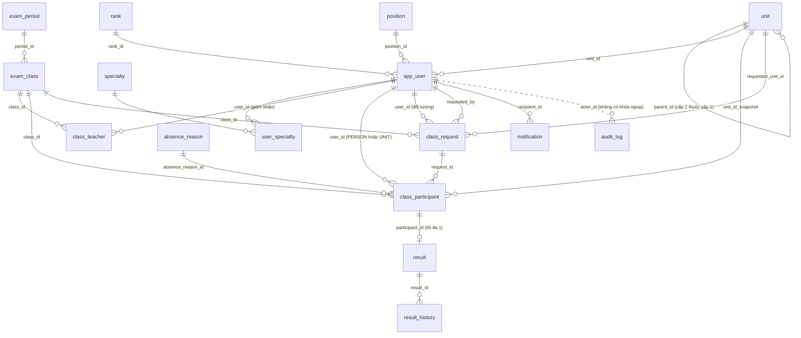
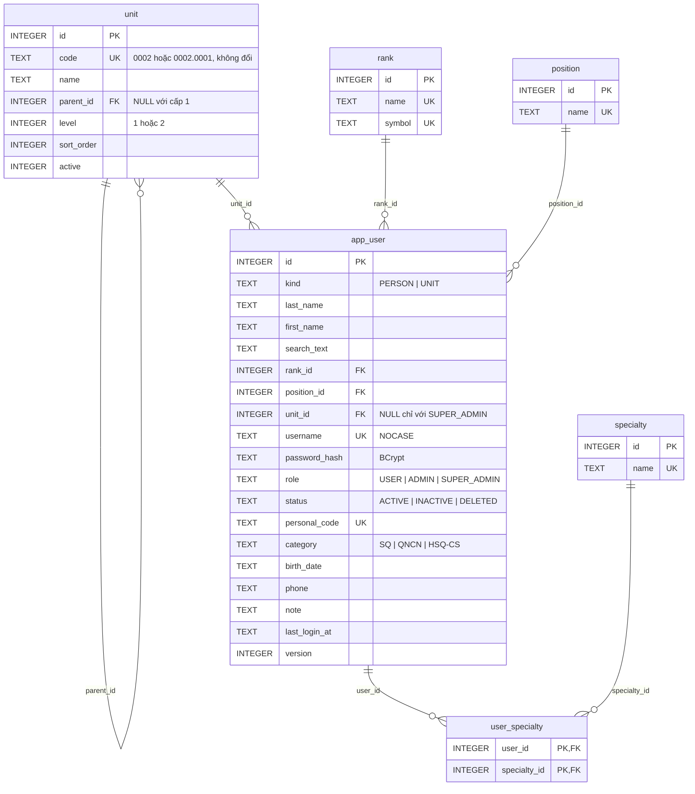
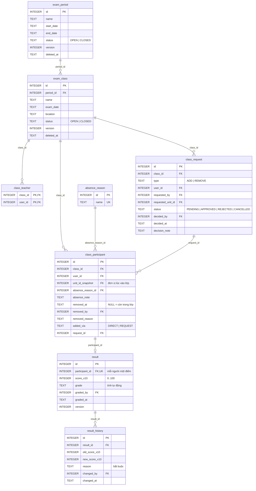

# ERD: Sơ đồ quan hệ thực thể và từ điển dữ liệu

Tài liệu mô tả cơ sở dữ liệu SQLite của hệ thống, lấy trực tiếp từ `backend/src/main/resources/db/migration/V1__init.sql`. Lý do thiết kế và các quyết định nằm ở [ARCHITECTURE.md](ARCHITECTURE.md) mục 2. API ở [API.md](API.md), use case ở [USE-CASE.md](USE-CASE.md).

> **Thuật ngữ.** Bảng `exam_class` là **nội dung kiểm tra** trên giao diện, `class_teacher` là **giám khảo** của nội dung đó. Tên trong DB giữ nguyên.

## 1. Quy ước chung

| Quy ước | Nội dung |
|---|---|
| Khóa chính | `id INTEGER PRIMARY KEY` (tự tăng), trừ `user_specialty`, `class_teacher` (khóa ghép) và `app_setting` (`key`) |
| Thời gian | `TEXT` ISO-8601 theo UTC (`2026-11-24T03:15:00.000Z`). Ngày kiểm tra, ngày sinh, ngày đợt lưu `YYYY-MM-DD` |
| Cờ | `active` là `INTEGER` 0/1 |
| Điểm | `result.score_x10` là số nguyên, 6.5 lưu là 65. Không dùng số thực |
| Khóa ngoại | Luôn `ON DELETE RESTRICT`; `PRAGMA foreign_keys=ON` cho mọi kết nối |
| Xóa | **Không xóa cứng.** Xóa mềm bằng `status`/`deleted_at`/`removed_at`; trigger `trg_*_no_delete` chặn `DELETE` ở tầng DB. Ngoại lệ có chủ đích: `class_teacher`, `user_specialty` (gán lại là thay tập dòng) |
| Dấu vết | Bảng nghiệp vụ có `created_at`, `created_by`, `updated_at`, `updated_by`; bảng xóa mềm có thêm `deleted_at`, `deleted_by` |
| Khóa lạc quan | Cột `version` ở `app_user`, `exam_period`, `exam_class`, `result`: sửa với `version` cũ thì 409 |
| Tìm kiếm tiếng Việt | `app_user.search_text` đã bỏ dấu, chữ thường; không dùng `LIKE` trên cột có dấu |

## 2. Sơ đồ tổng thể

Ba nhóm bảng:

| Nhóm | Bảng |
|---|---|
| Danh mục và tổ chức | `unit`, `rank`, `position`, `specialty`, `absence_reason` |
| Người dùng | `app_user`, `user_specialty` |
| Kiểm tra và điểm | `exam_period`, `exam_class`, `class_teacher`, `class_request`, `class_participant`, `result`, `result_history` |
| Hệ thống | `notification`, `audit_log`, `app_setting` |

Quan hệ "người dùng tự tham chiếu" (`created_by`, `updated_by`, `deleted_by`, `graded_by`, `changed_by`, `decided_by`, `removed_by`) có ở hầu hết bảng nghiệp vụ nhưng không vẽ ra để sơ đồ dễ đọc: mọi cột đó trỏ về `app_user.id`.

## 3. Sơ đồ chi tiết theo nhóm

### 3.1 Đơn vị và người dùng

### 3.2 Nội dung kiểm tra, người học và điểm

## 4. Từ điển dữ liệu

Ký hiệu: **PK** khóa chính, **FK** khóa ngoại, **UK** duy nhất, **NN** không NULL. Các cột `created_*`, `updated_*`, `deleted_*` mô tả ở mục 1 nên bỏ qua trong bảng dưới trừ khi có ý nghĩa riêng.

### 4.1 `unit` — đơn vị (cây hai cấp)

| Cột | Kiểu | Ràng buộc | Ghi chú |
|---|---|---|---|
| `id` | INTEGER | PK | |
| `code` | TEXT | NN, UK | Cấp 1: 4 ký tự (`0002`). Cấp 2: 9 ký tự `[mã cha].[xxxx]` (`0002.0001`). **Không đổi sau khi tạo** |
| `name` | TEXT | NN | Có thể trùng giữa các đơn vị, chỉ `code` là duy nhất |
| `parent_id` | INTEGER | FK `unit` | NULL với cấp 1. Cấp 0 (Super Admin) không có bản ghi |
| `level` | INTEGER | NN, CHECK 1 hoặc 2 | Cấp admin suy ra từ đây, không lưu riêng |
| `sort_order` | INTEGER | NN, mặc định 0 | |
| `active` | INTEGER | NN, 0/1 | Khóa đơn vị |

CHECK: cấp 1 phải không có cha, mã 4 ký tự không có dấu chấm; cấp 2 phải có cha, mã 9 ký tự với dấu chấm ở vị trí thứ 5.
Trigger: `trg_unit_parent_check` (cấp 2 phải dưới một đơn vị cấp 1 và mã bắt đầu bằng mã cha cộng dấu chấm), `trg_unit_immutable` (không đổi `code`, `parent_id`, `level`).

### 4.2 `rank`, `position`, `specialty`, `absence_reason` — danh mục

Bốn bảng cùng khuôn: `id` PK, `name` NN UK, `sort_order`, `active`, `created_at`, `updated_at` (không có `created_by`/`updated_by` vì chỉ Super Admin sửa và đã có audit log). Dùng `active` thay cho xóa để dữ liệu cũ vẫn hiển thị đúng.

| Bảng | Cột riêng | Seed |
|---|---|---|
| `rank` | `symbol` NN UK (ký hiệu cấp bậc) | 20 cấp bậc |
| `position` | | 26 chức vụ |
| `specialty` | | 24 chuyên ngành |
| `absence_reason` | | Ốm, Công tác, Nghỉ phép, Khác |

### 4.3 `app_user` — người dùng

Một bảng chứa hai loại bản ghi, phân biệt bằng `kind`: `PERSON` là con người, `UNIT` là bản ghi đại diện cho **một đơn vị** để đưa vào nội dung kiểm tra (hệ thống tự tạo, không có tài khoản).

| Cột | Kiểu | Ràng buộc | Ghi chú |
|---|---|---|---|
| `id` | INTEGER | PK | |
| `kind` | TEXT | NN, `PERSON`/`UNIT`, mặc định `PERSON` | |
| `last_name`, `first_name` | TEXT | | Họ đệm, tên. NN khi `PERSON`; NULL khi `UNIT` |
| `search_text` | TEXT | NN | Họ tên (hoặc tên đơn vị) bỏ dấu, chữ thường |
| `rank_id`, `position_id` | INTEGER | FK | Không bắt buộc; NULL khi `UNIT` |
| `unit_id` | INTEGER | FK `unit` | `PERSON`: đơn vị hiện tại (NULL chỉ với `SUPER_ADMIN`). `UNIT`: chính đơn vị được đại diện |
| `username` | TEXT | UK, NOCASE | Nhiều dòng NULL hợp lệ. `QuanTri` và `quantri` là trùng |
| `password_hash` | TEXT | | BCrypt. Không bao giờ ghi vào log hay trả qua API |
| `role` | TEXT | NN, `USER`/`ADMIN`/`SUPER_ADMIN`, mặc định `USER` | |
| `status` | TEXT | NN, `ACTIVE`/`INACTIVE`/`DELETED`, mặc định `ACTIVE` | `DELETED` là xóa mềm |
| `personal_code` | TEXT | UK | Mã định danh. NN khi `PERSON`; tự cấp `ND000001`... nếu để trống; khóa khớp khi nhập Excel |
| `category` | TEXT | `SQ`/`QNCN`/`HSQ-CS` hoặc NULL | Đối tượng. DB cho NULL (Super Admin không thuộc đơn vị); máy chủ bắt buộc với mọi người có đơn vị |
| `birth_date`, `phone`, `note` | TEXT | | Hồ sơ cá nhân |
| `last_login_at` | TEXT | | |
| `version` | INTEGER | NN, mặc định 0 | Khóa lạc quan |

Các CHECK:

1. `PERSON` ⇒ `last_name`, `first_name`, `personal_code` NN.
2. `UNIT` ⇒ `unit_id` NN, `role = USER`, và họ tên, mã định danh, cấp bậc, chức vụ, đối tượng, tài khoản, mật khẩu đều NULL.
3. `PERSON`: `SUPER_ADMIN` ⇔ `unit_id IS NULL`.
4. `role <> USER` ⇒ có `username` và `password_hash`.
5. Có `password_hash` ⇒ có `username`.
6. `status = DELETED` ⇔ `deleted_at IS NOT NULL`.

Chỉ mục: `(unit_id, status)`, `search_text`, `kind`, `category`; **duy nhất** `unit_id` khi `kind = 'UNIT'` (mỗi đơn vị đúng một bản ghi đại diện).

### 4.4 `user_specialty` — chuyên ngành của người dùng

| Cột | Kiểu | Ràng buộc |
|---|---|---|
| `user_id` | INTEGER | PK, FK `app_user` |
| `specialty_id` | INTEGER | PK, FK `specialty` |

Nhiều–nhiều. Cho phép xóa dòng (đặt lại chuyên ngành là thay cả tập). Chỉ mục `specialty_id`.

### 4.5 `exam_period` — đợt kiểm tra

| Cột | Kiểu | Ràng buộc | Ghi chú |
|---|---|---|---|
| `id` | INTEGER | PK | |
| `name` | TEXT | NN | |
| `start_date`, `end_date` | TEXT | CHECK `end_date >= start_date` | `YYYY-MM-DD` |
| `status` | TEXT | NN, `OPEN`/`CLOSED` | **Khóa đợt** thì mọi nội dung của đợt coi như đóng (tính ở SQL, không ghi đè `exam_class.status`) |
| `note` | TEXT | | |
| `version` | INTEGER | NN | |
| `deleted_at`, `deleted_by` | | | Xóa mềm; chỉ xóa được đợt không còn nội dung |

### 4.6 `exam_class` — nội dung kiểm tra

| Cột | Kiểu | Ràng buộc | Ghi chú |
|---|---|---|---|
| `id` | INTEGER | PK | |
| `period_id` | INTEGER | NN, FK `exam_period` | |
| `name` | TEXT | NN | |
| `exam_date` | TEXT | | `YYYY-MM-DD` |
| `location` | TEXT | | |
| `status` | TEXT | NN, `OPEN`/`CLOSED` | Đóng thì không thêm người, không nhận đề nghị; vẫn nhập điểm được |
| `note` | TEXT | | |
| `version` | INTEGER | NN | |
| `deleted_at`, `deleted_by` | | | Xóa mềm; không xóa được nội dung đã có điểm |

Chỉ mục: `period_id`, `exam_date`.

### 4.7 `class_teacher` — giám khảo của nội dung

| Cột | Kiểu | Ràng buộc | Ghi chú |
|---|---|---|---|
| `class_id` | INTEGER | PK, FK `exam_class` | |
| `user_id` | INTEGER | PK, FK `app_user` | Phải là `PERSON` có tài khoản, `ACTIVE`; tối đa 20 người mỗi nội dung. Super Admin luôn có quyền, không cần dòng riêng |
| `created_at`, `created_by` | | | |

Giám khảo là **gán theo từng nội dung**, không phải vai trò tài khoản.

### 4.8 `class_request` — đề nghị thêm/xóa người học

| Cột | Kiểu | Ràng buộc | Ghi chú |
|---|---|---|---|
| `id` | INTEGER | PK | |
| `class_id` | INTEGER | NN, FK `exam_class` | |
| `type` | TEXT | NN, `ADD`/`REMOVE` | |
| `user_id` | INTEGER | NN, FK `app_user` | Đối tượng (người hoặc bản ghi `UNIT`) |
| `requested_by` | INTEGER | NN, FK `app_user` | Admin đề nghị |
| `requested_unit_id` | INTEGER | NN, FK `unit` | Đơn vị của admin tại lúc đề nghị |
| `status` | TEXT | NN, `PENDING`/`APPROVED`/`REJECTED`/`CANCELLED` | |
| `decided_by`, `decided_at`, `decision_note` | | CHECK `status = PENDING` ⇔ `decided_at IS NULL` | |
| `created_at` | TEXT | NN | |

Chỉ mục: `(status, class_id)`; **duy nhất** `(class_id, user_id, type)` khi `status = 'PENDING'` (không có hai đề nghị chờ giống hệt nhau).

### 4.9 `class_participant` — người học trong nội dung

| Cột | Kiểu | Ràng buộc | Ghi chú |
|---|---|---|---|
| `id` | INTEGER | PK | |
| `class_id` | INTEGER | NN, FK | |
| `user_id` | INTEGER | NN, FK `app_user` | `PERSON` hoặc `UNIT` (nên không cần cột phân loại) |
| `unit_id_snapshot` | INTEGER | NN, FK `unit` | **Đơn vị lúc vào nội dung**; thống kê theo đơn vị dùng cột này, không đổi khi người chuyển đơn vị. Với `UNIT` là chính đơn vị đó |
| `absence_reason_id`, `absence_note` | | FK `absence_reason` | Lý do không kiểm tra. Lưu ở đây, không lưu ở `result` |
| `removed_at`, `removed_by`, `removed_reason` | | CHECK cùng có hoặc cùng không (`removed_reason` tùy chọn) | Gỡ mềm. `removed_reason` bắt buộc ở tầng service khi gỡ người đã có điểm |
| `added_via` | TEXT | NN, `DIRECT`/`REQUEST` | |
| `request_id` | INTEGER | FK `class_request` | CHECK: `added_via = REQUEST` ⇒ có `request_id` |

Chỉ mục: `class_id`, `user_id`, `unit_id_snapshot`; **duy nhất** `(class_id, user_id)` khi `removed_at IS NULL` (một người vào một nội dung một lần, nhưng thêm lại được sau khi bị gỡ — khi đó là một dòng mới).

Trạng thái người học (`state`, tính khi đọc, không lưu): `TESTED` có dòng `result`; `ABSENT` có `absence_reason_id`; còn lại `NOT_TESTED`. Không được vừa có điểm vừa có lý do vắng (nhập điểm thì xóa lý do vắng trong cùng giao dịch).

### 4.10 `result` — điểm

| Cột | Kiểu | Ràng buộc | Ghi chú |
|---|---|---|---|
| `id` | INTEGER | PK | |
| `participant_id` | INTEGER | NN, **UK**, FK `class_participant` | Mỗi người học đúng một điểm, kể cả khi hai giám khảo lưu cùng lúc |
| `score_x10` | INTEGER | NN, CHECK 0..100 | 6.5 lưu là 65 |
| `grade` | TEXT | **cột tính VIRTUAL** | `< 50` → `FAIL`; `50–65` → `PASS`; `66–79` → `GOOD`; `≥ 80` → `EXCELLENT` |
| `graded_by`, `graded_at` | | NN | Người nhập lần đầu |
| `version` | INTEGER | NN | Khóa lạc quan khi Super Admin sửa |
| `updated_at`, `updated_by` | | | Lần sửa gần nhất |

Chỉ mục: `grade`. Điểm của người học đã bị gỡ **vẫn nằm trong bảng** nhưng thống kê và lịch sử cá nhân bỏ qua (lọc theo `class_participant.removed_at`).

Bảng xếp loại: 4.9 → Không đạt; 5.0 và 6.5 → Đạt; 6.6 và 7.9 → Khá; 8.0 → Giỏi.

### 4.11 `result_history` — lịch sử sửa điểm

| Cột | Kiểu | Ràng buộc |
|---|---|---|
| `id` | INTEGER | PK |
| `result_id` | INTEGER | NN, FK `result` |
| `old_score_x10`, `new_score_x10` | INTEGER | NN, CHECK 0..100 |
| `reason` | TEXT | NN, CHECK không rỗng sau khi cắt khoảng trắng |
| `changed_by` | INTEGER | NN, FK `app_user` |
| `changed_at` | TEXT | NN |

Chỉ thêm: trigger chặn `UPDATE` và `DELETE`. Chỉ mục `result_id`.

### 4.12 `notification` — thông báo trong ứng dụng

| Cột | Kiểu | Ghi chú |
|---|---|---|
| `id` | INTEGER PK | |
| `recipient_id` | INTEGER NN, FK `app_user` | |
| `type` | TEXT NN | Ví dụ `REQUEST_CREATED`, duyệt, từ chối |
| `title`, `body` | TEXT | |
| `ref_type`, `ref_id` | TEXT, INTEGER | Đối tượng liên quan (`class_request`) để bấm vào mở đúng trang |
| `created_at`, `read_at` | TEXT | `read_at` NULL là chưa đọc |

Chỉ mục `(recipient_id, read_at)`. Không xóa cứng.

### 4.13 `audit_log` — nhật ký thao tác

| Cột | Kiểu | Ghi chú |
|---|---|---|
| `id` | INTEGER PK | |
| `at` | TEXT NN | |
| `actor_id` | INTEGER | **Không có khóa ngoại**: đăng nhập thất bại với tài khoản không tồn tại vẫn phải ghi được |
| `actor_username` | TEXT | Bản sao tên tại thời điểm ghi |
| `action` | TEXT NN | Ví dụ `LOGIN_SUCCESS`, `LOGIN_FAILED`, `USER_CREATED`, `USER_ROLE_CHANGED`, `RESULT_CREATED`, `RESULT_UPDATED`, `PARTICIPANT_ADDED`, `USERS_IMPORTED`, `BACKUP_CREATED` |
| `entity_type`, `entity_id` | TEXT, INTEGER | |
| `unit_code` | TEXT | Mã đơn vị liên quan |
| `before_json`, `after_json` | TEXT | Giá trị trước và sau. Trường có tên chứa password, hash, token, secret bị thay bằng `***` |
| `ip` | TEXT | |

**Chỉ thêm, không sửa, không xóa** (trigger chặn `UPDATE` và `DELETE`). Chỉ mục `at`, `(actor_id, at)`, `(action, at)`.

### 4.14 `app_setting` — cấu hình

| Cột | Kiểu | Ghi chú |
|---|---|---|
| `key` | TEXT PK | |
| `value` | TEXT NN | |
| `updated_at` | TEXT NN | |

Giá trị mặc định: `password.min-length=8`, `session.timeout-minutes=30`, `backup.time=02:00`, `backup.keep=5`, `backup.dir` rỗng (dùng thư mục mặc định).

## 5. Giá trị liệt kê

| Cột | Giá trị |
|---|---|
| `app_user.kind` | `PERSON`, `UNIT` |
| `app_user.role` | `USER`, `ADMIN`, `SUPER_ADMIN` |
| `app_user.status` | `ACTIVE`, `INACTIVE`, `DELETED` |
| `app_user.category` | `SQ` (sĩ quan), `QNCN` (quân nhân chuyên nghiệp), `HSQ-CS` (hạ sĩ quan - chiến sĩ) |
| `exam_period.status`, `exam_class.status` | `OPEN`, `CLOSED` |
| `class_request.type` | `ADD`, `REMOVE` |
| `class_request.status` | `PENDING`, `APPROVED`, `REJECTED`, `CANCELLED` |
| `class_participant.added_via` | `DIRECT`, `REQUEST` |
| `result.grade` | `FAIL` (Không đạt), `PASS` (Đạt), `GOOD` (Khá), `EXCELLENT` (Giỏi) |
| Trạng thái người học (tính khi đọc) | `TESTED`, `ABSENT`, `NOT_TESTED` |

## 6. Trigger bảo vệ dữ liệu

| Trigger | Bảng | Tác dụng |
|---|---|---|
| `trg_unit_parent_check` | `unit` | Chặn thêm đơn vị cấp 2 không có cha cấp 1 hoặc mã không bắt đầu bằng mã cha |
| `trg_unit_immutable` | `unit` | Chặn đổi mã, cấp, đơn vị cha |
| `trg_*_no_delete` | `unit`, `rank`, `position`, `specialty`, `absence_reason`, `app_user`, `exam_period`, `exam_class`, `class_request`, `class_participant`, `result`, `notification` | Chặn `DELETE` cứng |
| `trg_result_history_no_update`, `trg_result_history_no_delete` | `result_history` | Lịch sử sửa điểm chỉ thêm |
| `trg_audit_log_no_update`, `trg_audit_log_no_delete` | `audit_log` | Nhật ký chỉ thêm |

Lưu ý: trigger `BEFORE INSERT` chạy trước khi SQLite kiểm tra CHECK, nên với dữ liệu vi phạm cả hai, mã lỗi là `SQLITE_CONSTRAINT_TRIGGER` chứ không phải `_CHECK`; code xử lý lỗi không dựa vào việc phân biệt hai loại này.

## 7. Quy tắc nghiệp vụ gắn với dữ liệu

| Quy tắc | Cơ chế |
|---|---|
| Mỗi người học chỉ một điểm | `result.participant_id` UNIQUE |
| Xếp loại không bao giờ lệch điểm | `result.grade` là cột tính ở DB; frontend chỉ xem trước (ARCHITECTURE D6) |
| Thống kê theo đơn vị không đổi khi người chuyển đơn vị | Dùng `class_participant.unit_id_snapshot`; quyền xem chi tiết cá nhân dùng `app_user.unit_id` hiện tại |
| Điểm cá nhân và điểm đơn vị không trộn | Mọi thống kê lọc theo `app_user.kind` của người học |
| Người đã có điểm bị gỡ thì điểm còn nhưng không tính | `class_participant.removed_at` khác NULL bị bỏ qua ở thống kê, lịch sử |
| Phạm vi nhánh | `unit.code = U OR unit.code LIKE U || '.%'` (luôn có dấu chấm, để `0002` không khớp `00021`); ghép trong SQL qua `Scope` |
| Cấp admin suy ra từ đơn vị | Lấy từ `unit.level`, không có cột riêng; đổi đơn vị là đổi cấp admin (ARCHITECTURE R1) |
| Không hai đề nghị chờ giống nhau | Chỉ mục duy nhất một phần trên `class_request` |
| Thêm lại người sau khi gỡ | Chỉ mục duy nhất một phần trên `class_participant` chỉ tính dòng chưa gỡ |
| Một đơn vị đúng một bản ghi đại diện | Chỉ mục duy nhất một phần trên `app_user (unit_id) WHERE kind = 'UNIT'` |

## 8. Thống kê kích thước

17 bảng, 22 chỉ mục (trong đó 3 chỉ mục duy nhất một phần), 18 trigger (cùng khóa ngoại), dữ liệu seed gồm 20 cấp bậc, 26 chức vụ, 24 chuyên ngành, 4 lý do vắng, cây đơn vị ban đầu và cấu hình mặc định. Không seed người dùng nào: Super Admin được tạo ở lần chạy đầu từ `first-run.properties`.
