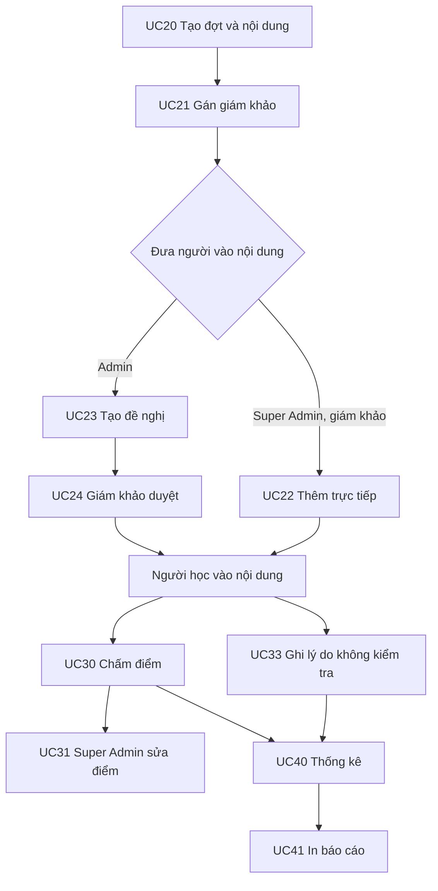
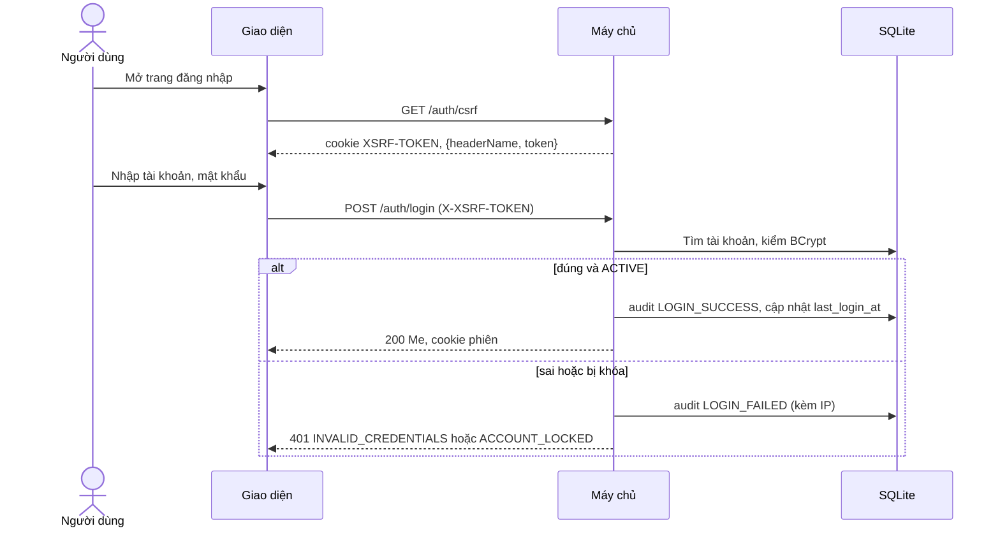
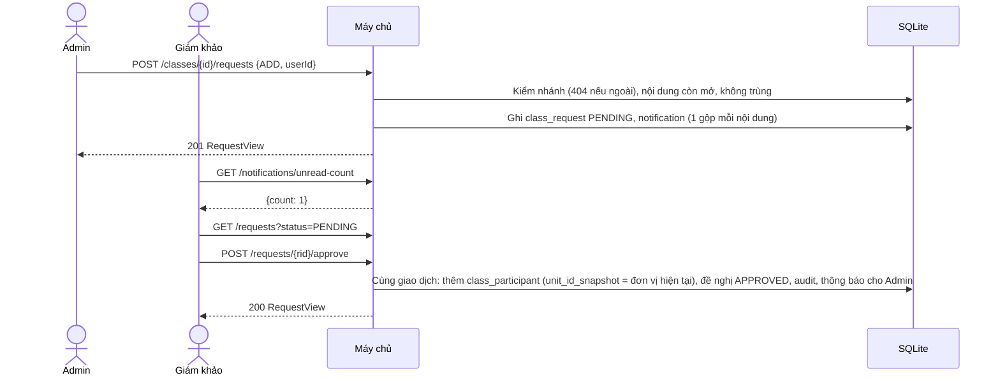
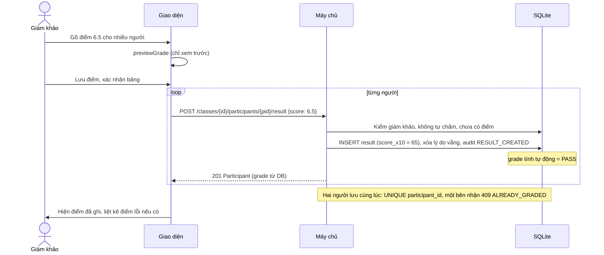
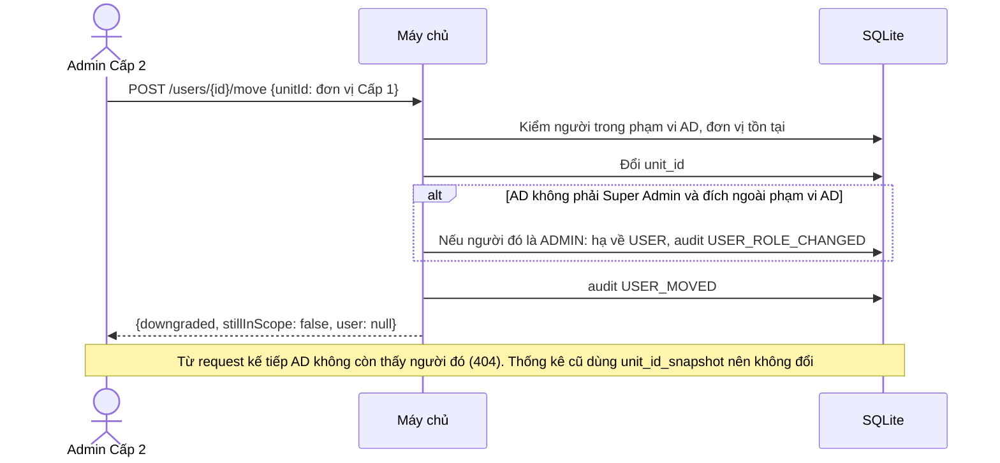

# Use case: Tác nhân và kịch bản sử dụng

Tài liệu mô tả ai làm được gì với hệ thống, theo từng kịch bản. Dựa trên [PRD.md](PRD.md) (yêu cầu), [ARCHITECTURE.md](ARCHITECTURE.md) mục 5 (phân quyền) và mã nguồn. Mỗi use case ghi API tương ứng ở [API.md](API.md); dữ liệu liên quan ở [ERD.md](ERD.md).

> **Thuật ngữ.** Trên giao diện "lớp" là **nội dung kiểm tra**, "giáo viên" là **giám khảo**. Tài liệu này dùng tên giao diện.

## Mục lục

1. [Tác nhân](#1-tác-nhân)
2. [Sơ đồ use case](#2-sơ-đồ-use-case)
3. [Danh sách use case](#3-danh-sách-use-case)
4. [Đặc tả use case chi tiết](#4-đặc-tả-use-case-chi-tiết)
5. [Sơ đồ tuần tự cho các luồng chính](#5-sơ-đồ-tuần-tự)
6. [Quy tắc nghiệp vụ xuyên suốt](#6-quy-tắc-nghiệp-vụ-xuyên-suốt)
7. [Truy vết use case với yêu cầu](#7-truy-vết)

---

## 1. Tác nhân

| Tác nhân | Mô tả | Phạm vi dữ liệu |
|---|---|---|
| **Super Admin** (Cấp 0) | Quản trị toàn hệ thống. Không thuộc đơn vị nào. Mặc định là giám khảo của mọi nội dung | Toàn bộ |
| **Admin** (Cấp 1 hoặc Cấp 2) | Quản lý nhân sự và theo dõi kết quả của đơn vị mình và các đơn vị con. Cấp suy ra từ đơn vị, không lưu riêng. Mỗi đơn vị có nhiều admin được | Đơn vị mình và cấp dưới cùng nhánh |
| **Giám khảo** | Người được gán vào một nội dung kiểm tra. **Không phải vai trò tài khoản**: một user thường hoặc một admin đều có thể là giám khảo của nội dung X, cộng dồn với quyền vốn có | Đúng nội dung được gán |
| **Người dùng** | Người học, có hoặc không có tài khoản đăng nhập | Chỉ bản thân |
| **Hệ thống** | Tác vụ nội bộ chạy nền, không do người dùng gọi | Toàn bộ |

Hai loại **đối tượng kiểm tra**: *cá nhân* (một con người) và *đơn vị* (cả đơn vị cùng được chấm một điểm tập thể). Đơn vị không phải tác nhân, không đăng nhập; hệ thống tự tạo bản ghi đại diện khi lần đầu đưa đơn vị vào một nội dung.

## 2. Sơ đồ use case

Sơ đồ chia theo nhóm chức năng. Mũi tên nối tác nhân tới use case mà họ được phép làm.

### 2.1 Tổng quan theo tác nhân

```mermaid
flowchart LR
    SA([Super Admin])
    AD([Admin])
    GK([Giám khảo])
    ND([Người dùng])
    HT([Hệ thống])

    subgraph TK[Tài khoản]
        UC01[UC01 Đăng nhập, đăng xuất]
        UC02[UC02 Đổi mật khẩu]
        UC03[UC03 Xem hồ sơ và điểm của mình]
    end
    subgraph NS[Nhân sự]
        UC10[UC10 Quản lý đơn vị và danh mục]
        UC11[UC11 Quản lý người dùng]
        UC12[UC12 Chuyển đơn vị, đổi quyền, tài khoản]
        UC13[UC13 Nhập người dùng bằng Excel]
    end
    subgraph KT[Kiểm tra]
        UC20[UC20 Quản lý đợt và nội dung kiểm tra]
        UC21[UC21 Gán giám khảo]
        UC22[UC22 Thêm, gỡ người học trực tiếp]
        UC23[UC23 Đề nghị thêm, gỡ người học]
        UC24[UC24 Duyệt, từ chối đề nghị]
        UC25[UC25 Phân công qua bảng, Excel]
    end
    subgraph DM[Điểm]
        UC30[UC30 Chấm điểm]
        UC31[UC31 Sửa điểm]
        UC32[UC32 Chấm điểm bằng Excel]
        UC33[UC33 Ghi lý do không kiểm tra]
    end
    subgraph TKE[Thống kê, báo cáo]
        UC40[UC40 Xem thống kê]
        UC41[UC41 In báo cáo]
        UC42[UC42 Xuất điểm ra Excel]
        UC43[UC43 Xem thông báo]
    end
    subgraph QT[Quản trị hệ thống]
        UC50[UC50 Xem nhật ký thao tác]
        UC51[UC51 Sao lưu, xem tình trạng]
        UC52[UC52 Sao lưu tự động]
    end

    ND --> UC01 & UC02 & UC03 & UC43
    GK --> UC22 & UC24 & UC25 & UC30 & UC32 & UC33 & UC42 & UC40 & UC41
    AD --> UC11 & UC12 & UC13 & UC23 & UC25 & UC40 & UC41 & UC42
    SA --> UC10 & UC20 & UC21 & UC31 & UC50 & UC51
    SA --> UC11 & UC12 & UC13 & UC22 & UC24 & UC25 & UC30 & UC32 & UC33 & UC40 & UC41 & UC42
    HT --> UC52
```



Mọi tác nhân có tài khoản đều làm được UC01, UC02, UC43; giám khảo và admin cũng là người dùng nên làm được UC03. Super Admin cũng có UC01–UC03 (không vẽ để sơ đồ gọn).

### 2.2 Quan hệ giữa các use case chính



## 3. Danh sách use case

Cột "Ai" liệt kê tác nhân được làm. Các mã UC dùng xuyên suốt tài liệu.

### 3.1 Tài khoản

| Mã | Tên | Ai | API chính |
|---|---|---|---|
| UC01 | Đăng nhập, đăng xuất | Mọi người có tài khoản | `GET /auth/csrf`, `POST /auth/login`, `POST /auth/logout` |
| UC02 | Đổi mật khẩu của mình | Mọi người có tài khoản | `PUT /me/password` |
| UC03 | Xem hồ sơ và điểm của mình | Mọi người có tài khoản | `GET /me`, `GET /me/classes` |

### 3.2 Nhân sự

| Mã | Tên | Ai | API chính |
|---|---|---|---|
| UC10 | Quản lý cây đơn vị và danh mục (cấp bậc, chức vụ, chuyên ngành, lý do vắng) | Super Admin | `/units`, `/catalogs` |
| UC11 | Quản lý người dùng: tìm kiếm, lọc, tạo, sửa hồ sơ, khóa, mở khóa, xóa mềm | Super Admin, Admin (trong nhánh) | `/users` |
| UC12 | Chuyển đơn vị, đổi quyền, cấp hoặc thu hồi tài khoản, đặt lại mật khẩu | Super Admin, Admin (trong nhánh) | `/users/{id}/move`, `/role`, `/account`, `/reset-password` |
| UC13 | Nhập người dùng bằng Excel | Super Admin, Admin (từng dòng trong nhánh) | `/users/import-template`, `/users/import` |
| UC14 | In thông tin cá nhân | Super Admin, Admin (nhánh), chính người đó | `/users/{id}/print`, `/users/{id}/history` |

### 3.3 Kiểm tra và người học

| Mã | Tên | Ai | API chính |
|---|---|---|---|
| UC20 | Quản lý đợt và nội dung kiểm tra (tạo, sửa, đóng, mở, xóa mềm; khóa đợt) | Super Admin | `/periods`, `/classes` |
| UC21 | Gán giám khảo cho nội dung | Super Admin | `PUT /classes/{id}/teachers`, `teacherIds` |
| UC22 | Thêm, gỡ người học trực tiếp; thêm cả đơn vị | Super Admin, giám khảo | `/classes/{id}/candidates`, `/participants`, `/participants/{pid}/remove` |
| UC23 | Đề nghị thêm hoặc gỡ người học | Admin | `POST /classes/{id}/requests` |
| UC24 | Duyệt, từ chối đề nghị; người đề nghị tự hủy | Giám khảo, Super Admin; người đề nghị | `/requests`, `/approve`, `/reject`, `/cancel` |
| UC25 | Phân công qua bảng người × nội dung hoặc bằng Excel | Super Admin, giám khảo (làm ngay); Admin (gửi đề nghị) | `/assignments/*` |
| UC26 | Nhập nội dung kiểm tra kèm người học bằng Excel | Super Admin | `/classes/import` |
| UC27 | Xem danh sách nội dung, chi tiết, người học (có tìm nhanh và lọc) | Mọi vai trò theo phạm vi | `GET /classes`, `/classes/{id}`, `/participants` |

### 3.4 Điểm

| Mã | Tên | Ai | API chính |
|---|---|---|---|
| UC30 | Chấm điểm lần đầu cho người học | Super Admin, giám khảo (không chấm cho mình) | `POST .../participants/{pid}/result` |
| UC31 | Sửa điểm kèm lý do, xem lịch sử sửa | Super Admin | `PUT /results/{rid}`, `GET /results/{rid}/history` |
| UC32 | Chấm điểm bằng Excel: một nội dung hoặc cả đợt | Giám khảo, Super Admin (cả đợt: chỉ Super Admin) | `/classes/{id}/results/import`, `/periods/{id}/results/import` |
| UC33 | Ghi hoặc xóa lý do không kiểm tra | Super Admin, giám khảo | `PUT .../participants/{pid}/absence` |

### 3.5 Thống kê, báo cáo, thông báo

| Mã | Tên | Ai | API chính |
|---|---|---|---|
| UC40 | Xem thống kê: xếp loại theo đơn vị, chưa kiểm tra, một nội dung, tổng quan | Super Admin, Admin (nhánh); giám khảo (nội dung mình) | `/stats/*` |
| UC41 | In kết quả một nội dung, in thông tin cá nhân (theo bộ lọc đang chọn) | Theo quyền xem dữ liệu đó | trang in, dùng API đọc |
| UC42 | Xuất điểm một nội dung ra Excel | Theo quyền xem danh sách người học | `GET /classes/{id}/results/export` |
| UC43 | Xem thông báo, đánh dấu đã đọc | Mọi người có tài khoản | `/notifications` |

### 3.6 Quản trị hệ thống

| Mã | Tên | Ai | API chính |
|---|---|---|---|
| UC50 | Xem nhật ký thao tác | Super Admin | `GET /audit-logs` |
| UC51 | Xem tình trạng hệ thống, tạo và tải bản sao lưu, đổi cài đặt sao lưu | Super Admin | `/admin/*` |
| UC52 | Sao lưu tự động hằng ngày và trước nâng cấp | Hệ thống | (tác vụ nội bộ, không có API) |
| UC53 | Khởi tạo Super Admin lần đầu; đặt lại mật khẩu Super Admin | Người cài đặt trên máy chủ | `first-run.properties`, `--reset-superadmin` |

---

## 4. Đặc tả use case chi tiết

Mỗi đặc tả gồm: tác nhân, điều kiện trước, luồng chính, luồng thay thế hoặc ngoại lệ, kết quả, quy tắc.

### UC01. Đăng nhập, đăng xuất

| | |
|---|---|
| **Tác nhân** | Người dùng, Admin, Giám khảo, Super Admin (đều có tài khoản) |
| **Điều kiện trước** | Người đó có `username` và mật khẩu; trạng thái `ACTIVE`; là người `PERSON` |
| **Luồng chính** | 1. Mở trang đăng nhập. 2. Giao diện lấy token CSRF. 3. Nhập tài khoản, mật khẩu, gửi. 4. Hệ thống kiểm mật khẩu BCrypt, tạo phiên (cookie `HttpOnly`). 5. Chuyển tới trang chủ theo vai trò |
| **Thay thế** | Sai tài khoản hoặc mật khẩu: `401 INVALID_CREDENTIALS` (cùng một câu cho cả hai trường hợp). Tài khoản bị khóa hoặc đã xóa mềm, mật khẩu đúng: `401 ACCOUNT_LOCKED`. Người loại đơn vị hoặc không có tài khoản: không đăng nhập được |
| **Kết quả** | Có phiên làm việc; hết hạn sau thời gian không hoạt động (mặc định 30 phút). Đăng xuất hủy phiên |
| **Quy tắc** | Không ép đổi mật khẩu lần đầu, **không khóa và không trì hoãn khi nhập sai** (rủi ro đã chấp nhận, ARCHITECTURE R4); mọi lần đăng nhập thành công và thất bại đều ghi nhật ký kèm IP |

### UC02. Đổi mật khẩu của mình

| | |
|---|---|
| **Điều kiện trước** | Đã đăng nhập |
| **Luồng chính** | 1. Mở "Đổi mật khẩu". 2. Nhập mật khẩu hiện tại và mật khẩu mới. 3. Hệ thống kiểm mật khẩu cũ, độ dài tối thiểu theo cài đặt (mặc định 8) và tối đa 72 byte, lưu BCrypt |
| **Ngoại lệ** | Sai mật khẩu hiện tại hoặc mật khẩu mới quá ngắn: lỗi theo ô |
| **Quy tắc** | Tài khoản mới cấp có mật khẩu mặc định `123456789` và không bị ép đổi; nên nhắc người dùng đổi ngay |

### UC11. Quản lý người dùng

| | |
|---|---|
| **Tác nhân** | Super Admin (toàn hệ thống), Admin (đơn vị mình và con) |
| **Điều kiện trước** | Đã đăng nhập với vai trò Admin trở lên |
| **Luồng chính (tạo)** | 1. Mở "Người dùng" → "Thêm". 2. Nhập họ đệm, tên, **đối tượng** (SQ, QNCN, HSQ-CS), đơn vị, cấp bậc, chức vụ, chuyên ngành (nhiều lựa chọn), ngày sinh, điện thoại, ghi chú. 3. Để trống mã định danh thì hệ thống tự cấp `ND000001`... 4. Lưu |
| **Luồng chính (tìm kiếm)** | Tìm theo tên, mã, tài khoản (không dấu); lọc nhiều giá trị cùng lúc theo đơn vị, đối tượng, cấp bậc, chức vụ, chuyên ngành, trạng thái, quyền. Chỉ thấy người trong phạm vi |
| **Luồng chính (khóa, xóa)** | Khóa (`INACTIVE`), mở khóa (`ACTIVE`), xóa mềm (`DELETED`), khôi phục (`ACTIVE`) ngay trên dòng, có hộp thoại xác nhận |
| **Ngoại lệ** | Đơn vị ngoài phạm vi: `404`. Mã định danh hoặc tài khoản trùng: `409`. Sai `version` khi sửa: `409`. Tự khóa, tự xóa chính mình: `403 SELF_ACTION`. Khóa hoặc xóa Super Admin cuối cùng: `409 LAST_SUPER_ADMIN`. Người ngoài phạm vi: `404` (không lộ là có tồn tại) |
| **Quy tắc** | Admin không tạo người vào đơn vị ngoài nhánh; không sửa được bản ghi đại diện đơn vị; xóa mềm không làm mất dữ liệu nhưng người đó không còn trong danh sách mặc định, vẫn nằm trong thống kê lịch sử |

### UC12. Chuyển đơn vị, đổi quyền, tài khoản, đặt lại mật khẩu

| | |
|---|---|
| **Tác nhân** | Super Admin, Admin (trong nhánh) |
| **Luồng chính (chuyển đơn vị)** | 1. Chọn người → "Thao tác khác" → "Chuyển đơn vị". 2. Chọn đơn vị đích (**bất kỳ đơn vị nào**, bằng danh sách radio có tìm nhanh). 3. Hộp thoại cảnh báo về mất quyền. 4. Xác nhận |
| **Thay thế (hạ quyền, R1)** | Nếu người thực hiện không phải Super Admin và đơn vị đích **ngoài phạm vi** của họ, người được chuyển nếu đang là `ADMIN` bị **tự hạ về `USER`** và ghi nhật ký; Admin ở đơn vị đích phải cấp lại quyền. Người thực hiện **mất quyền** với người đó ngay sau thao tác (kết quả `stillInScope = false`) |
| **Luồng chính (đổi quyền)** | Admin cấp `ADMIN` cho người trong nhánh mình; chỉ Super Admin cấp `SUPER_ADMIN`. Lên `ADMIN` hoặc `SUPER_ADMIN` cần người đó đã có tài khoản và mật khẩu |
| **Luồng chính (tài khoản)** | Cấp tài khoản mới (nhận mật khẩu mặc định), đổi tên tài khoản (giữ mật khẩu), thu hồi tài khoản (chỉ với Người dùng) ở trang chi tiết |
| **Luồng chính (đặt lại mật khẩu)** | Nhập mật khẩu mới cho người trong phạm vi; không áp dụng cho chính mình; Admin không thấy tài khoản Super Admin nên nhận `404` |
| **Ngoại lệ** | Tự chuyển đơn vị của mình, chuyển Super Admin (không có đơn vị): từ chối. Admin cấp `SUPER_ADMIN`: từ chối |
| **Kết quả** | Mọi thao tác ghi nhật ký (`USER_MOVED`, `USER_ROLE_CHANGED`, `USER_UPDATED`, `PASSWORD_RESET`). **Thống kê cũ của đơn vị trước không đổi** vì dùng đơn vị lúc vào nội dung |

### UC13. Nhập người dùng bằng Excel

| | |
|---|---|
| **Tác nhân** | Super Admin, Admin |
| **Luồng chính** | 1. Tải file mẫu (sheet hướng dẫn đứng đầu, ô chọn lấy từ DB). 2. Điền dữ liệu. 3. Tải lên ở chế độ **kiểm tra** (`dryRun`): xem lỗi theo từng dòng và cột, xem họ tên người được khớp để đối chiếu. 4. Sửa lỗi nếu có. 5. Xác nhận **ghi**: tất cả hoặc không ghi gì |
| **Quy tắc khớp** | Khớp theo mã định danh: có thì cập nhật, không có thì tạo (để trống mã thì tự cấp). Ô trống ở cột không bắt buộc **giữ giá trị cũ**. Đơn vị khác hiện tại là chuyển đơn vị |
| **Cột đặc biệt** | Đối tượng bắt buộc với người mới. Tài khoản và Quyền (Người dùng hoặc Admin, mặc định Người dùng): Admin thiếu tài khoản bị báo ngay ở bước kiểm tra; tài khoản mới nhận mật khẩu mặc định |
| **Ngoại lệ** | Đơn vị hoặc người khớp ngoài phạm vi (không lộ họ tên); người đã xóa, là Super Admin; tự chuyển đơn vị; tài khoản trùng trong file hoặc đã có người dùng; file quá 5 MB hoặc 5.000 dòng; thiếu cột |
| **Kết quả** | Một dòng nhật ký tổng `USERS_IMPORTED` cộng nhật ký từng bản ghi. Có thể tải danh sách lỗi dạng CSV |

### UC20. Quản lý đợt và nội dung kiểm tra

| | |
|---|---|
| **Tác nhân** | Super Admin |
| **Luồng chính (đợt)** | Tạo đợt (tên, từ ngày, đến ngày, ghi chú). Đóng (khóa) hoặc mở lại. Xóa mềm đợt không còn nội dung |
| **Luồng chính (nội dung)** | 1. Từ danh sách hoặc trang đợt, mở hộp thoại "Thêm nội dung" (không chuyển trang). 2. Chọn đợt, tên, ngày, địa điểm, ghi chú. 3. Gán giám khảo ngay trong hộp thoại (gõ tên, mã hoặc tài khoản; gợi ý hiện dưới ô; chọn thành thẻ). 4. Lưu một lần |
| **Thay thế** | Đóng nội dung: không thêm người, không nhận đề nghị, **vẫn nhập điểm được**. Mở lại nội dung khi đợt đang khóa: `409 PERIOD_CLOSED` |
| **Ngoại lệ** | Tạo nội dung vào đợt đã đóng: lỗi ở trường đợt. Xóa nội dung đã có điểm: `409 CLASS_HAS_RESULTS` (dùng đóng nội dung thay thế). Xóa đợt còn nội dung: `409 PERIOD_HAS_CLASSES` |
| **Quy tắc** | **Khóa đợt thì mọi nội dung của đợt coi như đóng** (không ghi đè trạng thái từng nội dung); mở lại đợt thì nội dung trở về trạng thái riêng. Xóa nội dung hủy các đề nghị đang chờ của nội dung đó. Admin vẫn xem được mọi nội dung nhưng chỉ thấy người học, điểm, thống kê thuộc nhánh mình |

### UC21. Gán giám khảo

| | |
|---|---|
| **Tác nhân** | Super Admin |
| **Luồng chính** | Trong hộp thoại nội dung (hoặc `PUT /classes/{id}/teachers`), chọn danh sách giám khảo; hệ thống **thay toàn bộ** danh sách |
| **Điều kiện** | Giám khảo phải là người cá nhân **có tài khoản**, có mật khẩu và đang hoạt động; tối đa 20 người mỗi nội dung. Người loại đơn vị không làm giám khảo |
| **Kết quả** | Bỏ gán thì người đó mất quyền ngay ở request kế tiếp. Super Admin luôn có quyền như giám khảo, không cần dòng gán |

### UC22. Thêm, gỡ người học trực tiếp

| | |
|---|---|
| **Tác nhân** | Super Admin, giám khảo của nội dung đó |
| **Điều kiện trước** | Nội dung còn mở (đợt không khóa) |
| **Luồng chính (thêm)** | 1. Mở "Thêm người học". 2. Gõ tối thiểu 2 ký tự để tìm ứng viên **trong toàn Lữ đoàn** (kết quả chỉ gồm tên, cấp bậc, đơn vị, mã định danh, tối đa khoảng 20). 3. Chọn người, hoặc chuyển sang tìm đơn vị để thêm **cả đơn vị**. 4. Hệ thống lưu `unit_id_snapshot` là đơn vị hiện tại của người đó |
| **Luồng chính (gỡ)** | Gỡ người **chưa có điểm**: giám khảo và Super Admin. Lý do không bắt buộc |
| **Thay thế (gỡ người đã có điểm)** | **Chỉ Super Admin**, bắt buộc nhập lý do. Điểm **giữ trong dữ liệu** nhưng người đó không còn trong thống kê và lịch sử cá nhân. Giám khảo nhận `403 HAS_RESULT` |
| **Ngoại lệ** | Người đã trong nội dung: `409 ALREADY_IN_CLASS`. Nội dung đóng: `409 CLASS_CLOSED`. Người không `ACTIVE` hoặc Super Admin (không có đơn vị): không thêm được |
| **Quy tắc** | Mỗi lần thêm ghi nhật ký (`PARTICIPANT_ADDED`); thêm đơn vị lần đầu còn ghi `UNIT_RECORD_CREATED`. Giám khảo không thêm được vào nội dung của người khác (`404`) |

### UC23. Đề nghị thêm hoặc gỡ người học

| | |
|---|---|
| **Tác nhân** | Admin |
| **Điều kiện trước** | Đối tượng thuộc nhánh của Admin; nội dung còn mở |
| **Luồng chính** | 1. Mở "Phân công" (hoặc trang nội dung, trang Đề nghị) và chọn người, hoặc chọn cả đơn vị (mỗi đơn vị một đề nghị). 2. Gửi đề nghị `ADD` hoặc `REMOVE`. 3. Hệ thống tạo đề nghị `PENDING` và gửi **một thông báo gộp** cho giám khảo của nội dung và mọi Super Admin |
| **Ngoại lệ** | Đối tượng ngoài nhánh: `404`. `ADD` người đã trong nội dung hoặc `REMOVE` người không trong nội dung: `409`. Trùng một đề nghị đang chờ: `409 DUPLICATE_REQUEST`. Nội dung đóng: `409 CLASS_CLOSED` |
| **Quy tắc** | Chỉ Admin tạo đề nghị; Super Admin và giám khảo thêm trực tiếp (UC22). Người đề nghị hủy được đề nghị của mình khi còn chờ |

### UC24. Duyệt, từ chối đề nghị

| | |
|---|---|
| **Tác nhân** | Giám khảo của nội dung, Super Admin (người đề nghị chỉ hủy được của mình) |
| **Luồng chính** | 1. Bấm thông báo "đề nghị mới" → mở trang Đề nghị đang chờ, nhóm theo nội dung, nhóm liên quan được viền đậm và cuộn tới. 2. Chọn một hay nhiều đề nghị (hoặc "Chọn tất cả" của nội dung). 3. **Duyệt** (ghi chú tùy chọn) hoặc **Từ chối** (lý do bắt buộc). 4. Hệ thống xử lý từng đề nghị, báo riêng đề nghị lỗi |
| **Kết quả (duyệt)** | `ADD`: tạo người học với `unit_id_snapshot` là đơn vị **hiện tại** của đối tượng. `REMOVE`: gỡ mềm. Người đề nghị nhận thông báo. Số đếm thông báo của người xử lý giảm |
| **Ngoại lệ** | Nội dung đã đóng: duyệt `ADD` bị `409 CLASS_CLOSED`. Gỡ người **đã có điểm**: chỉ Super Admin duyệt, ghi chú duyệt là lý do gỡ. Đề nghị không còn chờ: `409 NOT_PENDING`. Người đề nghị không phải giám khảo thì không tự duyệt (`403`) |

### UC25. Phân công qua bảng hoặc Excel

| | |
|---|---|
| **Tác nhân** | Super Admin, giám khảo (thêm ngay); Admin (gửi đề nghị) |
| **Luồng chính (bảng)** | 1. Mở "Phân công", chọn **đợt**. 2. Lọc: đơn vị (chọn nhiều), đối tượng, chuyên ngành, tìm tên hoặc mã; xem **từng đơn vị một** bằng Trước, Sau. 3. Bấm ô (người × nội dung) để chọn thêm hoặc gỡ. 4. Bấm "Áp dụng" (hoặc "Gửi đề nghị" với Admin) → xác nhận → xem kết quả từng thay đổi |
| **Luồng chính (Excel)** | Tải file mẫu theo đợt (mỗi đơn vị một sheet, cột là nội dung đang mở, ô chọn `x`) → điền → kiểm tra (`dryRun`) → ghi. `x` ở người chưa tham gia là thêm, ô trống ở người đang tham gia là gỡ |
| **Phạm vi** | Super Admin, giám khảo xem **toàn bộ** người; Admin chỉ người thuộc nhánh mình. Giám khảo chỉ thao tác được cột nội dung của mình. Chỉ lộ tên, cấp bậc, mã, đơn vị, chuyên ngành |
| **Ngoại lệ** | Ô đã có điểm: chỉ gỡ được ở trang nội dung kèm lý do. Ô đang chờ duyệt: bỏ qua. Nội dung đã đóng: chỉ xem. Quá 300 thay đổi một lần: lỗi. Thay đổi lỗi được báo riêng, các thay đổi còn lại vẫn áp dụng (bảng); với Excel thì **tất cả hoặc không** |
| **Quy tắc** | Đi qua đúng service của UC22/UC23 nên giữ nguyên mọi kiểm tra và nhật ký |

### UC30. Chấm điểm lần đầu

| | |
|---|---|
| **Tác nhân** | Super Admin, giám khảo của nội dung |
| **Điều kiện trước** | Người học còn trong nội dung (chưa gỡ), chưa có điểm. Nội dung đóng vẫn chấm được |
| **Luồng chính** | 1. Mở trang "Chấm điểm" (danh sách gom theo đơn vị lúc tham gia; tìm, lọc đơn vị, "Chưa có điểm / Tất cả"). 2. Gõ điểm 0–10, tối đa một chữ số lẻ (nhận cả dấu phẩy); xếp loại hiện **xem trước**. Enter chuyển ô kế. 3. Bấm "Lưu điểm" → hộp thoại xác nhận liệt kê tên, đơn vị, điểm, xếp loại. 4. Xác nhận: hệ thống lưu từng người |
| **Kết quả** | Mỗi người **đúng một điểm** (UNIQUE ở DB). Xếp loại tính tự động ở DB. Lý do vắng (nếu có) bị xóa cùng giao dịch. Lưu người chấm, thời điểm; ghi `RESULT_CREATED`. Sau khi lưu hiện điểm máy chủ đã ghi để kiểm tra ngay |
| **Ngoại lệ** | Đã có điểm: `409 ALREADY_GRADED` (cả khi hai giám khảo lưu cùng lúc: một bên thành công). Giám khảo chấm cho chính mình: `403 SELF_GRADING` (Super Admin chấm thay được). Điểm sai định dạng hoặc ngoài khoảng: lỗi ở ô, giữ lại để sửa. Người đã gỡ: `409 ALREADY_REMOVED`. Người không quản lý nội dung: `404` |
| **Xếp loại** | `< 5.0` Không đạt; `5.0–6.5` Đạt; `6.6–7.9` Khá; `≥ 8.0` Giỏi. Luôn hiển thị bằng **chữ kèm màu** |
| **Điện thoại** | Thiết kế riêng: ô nhập lớn, bàn phím số, bước xác nhận chống nhập nhầm (vì điểm chỉ nhập một lần) |

### UC31. Sửa điểm

| | |
|---|---|
| **Tác nhân** | Super Admin (duy nhất) |
| **Luồng chính** | 1. Ở danh sách người học, mở "Sửa điểm". 2. Nhập điểm mới và **lý do bắt buộc** (tối đa 500 ký tự). 3. Hệ thống ghi lịch sử (`result_history`) và nhật ký (điểm, xếp loại cũ và mới, lý do) |
| **Ngoại lệ** | Điểm mới trùng điểm cũ: `400`. Sai `version`: `409`. Người đã gỡ khỏi nội dung: `409`. Admin, giám khảo: từ chối |
| **Kết quả** | Admin, giám khảo thấy nhãn "Đã sửa"; chỉ Super Admin xem lịch sử sửa: ai, lúc nào, điểm cũ → mới, lý do |

### UC32. Chấm điểm bằng Excel

| | |
|---|---|
| **Tác nhân** | Giám khảo, Super Admin (một nội dung); **Super Admin** (cả đợt) |
| **Luồng chính (một nội dung)** | Tải mẫu là danh sách đầy đủ của nội dung (người đã có điểm hiện sẵn, khóa ô) → điền cột Điểm → kiểm tra → ghi |
| **Luồng chính (cả đợt)** | Từ dòng của đợt, tải mẫu theo đợt: mỗi **đơn vị lúc tham gia** một sheet, dòng "Cả đơn vị" (điểm tập thể) rồi từng người, cột là **mọi nội dung của đợt** (kể cả đã đóng). Ô nhập nền vàng; ô đã có điểm nền xám, khóa; ô người không có trong nội dung gạch chéo, khóa → điền → kiểm tra → ghi |
| **Quy tắc** | Ô trống bỏ qua. Điểm đã có giữ nguyên thì bỏ qua; **đổi điểm đã có là lỗi** (không ghi đè). Không tự chấm cho mình. Nhập điểm xóa lý do vắng. Ghi tất cả hoặc không; mỗi điểm đi qua đúng nhật ký như chấm tay, cộng `RESULTS_IMPORTED` |
| **Ngoại lệ** | Mã không thuộc nội dung, trùng dòng, điểm sai (`6.55`, `11`, chữ). Người không có quyền: `404` (điểm) hoặc `403` |

### UC33. Ghi lý do không kiểm tra

| | |
|---|---|
| **Tác nhân** | Super Admin, giám khảo |
| **Luồng chính** | Ở dòng người học chưa có điểm, chọn lý do từ danh sách (Ốm, Công tác, Nghỉ phép, Khác...) và ghi chú; hoặc xóa lý do |
| **Quy tắc** | Không thể vừa có điểm vừa có lý do vắng. Làm được cả khi nội dung đã đóng. Người có lý do vắng được thống kê là "không kiểm tra", khác với "chưa kiểm tra" (chưa có gì) |

### UC40. Xem thống kê

| | |
|---|---|
| **Tác nhân** | Super Admin, Admin (nhánh mình); giám khảo (thống kê nội dung mình) |
| **Luồng chính** | 1. Mở "Thống kê". 2. Chọn thẻ (Xếp loại theo đơn vị, Chưa kiểm tra) và loại điểm (**Cá nhân** hoặc **Tập thể đơn vị**, luôn có nhãn ghi rõ, không gộp). 3. Lọc: đợt, nội dung của đợt, đơn vị (chọn nhiều), khoảng ngày. 4. Xem 5 thẻ số liệu, biểu đồ và bảng số liệu có dòng tổng |
| **Trang chủ** | Admin, Super Admin có 6 biểu đồ tổng quan (hai vòng cá nhân và tập thể, xếp loại theo đơn vị, điểm trung bình theo đợt, xếp loại theo đợt, tỷ lệ đạt theo nội dung). Mọi vai trò có dòng nhắc "N nội dung chưa chấm xong" |
| **Quy tắc** | Thống kê theo đơn vị **lúc vào nội dung**; bỏ người đã gỡ; điểm cá nhân và điểm đơn vị không trộn; thành viên của một đơn vị **không xem được điểm của đơn vị mình**. Admin không thấy họ tên người đã chuyển khỏi nhánh trong danh sách chưa kiểm tra. Biểu đồ luôn kèm chú giải chữ và bảng số liệu |

### UC41. In báo cáo

| | |
|---|---|
| **Tác nhân** | Theo quyền xem dữ liệu đó |
| **Luồng chính** | 1. Ở trang chi tiết nội dung (hoặc chi tiết người dùng, Hồ sơ), đặt bộ lọc rồi bấm **In**. 2. Trang in mở với đúng bộ lọc: chỉ in phần khớp, số liệu tính trên phần được in, có dòng "Bộ lọc: ...". 3. Dùng hộp thoại in của trình duyệt (khổ A4, lưu PDF được). 4. Nút "In tất cả (bỏ lọc)" để in toàn bộ |
| **Bản in** | Cùng bố cục với file Excel của hệ thống, **đen trắng**, bỏ nền và thanh điều hướng, hàng tiêu đề lặp lại mỗi trang, chân trang "Trang x / y". In kết quả một nội dung (A4 ngang) và in thông tin cá nhân (A4 dọc, kèm kết quả qua các đợt, cấp bậc tên đầy đủ) |
| **Ngoài phạm vi** | Trang thống kê không có bản in |

### UC42. Xuất điểm ra Excel

| | |
|---|---|
| **Tác nhân** | Người xem được danh sách người học của nội dung |
| **Luồng chính** | Ở trang chi tiết nội dung hoặc trang chấm điểm, bấm "Xuất điểm Excel" |
| **Kết quả** | File một sheet `KetQua`: mã, họ tên, cấp bậc, đối tượng, đơn vị lúc tham gia, điểm, xếp loại (chữ), tình trạng, ghi chú, người và thời gian chấm; dòng thông tin có sĩ số, số đã, không, chưa kiểm tra, xếp loại cá nhân và đơn vị tách riêng. Chỉ gồm người trong phạm vi của người xuất |

### UC43. Thông báo

| | |
|---|---|
| **Tác nhân** | Mọi người có tài khoản |
| **Luồng chính** | Chuông trên thanh trên hiển thị số chưa đọc (giao diện hỏi khoảng 30 giây một lần, chỉ khi tab hiển thị và người dùng có thao tác). Bấm chuông xem nhanh 5 thông báo mới; mở trang "Thông báo" để xem hết; bấm một thông báo để đi tới đề nghị tương ứng và đánh dấu đã đọc |
| **Quy tắc** | Chỉ thấy thông báo của mình. Số đếm mất khi đã xử lý |

### UC50, UC51. Quản trị hệ thống

| | |
|---|---|
| **Tác nhân** | Super Admin |
| **UC50** | Xem nhật ký thao tác: lọc theo người, hành động, thời gian, phân trang. **Chỉ xem**, nhật ký không sửa, không xóa được (ở DB có trigger chặn) và không có chức năng xóa nhật ký |
| **UC51** | Trang "Hệ thống": phiên bản ứng dụng và dữ liệu, dung lượng DB, ổ đĩa còn trống, cảnh báo (chưa sao lưu quá 2 ngày, sao lưu cùng ổ đĩa với dữ liệu, ổ sắp đầy); danh sách bản sao lưu (tự động, thủ công, trước nâng cấp) có nút tải; "Tạo bản sao lưu ngay"; cài đặt giờ sao lưu, số bản giữ (1–30), thư mục (kiểm ghi được ngay); các bước khôi phục |
| **Khôi phục** | Thủ công: dừng dịch vụ, thay file DB, khởi động lại (OPERATIONS-GUIDE.md mục 9); chưa có khôi phục bằng giao diện |

### UC52. Sao lưu tự động

| | |
|---|---|
| **Tác nhân** | Hệ thống |
| **Luồng chính** | Mỗi phút kiểm một lần: đã qua giờ hẹn (mặc định 02:00, giờ Việt Nam) mà hôm nay chưa có bản tự động thì sao lưu (`VACUUM INTO` trên kết nối chỉ đọc, ghi ra `.part`, kiểm `integrity_check`, rồi đổi tên). Giữ số bản tự động gần nhất theo cấu hình (mặc định 5), xóa bản cũ hơn |
| **Thay thế** | Máy tắt lúc giờ hẹn: sao lưu bù ngay khi bật lại. Khi khởi động mà DB có dữ liệu và còn migration chưa chạy: sao lưu vào `backups\upgrade\` trước khi chạy Flyway; sao lưu lỗi thì không nâng cấp |
| **Quy tắc** | Bản thủ công và bản trước nâng cấp **không bị vòng xoay xóa** |

### UC53. Khởi tạo và đặt lại Super Admin

| | |
|---|---|
| **Tác nhân** | Người cài đặt (trên máy chủ) |
| **Khởi tạo** | Bộ cài hỏi cổng và mật khẩu Super Admin, ghi vào `first-run.properties` (quyền chỉ SYSTEM và Administrators). Lần chạy đầu ứng dụng tạo tài khoản `admin`, băm BCrypt, rồi **xóa file ngay** |
| **Đặt lại** | `reset-superadmin.ps1` (gọi `java -jar ... --reset-superadmin`) trên máy chủ, mật khẩu qua biến môi trường `TS_RESET_PASSWORD` hoặc hỏi trên console. Chỉ chạy cục bộ, không có đường qua mạng |

---

## 5. Sơ đồ tuần tự

### 5.1 Đăng nhập



### 5.2 Đề nghị thêm người học và duyệt



### 5.3 Chấm điểm



### 5.4 Chuyển đơn vị và hạ quyền (R1)



### 5.5 Nhập Excel hai bước

```mermaid
sequenceDiagram
    actor U as Người nhập
    participant FE as Giao diện
    participant API as Máy chủ
    participant DB as SQLite
    U->>FE: Tải file mẫu
    FE->>API: GET .../import-template
    API-->>FE: .xlsx (sheet HuongDan đứng đầu, ô chọn lấy từ DB)
    U->>FE: Điền, chọn file
    FE->>API: POST .../import?dryRun=true (multipart)
    API->>API: Kiểm quyền trước, đọc file (ngoài giao dịch ghi)
    API-->>FE: ImportReport {errors[], rows[], written: false}
    alt có lỗi
        FE->>U: Bảng lỗi theo dòng, cột; tải CSV lỗi
    else không lỗi
        U->>FE: Xác nhận ghi
        FE->>API: POST .../import?dryRun=false
        API->>DB: Một giao dịch ghi: kiểm lại toàn bộ rồi ghi, audit *_IMPORTED
        API-->>FE: ImportReport {written: true}
    end
```

---

## 6. Quy tắc nghiệp vụ xuyên suốt

| # | Quy tắc | Áp dụng cho |
|---|---|---|
| BR1 | **Phạm vi nhánh:** Admin của đơn vị `U` thấy `U` và mọi đơn vị con; kiểm tra trong truy vấn SQL, không chỉ ở giao diện | UC11–UC13, UC22–UC25, UC40 |
| BR2 | **Ngoài phạm vi trả `404`**, không phải `403`, để không lộ sự tồn tại | Mọi use case |
| BR3 | **Một người một điểm** (UNIQUE ở DB); chỉ Super Admin sửa, bắt buộc lý do, ghi lịch sử và nhật ký | UC30–UC32 |
| BR4 | **Điểm lưu ×10**, xếp loại là cột tính ở DB; điểm biên 4.9, 5.0, 6.5, 6.6, 7.9, 8.0 | UC30, UC40 |
| BR5 | **Không xóa cứng:** xóa mềm, gỡ mềm; dữ liệu đã xóa mềm không hiện trong danh sách nhưng còn trong thống kê lịch sử | Mọi use case xóa, gỡ |
| BR6 | **Thống kê theo đơn vị lúc vào nội dung** (`unit_id_snapshot`), bỏ người đã gỡ, **không trộn** điểm cá nhân với điểm đơn vị | UC40, UC42 |
| BR7 | **Giám khảo là gán theo nội dung**, cộng dồn với quyền vốn có; tìm ứng viên toàn Lữ đoàn nhưng chỉ nhận 4 trường (tên, cấp bậc, đơn vị, mã) | UC21, UC22 |
| BR8 | **Giám khảo không chấm cho chính mình** (Super Admin chấm thay được) | UC30, UC32 |
| BR9 | **Chỉ Admin tạo đề nghị**; Super Admin và giám khảo thêm trực tiếp | UC22, UC23 |
| BR10 | **Đóng đợt thì mọi nội dung của đợt đóng**: không thêm người, không đề nghị; vẫn chấm điểm được | UC20, UC22, UC23, UC30 |
| BR11 | **Không tự khóa, xóa, hạ quyền chính mình; luôn còn ít nhất một Super Admin `ACTIVE`** | UC11, UC12 |
| BR12 | **Chuyển ra ngoài phạm vi thì hạ `ADMIN` về `USER`** và người chuyển mất quyền với người đó | UC12 |
| BR13 | **Người loại đơn vị** không đăng nhập, không làm giám khảo hay admin; thành viên đơn vị không xem điểm đơn vị mình | UC22, UC40 |
| BR14 | **Nhập Excel:** luôn có bước kiểm tra (`dryRun`), báo lỗi theo dòng, ghi tất cả hoặc không ghi gì, giới hạn 5 MB và 5.000 dòng | UC13, UC25, UC26, UC32 |
| BR15 | **Ghi nhật ký** các hành động quan trọng, cùng giao dịch với thao tác; nhật ký chỉ thêm | Mọi thao tác ghi |
| BR16 | **Xếp loại luôn có chữ kèm màu**, không chỉ dùng màu; bản in đen trắng | UC30, UC40, UC41 |
| BR17 | **Mật khẩu chỉ lưu BCrypt**, không ghi vào log hay phản hồi; không khóa, không trì hoãn khi nhập sai | UC01, UC02 |

## 7. Truy vết

Bảng đối chiếu use case với tính năng trong [PRD.md](PRD.md) mục "Phạm vi chức năng".

| PRD | Nội dung | Use case |
|---|---|---|
| 1 | Đăng nhập, đăng xuất, đổi mật khẩu | UC01, UC02, UC53 |
| 2 | Cây đơn vị | UC10 |
| 3 | Quản lý user | UC11, UC12, UC14 |
| 4 | Phân quyền theo nhánh | BR1, BR2, BR11, BR12 |
| 5 | Danh mục | UC10 |
| 6 | Đợt và nội dung kiểm tra | UC20, UC21, UC22, UC26, UC27, UC33 |
| 7 | Luồng đề nghị, bảng phân công | UC23, UC24, UC25, UC43 |
| 8 | Chấm điểm | UC30, UC31, UC32 |
| 9 | Trang cá nhân | UC03 |
| 10 | Tìm kiếm và thống kê | UC11, UC27, UC40 |
| 11 | Nhập, xuất Excel | UC13, UC25, UC26, UC32, UC42 |
| 12 | In ấn | UC14, UC41 |
| 13 | Xóa mềm tuyệt đối | BR5 |
| 14 | Audit log | UC50, BR15 |
| 15 | Sao lưu | UC51, UC52 |
| 16 | Đóng gói | UC53 |
| 17 | Giao diện responsive, phong cách Hải quân | Áp dụng cho mọi use case; chấm điểm, duyệt đề nghị, thông báo tối ưu cho điện thoại |
